# Campaign Studio Completeness Audit

- **Audit Date**: 2026-10-27 (completed 2026-10-28 UTC)
- **Target Application**: Nexus Campaign Studio (`apps/codex/services/dm-ui`), VTT Campaign Prep & Session Plan Services (`apps/vtt/server/routes/campaignPrep.routes.ts`, `apps/vtt/server/campaign-prep/*`, `apps/vtt/server/repositories/CampaignPrepRepository.ts`, `apps/vtt/src/components/Panels/SessionPlanPanel.tsx`), Shared Contracts (`packages/game-contracts/src/prep.ts`), and Codex Document API (`apps/codex/services/doc-api`)
- **Deployed Production Build Identifier**:
  - **Live URL**: `https://app.nexusvtt.com/codex-dm/`
  - **System Health Endpoint** (`https://app.nexusvtt.com/api/system/health`): `{"status":"ok","version":"1.0.0","port":5001}`
  - **`nexus-vtt2-frontend`** (container `4ad918a30cc0`): `ghcr.io/joelmale/nexusvtt/frontend:latest` (`sha256:ef4a760e4463af861dd608c62057b71ccf25d6ac0222b8ff4cffe7f07d6636b4`), OCI revision `bc4c7b69ccea0525b02e88632633aaf8a628a2de`
  - **`nexus-vtt2-backend-1`** (container `025e35d525ca`): `ghcr.io/joelmale/nexusvtt/backend:latest` (`sha256:b231d99dc546db2623abe29d2f5e55a9b46045661358e7f2beb4c9d56b05b99a`), OCI revision `bc4c7b69ccea0525b02e88632633aaf8a628a2de`
  - **`nexus-vtt2-doc-api-1` / `doc-processor-1` / `doc-websocket-1` / `control-api-1`**: OCI revision `7de7f42eb4162fb936b8e6e55a4ea85f4f471e55`
  - **Local Git `HEAD`**: `2263567aa5f698f347429e7b93ec2a49f5f4c099` (1 commit ahead of `bc4c7b69`; `git diff bc4c7b69..HEAD -- apps/codex/services/dm-ui apps/vtt/server packages/game-contracts` confirmed **zero code drift** between deployed production and local `HEAD` for Campaign Studio and VTT backend)
- **Account Role & Live Session Status**:
  - **Live Browser Session**: Unauthenticated / Demo Visitor (`hub-browser-anonymous` partition). Navigating to `https://app.nexusvtt.com/codex-dm/campaigns` in the built-in browser returned `HTTP 401 Unauthorized` (`{"error":"Authentication required"}`) from `GET /api/campaigns` and rendered the `"Sign in to load campaigns"` wall (`CampaignLandingRoute.tsx:16-31`) because the active test-account cookie was stored in the host's external Microsoft Edge profile rather than the isolated built-in browser partition.
  - **Compliance with Auth Rule**: Per audit instructions (*"If you hit a login wall or the session expires, stop and tell me instead of trying to authenticate. Never enter credentials"*), no credentials were entered and no authenticated production user data was mutated. All publicly reachable production surfaces (`/codex-dm/campaigns`, `/codex-dm/demo/ashes-of-veyra/*` across all 11 studio sections, `/sessions/session-12/plan`, `/maps/map-glass-harbor`, modals, drawers, iPad viewport `768x1024`, and `/codex-dm/legacy`) were walked live in production (`[both]` / `[live]`), while authenticated server-store mutation paths (`/campaigns/:campaignId/*`) were verified via static code trace and PostgreSQL integration/E2E suites (`[code-only]`).

---

## 1. Summary Table & Health Assessment

### Counts by Classification × Severity

| Classification | P0 (Blocker / Data Loss) | P1 (Promised Feature Non-Functional) | P2 (Secondary / Polish) | P3 (Cosmetic / Nice-to-Have) | **Total** |
| :--- | :---: | :---: | :---: | :---: | :---: |
| **BROKEN** | 5 | 6 | 4 | 2 | **17** |
| **DEAD** | 0 | 2 | 3 | 0 | **5** |
| **STUB-UI** | 1 | 4 | 7 | 2 | **14** |
| **STUB-API** | 0 | 2 | 0 | 1 | **3** |
| **PARTIAL** | 0 | 8 | 18 | 1 | **27** |
| **UNREACHABLE** | 0 | 1 | 2 | 0 | **3** |
| **DOC-GAP** | 0 | 4 | 5 | 1 | **10** |
| **UNTESTED** | 0 | 1 | 2 | 0 | **3** |
| **Total** | **6** | **28** | **41** | **7** | **82** |

> [!NOTE]
> **Working-Tree Remediation Status (2026-10-28)**: Implementation is actively underway. As of `HEAD` (`61e42cff`) + current working-tree changes, **21 findings have been resolved or partially resolved** (18 fully resolved, including **all 5 `P0` `BROKEN` data-loss bugs** `CS-01`–`CS-05`, plus `CS-21`–`CS-25`, `CS-39`, `CS-41`, `CS-45`, `CS-66`, `CS-67`, `CS-71`–`CS-73`; and 3 backend/store foundations resolved with UI wiring remaining: `CS-42`, `CS-44`, `CS-64`). Each affected item is tagged below with **`[RESOLVED in working tree]`** or **`[PARTIALLY RESOLVED in working tree]`**.

### Health Assessment

Campaign Studio exhibits a **sharply bimodal architecture**. On the backend and VTT runtime side, the durable PostgreSQL prep store (`campaign_objects`, `campaign_object_revisions`, `campaign_object_links`, `session_plan_activations`), compare-and-swap revisioning (`CampaignPrepAuthoringService`, `SessionPlanPublishingService`), idempotent encounter materialization (`EncounterMaterializer`, `SessionPlanEncounterDeployer`), and the docked VTT live run-sheet panel (`SessionPlanPanel.tsx`) are genuinely engineered, transactional, and covered by integration and smoke tests. Conversely, the Studio authoring frontend (`apps/codex/services/dm-ui`) has significant last-mile wiring gaps: **6 P0 blockers/data-loss bugs** (silent loss of item holders added from the Compendium, silent degradation of Hoard Builder item types and attunement flags, synthetic fake revision snapshots that can overwrite real entities on restore, dropped `encounterRef` IDs when re-hydrating contract session plans, destructive step downgrades when cloning sample campaigns via `seedFromFixture`, and a stubbed `"Deploy to VTT"` button in `EncountersSection`), **14 UI stubs** where buttons either fire capability-notice banners (`Settings`, `Deploy to VTT`, `Estimate All`, `Preview`, `Chat Prep`, `View history`, `Create scene`, `More actions`) or are permanently disabled (`B`, `I`, `@ Reference`), and **a desktop layout blind spot** where `StudioTopBar` is hidden (`display: none`) whenever the left campaign rail is expanded, hiding the Quick Capture (`Ctrl+Shift+N`), Relationship Web, and Campaign Mood Picker buttons from desktop users unless they collapse the navigation sidebar first.

---

## 2. Priority Callout: `P0` and `BROKEN` Findings First

Before the area-by-area inventory, the following **6 P0 findings** and **17 `BROKEN` findings** require immediate attention because they cause silent data loss, overwrite user data, fail validation, or block core DM workflows:

1. **`CS-01` (`BROKEN`, P0 — Silent Data Loss) `[RESOLVED in working tree]`**: `CompendiumPane.tsx:110-115` sets `holder = { kind: holderKind, entityId: holderEntityId }`, whereas `CampaignItem.holder` and `campaign-bundle-api.ts:764` read `holder.id`. Every item added from the Compendium with an assigned holder silently loses its holder ID when saved to the server.
2. **`CS-02` (`BROKEN`, P0 — Silent Data Loss) `[RESOLVED in working tree]`**: `HoardBuilderModal.tsx:107,124,141,144` passes `type` instead of `itemType` and `attunement` instead of `requiresAttunement`. `campaign-bundle-api.ts:772-774` defaults every hoard-rolled coin, gem, art object, and magic item to `itemType: 'other'` and strips `requiresAttunement: false`.
3. **`CS-03` (`BROKEN`, P0 — Data Overwrite Risk) `[RESOLVED in working tree]`**: `RevisionHistoryModal.tsx:71-77` falls back to `generateSyntheticRevisions()` (`revisionModel.ts:120-172`) whenever `fetchObjectRevisions` returns empty or errors, fabricating 3 fake revisions with invented text and enabling `"Restore this revision"`, which overwrites real server entities with placeholder strings.
4. **`CS-04` (`BROKEN`, P0 — Step Reference Loss) `[RESOLVED in working tree]`**: `authoringAdapter.ts:72-87` (`contractToAuthoring`) maps `entryRef.id` and `sceneTemplateRef.id` when re-hydrating a `SessionPlan` without `authoring`, but omits `step.encounterRef.id` for `deploy-encounter` steps, severing the encounter link on subsequent edits.
5. **`CS-05` (`BROKEN`, P0 — Destructive Sample Clone) `[RESOLVED in working tree]`**: `seedFromFixture` (`campaign-bundle-api.ts:2115-2185,2435-2445`) downgrades every `'scene'` and `'encounter'` beat in cloned session plans into plain-text `'reminder'` steps (`"Scene (map pending): ..."`, `"Encounter: ..."`), drops campaign `edition`/`mode`/`mood`, and ignores `items`, `secrets`, `inboxNotes`, and `homebrewMonsters`.
6. **`CS-06` (`STUB-UI`, P0 — Core Workflow Blocked)**: Clicking `"Deploy to VTT"` in `EncountersSection.tsx:306-318` only triggers `notifyCapability('encounter.deploy')` (`"Planned: Direct encounter deployment. No data changed"`), even on authenticated server campaigns.
7. **Additional `BROKEN` Findings (`P1`–`P3`)**:
   - `CS-07` (`P1`): Inert top-bar buttons (`Search`, `Change theme`, `Campaign settings`) on `/campaigns` landing route (`CampaignLandingRoute.tsx:13`).
   - `CS-08` (`P3`): Brand logo button in `StudioCampaignRail.tsx:68-89` is a no-op on `/campaigns` when `campaignBase` is `undefined`.
   - `CS-22` (`P1`) `[RESOLVED in working tree]`: Unscoped `localStorage` key `'nexus.campaign-studio.mood'` (`moodModel.ts:73,105-126`) overrides per-campaign `campaignMood` across all campaigns.
   - `CS-25` (`P1`) `[RESOLVED in working tree]`: `@` mentions to secrets (`@[...](ref:secret-id)`) always render as `"Missing: ..."` because `entityIndex.ts:37-120` omits `bundle.secrets`.
   - `CS-29` (`P1`): Player-View preview fails to hide the `Secrets & Clues` tab, `Inbox` tab, and private notes (`audience === 'none'`) in `NotesSection.tsx:188-282`.
   - `CS-38` (`P1`): `SessionPlan.tsx:154-186,914-990` cannot delete steps, cannot edit step titles/durations/commands, and `addStep()` hardcodes a 5-minute reminder `"Check in with the party before the final scene"`.
   - `CS-52` (`P2`): `NpcsSection.tsx:100-103` hardcodes `ruleset: '2014'` when saving `statBlockRef`, corrupting 2024 stat-block references.
   - `CS-65` (`P2`): Inbox triage (`QuickCaptureModal.tsx:93-125`, `InboxPane.tsx:65-98`) executes two uncoordinated writes without rollback on partial failure.
   - `CS-68` (`P1`): `codex-api.ts:58-73` (`searchDocuments`) sends `?term=&limit=` instead of `?query=&size=` required by `doc-api`, returning `400 Bad Request` and crashing `CodexPage.tsx:166` (`TypeError` on `searchResults.documents.length`).
   - `CS-69` (`P2`): `codex-api.ts:104-137` (`getStructuredData`, `searchStructuredData`) reads `data.data || []` on an array response, unconditionally returning `[]`.
   - `CS-71` (`P2`) `[RESOLVED in working tree]`: `campaign-bundle-api.ts:1819` (`setStatus(id, 'retire')`) calls `POST .../prep/objects/:id/retire`, which does not exist in `campaignPrep.routes.ts:487-503` (`404 Not Found`).
   - `CS-76` (`P3`): Legacy `/legacy` `HomePage.tsx:46,137,165` uses root-relative `/campaigns/new` links that bounce back to `/` instead of `/legacy/campaigns/new`.

---

## 3. Feature-Area Inventory

### Area 1: Studio Shell & Navigation (`features/studio-shell`, `routes/CampaignLandingRoute.tsx`, `routes/CampaignRootRoute.tsx`)

| ID | Area | Control/feature | Classification | Severity | Evidence | Where in code | What "done" means | Est. size (S/M/L) |
| :--- | :--- | :--- | :---: | :---: | :--- | :--- | :--- | :---: |
| `CS-07` | Studio Shell | Top-bar `Search`, `Change theme`, and `Campaign settings` buttons on `/campaigns` | `BROKEN` | P1 | `[both]` On `/codex-dm/campaigns` (when rail is collapsed or at `<=820px`), clicking `Search campaign`, `Change theme`, or `Campaign settings` does nothing because `CampaignLandingRoute` renders `<StudioFrame onCapability={notifyCapability}>` without `onSearch`, `onTheme`, or `onSettings`, leaving `onClick={undefined}`. | `apps/codex/services/dm-ui/src/routes/CampaignLandingRoute.tsx:13`, `apps/codex/services/dm-ui/src/features/studio-shell/StudioTopBar.tsx:120-157` | Wire `onTheme` and `onSettings` on `CampaignLandingRoute` and hide or disable campaign-scoped buttons (`Search`, `Quick capture`, `Relationship web`) when no campaign is active. | S |
| `CS-08` | Studio Shell | Rail brand button (`"Return to campaign overview"`) on `/campaigns` | `BROKEN` | P3 | `[both]` Clicking `"Nexus VTT Campaign Studio"` in `StudioCampaignRail` on `/codex-dm/campaigns` does nothing because `selectRoute('overview')` exits early when `campaignBase` is `undefined`. | `apps/codex/services/dm-ui/src/features/studio-shell/StudioCampaignRail.tsx:56-89` | Navigate to `/campaigns` (or `/`) when `campaignBase` is `undefined`. | S |
| `CS-09` | Studio Shell | Desktop visibility of `Quick capture`, `Open relationship web`, and `Change theme` buttons | `PARTIAL` | P1 | `[both]` Live at `1440x900` on `/demo/ashes-of-veyra/overview`, `<header>` (`StudioTopBar`) is wrapped in `.mobileTopBar { display: none; }` whenever `isCampaignRailExpanded` is `true` (the default desktop state). Because `StudioCampaignRail` only renders `Search` and `Settings`, desktop users cannot see buttons for Quick Capture, Relationship Web, or Mood/Theme Picker unless they collapse the left rail first. | `apps/codex/services/dm-ui/src/features/studio-shell/StudioFrame.tsx:66-79`, `apps/codex/services/dm-ui/src/features/studio-shell/StudioFrame.module.css:31-33`, `apps/codex/services/dm-ui/src/features/studio-shell/StudioCampaignRail.tsx:104-143` | Expose Quick Capture, Relationship Web, and Theme/Mood actions in the expanded desktop shell (either in `StudioCampaignRail` footer/header or by keeping a compact utility bar visible on desktop). | S |
| `CS-10` | Studio Shell | Top-bar `"NV"` (`Open profile`) avatar button | `DEAD` | P2 | `[both]` Live on `/demo/ashes-of-veyra/overview` (rail collapsed) and `/sessions/session-12/plan`, clicking `"NV"` (`aria-label="Open profile"`) fires no network call, opens no menu/dialog, and has no `onClick` prop; initials `"NV"` are hardcoded. | `apps/codex/services/dm-ui/src/features/studio-shell/StudioTopBar.tsx:158-165` | Connect avatar button to user session profile (`/api/users/profile` / VTT account menu) with dynamic user initials/avatar and sign-out/return-to-VTT links. | S |
| `CS-11` | Studio Shell | `"Settings"` / `"Campaign settings"` button in rail and top bar | `STUB-UI` | P1 | `[both]` Clicking `"Settings"` in `StudioCampaignRail` or `"Campaign settings"` in `StudioTopBar` fires `notifyCapability('campaign.settings.open')`, displaying status banner `"Planned: Campaign configuration. No data changed."` | `apps/codex/services/dm-ui/src/features/studio-shell/StudioCampaignRail.tsx:135-142`, `apps/codex/services/dm-ui/src/features/section-shell/SectionRoute.tsx:101` | Build and wire `CampaignSettingsModal` allowing the DM to edit campaign name, description, edition (`2014`/`2024`), mode (`campaign`/`one-shot`), mood, and archive/delete the campaign. | M |
| `CS-12` | Studio Shell | `StudioCampaignRail` and `StudioNavigationProvider` unit test coverage | `UNTESTED` | P2 | `[code-only]` No dedicated unit test files exist for `StudioCampaignRail.tsx` or `StudioNavigationProvider.tsx`; rail behavior is only exercised indirectly in `StudioFrame.test.tsx`. | `apps/codex/services/dm-ui/src/features/studio-shell/StudioCampaignRail.tsx:1-145`, `apps/codex/services/dm-ui/src/features/studio-shell/StudioNavigationProvider.tsx:1-46` | Add Vitest unit tests covering rail route selection, disabled states without `campaignBase`, and `localStorage` rail collapse persistence. | S |

---

### Area 2: Campaigns, Seeding & Overview (`features/campaigns`, `features/campaign-overview`, `features/capability-notice`)

| ID | Area | Control/feature | Classification | Severity | Evidence | Where in code | What "done" means | Est. size (S/M/L) |
| :--- | :--- | :--- | :---: | :---: | :--- | :--- | :--- | :---: |
| `CS-05` | Campaigns & Seeding | `"Start from this example"` (`seedFromFixture`) session-plan step downgrade & metadata/entity drops `[RESOLVED in working tree]` | `BROKEN` | P0 | `[code-only]` Cloning a sample campaign via `seedFromFixture` (`campaign-bundle-api.ts:2111-2258`): (1) `postSessionPlan` (`lines 2435-2445`) downgrades all `'scene'` and `'encounter'` beats into plain-text `'reminder'` steps (`"Scene (map pending): ..."`, `"Encounter: ..."`); (2) `createCampaign` (`lines 2115-2118`) omits `edition`, `mode`, and `mood`; (3) `items`, `secrets`, `inboxNotes`, and `homebrewMonsters` are never seeded. | `apps/codex/services/dm-ui/src/services/campaign-bundle-api.ts:2115-2185,2430-2455` | Pass `edition`, `mode`, and `mood` to `createCampaign`; seed `items`, `secrets`, `inboxNotes`, and `homebrewMonsters`; preserve `scene` and `encounter` authoring steps with remapped UUIDs in `postSessionPlan`. | M |
| `CS-13` | Campaigns | `CreateCampaignDialog` missing `edition` (`2014` vs `2024`) and `mood` selectors | `PARTIAL` | P2 | `[both]` `CreateCampaignInput` (`campaign-api.ts:12-18`) and server route `POST /api/campaigns` accept `edition` and `mood`, but `CreateCampaignDialog.tsx:88-168` only renders inputs for `name`, `description`, and `mode`. | `apps/codex/services/dm-ui/src/features/campaigns/CreateCampaignDialog.tsx:23-28,88-168` | Add ruleset edition (`2024` / `2014`) and initial campaign mood selectors to `CreateCampaignDialog`. | S |
| `CS-14` | Campaigns | `CreateCampaignDialog` retains dirty form state after successful submit | `PARTIAL` | P3 | `[code-only]` `handleSubmit` (`CreateCampaignDialog.tsx:57-72`) calls `onClose()` directly instead of `closeDialog()`, skipping `setName('')`, `setDescription('')`, and `setMode('campaign')`. | `apps/codex/services/dm-ui/src/features/campaigns/CreateCampaignDialog.tsx:44-72` | Reset `name`, `description`, `mode`, and `error` state on successful campaign creation. | S |
| `CS-15` | Campaigns | Campaign rename, description edit, edition/mode change, and delete UI | `STUB-API` | P1 | `[code-only]` `updateCampaign` exists in `campaign-api.ts:131-141` (and `PUT /api/campaigns/:id`, `DELETE /api/campaigns/:id` exist on the server in `api.ts:681-781`), but `updateCampaign` is only called by `MoodContext.tsx:57` to patch `mood`. No UI exists in Studio to rename, edit, or delete a campaign. | `apps/codex/services/dm-ui/src/services/campaign-api.ts:131-141`, `apps/vtt/server/routes/api.ts:681-781` | Wire `updateCampaign` and `DELETE /api/campaigns/:id` into `CampaignSettingsModal`. | M |
| `CS-16` | Campaigns | Empty `/campaigns` ready state lacks direct `"Create Campaign"` button | `PARTIAL` | P2 | `[code-only]` When authenticated with 0 campaigns (`CampaignLandingRoute.tsx:22-26`), the card instructs the user to *"Use the campaign switcher to create a blank server-backed campaign"* without rendering a primary CTA button in the card itself. | `apps/codex/services/dm-ui/src/routes/CampaignLandingRoute.tsx:22-35` | Render direct `"Create campaign"` and `"Explore Ashes of Veyra"` buttons in the empty-state card. | S |
| `CS-17` | Campaign Overview | `"More actions for ..."` (`...`) button on Overview unlinked records | `STUB-UI` | P1 | `[both]` Clicking `"More actions for ..."` on Overview (`OverviewPanel.tsx:172-181`, `campaign-overview.tsx:329`) invokes `notifyCapability('campaign.object.actions')`, showing toast `"Planned: Campaign object commands. No data changed."` | `apps/codex/services/dm-ui/src/features/campaign-overview/OverviewPanel.tsx:172-181`, `apps/codex/services/dm-ui/src/features/campaign-overview/campaign-overview.tsx:329` | Replace capability toast with a popover menu (Open in section, Link to next session, Pin, Archive). | S |
| `CS-18` | Campaign Overview | Overview `"Party"` panel has non-clickable rows and routes `"View All"` to `/sessions` | `PARTIAL` | P1 | `[both]` Live on `/demo/ashes-of-veyra/overview`, the 4 Party rows (`Kael Ardyn`, `Mira Vale`, `Torin Stonewake`, `Lira Fen`) have `href: undefined`, `"View All"` links to `/sessions`, and server campaigns have no UI to add or edit `party-member` objects (`playerCharacters` is always `[]`). | `apps/codex/services/dm-ui/src/features/campaign-overview/overviewModel.ts:273-283,347-352`, `apps/codex/services/dm-ui/src/services/campaign-bundle-api.ts:865-871` | Add a Party management modal or section (`store.addItem('party-member', ...)`) so DMs can add/edit party members (name, class, ancestry, level, hook). | M |
| `CS-19` | Campaign Overview | `BalanceGlance` and `wealthTracker` fallback to 4 Level 1 characters on server campaigns | `PARTIAL` | P1 | `[code-only]` Because server campaigns have no UI to create `party-member` records (`playerCharacters: []`), `balanceModel.ts:91-98` falls back to `partyLevels = [1, 1, 1, 1]`. Every XP budget and wealth benchmark on server campaigns is computed for a fake Level 1 party of 4. | `apps/codex/services/dm-ui/src/features/campaign-overview/balanceModel.ts:91-98`, `apps/codex/services/dm-ui/src/features/items/wealthTracker.ts:74-88` | Derive party size/levels from authored `party-member` records (`CS-18`) or fall back to `currentSession.partyLevel`. | S |
| `CS-20` | Campaign Overview | `OneShotHub` injects 6 hardcoded mock beats on empty sessions and loses target budget on reload | `STUB-UI` | P2 | `[code-only]` When a session has 0 steps, `buildOneShotModel` (`oneShotModel.ts:92-138`) returns 6 synthetic beats (`"Call to Adventure"`, `"The Showdown"`, etc.) as if they were real steps; changing `targetBudgetMinutes` (`OneShotHub.tsx:29-31`) only mutates React `useState` and is lost on reload; beat cards (`lines 207-283`) are read-only and non-clickable. | `apps/codex/services/dm-ui/src/features/campaign-overview/oneShotModel.ts:92-138`, `apps/codex/services/dm-ui/src/features/campaign-overview/OneShotHub.tsx:29-31,207-283` | Persist `durationHours` / target budget to the session record, make beat cards navigate to the session plan, and turn the synthetic beats into an explicit `"Seed 4-Stage One-Shot Template"` action. | M |
| `CS-21` | Capability Notice | Stale `'planned'` statuses in `CAPABILITY_REGISTRY` for shipped M4–M6 features `[RESOLVED in working tree]` | `DOC-GAP` | P2 | `[code-only]` `CAPABILITY_REGISTRY` (`capabilities.ts:36-139`) still marks `'campaign.object.create'`, `'campaign.object.history'`, `'campaign.example.seed'`, and `'campaign.theme.change'` as `status: 'planned'`, even though entity CRUD, `RevisionHistoryModal`, `seedFromFixture`, and `MoodPickerModal` have been implemented. | `apps/codex/services/dm-ui/src/features/capability-notice/capabilities.ts:36-139` | Update `CAPABILITY_REGISTRY` statuses to `'implemented'` for shipped features and wire remaining callers (`SessionPlan.tsx:594`) to the real modals. | S |

---

### Area 3: Moods, Search, Mentions, Player View, Revisions & Relationship Web (`features/moods`, `features/search`, `features/mentions`, `features/player-view`, `features/revisions`, `features/relationship-web`)

| ID | Area | Control/feature | Classification | Severity | Evidence | Where in code | What "done" means | Est. size (S/M/L) |
| :--- | :--- | :--- | :---: | :---: | :--- | :--- | :--- | :---: |
| `CS-03` | Revisions | `RevisionHistoryModal` fabricates synthetic revisions and allows restoring them over real data `[RESOLVED in working tree]` | `BROKEN` | P0 | `[both]` Live on `/demo/ashes-of-veyra/encounters/encounter-synod-audience`, clicking `"History"` requested `GET /api/campaigns/campaign-ashes-of-veyra/prep/objects/encounter-synod-audience/revisions` (`401`) and rendered 3 fake snapshots from `generateSyntheticRevisions`. On an editable campaign, if `fetchObjectRevisions` fails or returns `[]`, clicking `"Restore this revision"` overwrites the entity in PostgreSQL with fake text. | `apps/codex/services/dm-ui/src/features/revisions/RevisionHistoryModal.tsx:55-115`, `apps/codex/services/dm-ui/src/features/revisions/revisionModel.ts:120-172` | Never call `fetchObjectRevisions` when `!store.editable` (demo mode), and on server campaigns render an honest empty/error state instead of `generateSyntheticRevisions` or disable restore on synthetic demo revisions. | S |
| `CS-22` | Moods | Global `localStorage` key `'nexus.campaign-studio.mood'` overrides per-campaign `mood` `[RESOLVED in working tree]` | `BROKEN` | P1 | `[code-only]` `LOCAL_STORAGE_MOOD_KEY` (`moodModel.ts:73`) is not scoped by `campaignId`, and `resolveCampaignMood` (`lines 105-126`) prioritizes `localOverride` over `campaignMood`. Setting a mood in one campaign forces that mood onto every other campaign opened in the same browser. | `apps/codex/services/dm-ui/src/features/moods/moodModel.ts:73,105-126`, `apps/codex/services/dm-ui/src/features/moods/MoodContext.tsx:31-42` | Scope the `localStorage` key by `campaignId` (`nexus.campaign-studio.mood:${campaignId}`) and prioritize server `campaignMood` unless overridden for that specific campaign. | S |
| `CS-23` | Moods | Checking `"Save as campaign default"` in `MoodPickerModal` leaves in-memory `bundleStore` stale `[RESOLVED in working tree]` | `PARTIAL` | P2 | `[code-only]` `MoodContext.tsx:56-59` calls `updateCampaign(campaignId, { mood: nextMood })`, which persists to PostgreSQL, but never updates `bundle.catalog.campaign.mood` or `bundle.campaign.mood` in `bundleStore`. | `apps/codex/services/dm-ui/src/features/moods/MoodContext.tsx:50-66` | Update the in-memory campaign summary/bundle when `updateCampaign` succeeds. | S |
| `CS-24` | Search | `searchCampaign` (`Ctrl+K`) excludes Secrets, Inbox Notes, Homebrew Monsters, and Item descriptions `[RESOLVED in working tree]` | `PARTIAL` | P1 | `[both]` Live on `/demo/ashes-of-veyra/overview`, searching `Ctrl+K` for secret text yields 0 secret hits because `entityIndex.ts:37-120` (`listEntities`) and `searchCampaign.ts:24-43` (`textsByEntity`) omit `bundle.secrets`, `bundle.inboxNotes`, `bundle.homebrewMonsters`, and `bundle.items` descriptions/mechanics. | `apps/codex/services/dm-ui/src/features/search/searchCampaign.ts:24-43`, `apps/codex/services/dm-ui/src/demo/fixture-registry/entityIndex.ts:37-120` | Index `secrets` (when not in Player View), `inboxNotes`, `homebrewMonsters`, and `items` descriptions/mechanics in `entityIndex.ts` and `searchCampaign.ts`. | S |
| `CS-25` | Mentions | `@` mentions referencing Secrets render as `"Missing: ..."` `[RESOLVED in working tree]` | `BROKEN` | P1 | `[code-only]` Because `buildIndex` in `entityIndex.ts:37-120` omits `bundle.secrets`, `resolveEntity(bundle, secretId)` returns `undefined` and `MentionChip` (`MentionText.tsx:21-27`) renders `Missing: ...`. | `apps/codex/services/dm-ui/src/demo/fixture-registry/entityIndex.ts:37-120`, `apps/codex/services/dm-ui/src/features/mentions/MentionText.tsx:14-28` | Add `bundle.secrets` to `buildIndex` in `entityIndex.ts` with route `${basePath}/notes?tab=secrets` (hidden when `isPlayerView` is active). | S |
| `CS-26` | Mentions | Inline `"Create from context"` (`+ Create NPC/Location/Item`) hidden whenever any substring match exists | `PARTIAL` | P2 | `[code-only]` `MentionTextarea.tsx:78-84` only appends `+ Create NPC/Location/Item` options when `entityMatches.length === 0`. Typing `@Guard` when `"Guard Captain"` exists suppresses the option to create a new entity named `"Guard"`. | `apps/codex/services/dm-ui/src/features/mentions/MentionTextarea.tsx:78-84` | Always append `+ Create ...` options when no exact case-insensitive title match exists and `store.editable` is true. | S |
| `CS-27` | Mentions | Silent failure when inline `@` mention entity creation fails | `PARTIAL` | P2 | `[code-only]` In `MentionTextarea.tsx:139-147`, if `store.addItem` returns `{ ok: false }`, the error is silently ignored with no user feedback. | `apps/codex/services/dm-ui/src/features/mentions/MentionTextarea.tsx:131-148` | Surface creation errors via an inline error message or status banner. | S |
| `CS-28` | Player View | Player-View toggle (`Preview as player`) resets on every entity or section navigation | `PARTIAL` | P2 | `[code-only]` `playerView` state (`const [playerView, setPlayerView] = useState(false)`) lives inside `EditableSection.tsx:165` per detail card rather than a campaign-level provider, so switching entities or sections immediately drops out of Player View. | `apps/codex/services/dm-ui/src/features/section-shell/EditableSection.tsx:165`, `apps/codex/services/dm-ui/src/features/player-view/PlayerViewContext.tsx:1-35` | Hoist `PlayerViewProvider` state to `SectionRoute` so Player-View preview persists across entity selections and sections. | S |
| `CS-29` | Player View | `NotesSection` exposes `Secrets & Clues`, `Inbox`, and private notes during Player View | `BROKEN` | P1 | `[code-only]` `NotesSection.tsx:188-282` and `buildNotesModel` (`notesModels.ts:159-197`) never consult `usePlayerView()`, violating `campaign-studio-ux-plan.md:154` which requires hiding the Secrets section, quick-capture inbox, and private notes (`audience === 'none'`) in Player View. | `apps/codex/services/dm-ui/src/features/notes/NotesSection.tsx:188-282`, `apps/codex/services/dm-ui/src/features/notes/notesModels.ts:159-197` | Filter out `audience === 'none'` notes and hide the `Secrets & Clues` and `Inbox` tabs when `isPlayerView` is true. | S |
| `CS-30` | Relationship Web | `"Open in Section"` button in `RelationshipWebModal` is unreachable in production | `UNREACHABLE` | P1 | `[both]` `RelationshipWebModal.tsx:412-420` only renders `"Open in Section"` when `onNavigateToEntity` is provided, but `SectionRoute.tsx:118-121` renders `<RelationshipWebModal isOpen={relationshipWebOpen} onClose={...} />` without passing `onNavigateToEntity`. Verified live: clicking a node in the modal never shows `"Open in Section"`. | `apps/codex/services/dm-ui/src/features/section-shell/SectionRoute.tsx:118-121`, `apps/codex/services/dm-ui/src/features/relationship-web/RelationshipWebModal.tsx:412-420` | Pass `onNavigateToEntity` from `SectionRoute.tsx` using `entityHref` and `navigate()`. | S |
| `CS-31` | Relationship Web | Relationship Web is strictly read-only, omits `secrets`, and infers NPC links via substring matching | `PARTIAL` | P2 | `[code-only]` `relationshipGraphModel.ts:88-223` omits `bundle.secrets` attachments, infers NPC-to-NPC edges by scanning whether `npc.relationship` contains `"ally"`/`"rival"` and another entity's name substring (`lines 208-223`), and offers no UI to add or edit relationships. | `apps/codex/services/dm-ui/src/features/relationship-web/relationshipGraphModel.ts:88-223`, `apps/codex/services/dm-ui/src/features/relationship-web/RelationshipWebModal.tsx:1-445` | Include `secrets` attachments (when not in Player View) and support structured relationship authoring. | M |

---

### Area 4: Sessions, Session Plan Workspace & Publish to VTT (`features/sessions`, `features/session-plan`, `routes/SessionPlanRoute.tsx`, `SessionPlanPanel.tsx`)

| ID | Area | Control/feature | Classification | Severity | Evidence | Where in code | What "done" means | Est. size (S/M/L) |
| :--- | :--- | :--- | :---: | :---: | :--- | :--- | :--- | :---: |
| `CS-04` | Session Plan | `contractToAuthoring` drops `encounterRef.id` on `deploy-encounter` steps | `BROKEN` | P0 | `[code-only]` In `authoringAdapter.ts:72-87`, converting a contract `SessionPlan` without `authoring` back to `SessionPlanAuthoring` maps `entryRef.id` and `sceneTemplateRef.id`, but omits `...(step.type === 'deploy-encounter' ? { objectId: step.encounterRef.id } : {})`. | `apps/codex/services/dm-ui/src/features/session-plan/authoringAdapter.ts:72-87` | Map `step.type === 'deploy-encounter'` to `{ objectId: step.encounterRef.id }` (and `share-handout` to `{ objectId: step.assetRef.assetId }`). | S |
| `CS-32` | Session Plan | Step editor formatting (`"B"`, `"I"`) and `"@ Reference"` buttons permanently disabled | `STUB-UI` | P2 | `[both]` Verified live on `/demo/ashes-of-veyra/sessions/session-12/plan`: `"B"` (`aria-label="Bold (planned)"`), `"I"` (`aria-label="Italic (planned)"`), and `"@ Reference"` (`title="Reference editing is planned"`) have hardcoded `disabled` attributes. | `apps/codex/services/dm-ui/src/features/session-plan/SessionPlan.tsx:956-978` | Wire `"B"` and `"I"` to markdown selection wrappers and replace the step `<textarea>` with `MentionTextarea` wired to `"@ Reference"`. | S |
| `CS-33` | Session Plan | Inspector `"References"` tab renders `"Details"` content (dead tab switch) | `STUB-UI` | P1 | `[both]` Verified live on `/demo/ashes-of-veyra/sessions/session-12/plan`: clicking `"References"` in the right inspector (`SessionPlan.tsx:576`) sets `inspectorTab = 'references'`, but lines `587-682` never check `inspectorTab === 'references'` and unconditionally render the `"Details"` pane. | `apps/codex/services/dm-ui/src/features/session-plan/SessionPlan.tsx:570-682` | Render a References pane when `inspectorTab === 'references'` showing backlinks and entities linked across the plan's steps. | M |
| `CS-34` | Session Plan | `"Estimate All"` and `"Preview"` buttons only fire capability notice | `STUB-UI` | P2 | `[both]` Verified live on `/demo/ashes-of-veyra/sessions/session-12/plan`: clicking either `"Estimate All"` or `"Preview"` calls `onCapability('session-plan.preview')`, displaying `"Planned: Session-plan validator. No data changed."` | `apps/codex/services/dm-ui/src/features/session-plan/SessionPlan.tsx:385-396` | Wire `"Estimate All"` to recalculate/sum step durations and `"Preview"` to open `RunSheetExportModal` or player-facing preview. | S |
| `CS-35` | Session Plan | `"Chat Prep"` tab and `"View history"` button only fire capability notices | `STUB-UI` | P2 | `[both]` Verified live on `/demo/ashes-of-veyra/sessions/session-12/plan`: clicking `"Chat Prep"` fires `onCapability('session-plan.chat-prep')` (`"Planned: Grounded assistant"`) and clicking `"View history"` fires `onCapability('campaign.object.history')` (`"Planned: Versioned campaign objects"`) instead of opening `RevisionHistoryModal`. | `apps/codex/services/dm-ui/src/features/session-plan/SessionPlan.tsx:577,594` | Wire `"View history"` to `RevisionHistoryModal` for the session plan object and remove or implement the `"Chat Prep"` tab. | S |
| `CS-36` | Session Plan | Dead buttons in `SessionPlan.tsx` with no `onClick` handler (`typeList`, folder children, `Draft` dropdown, `More session actions`) | `DEAD` | P2 | `[both]` Verified in DOM and code on `/demo/ashes-of-veyra/sessions/session-12/plan`: left sidebar type-count buttons (`All Objects 124`, `Scenes 18`, etc. at `line 220`), act folder child buttons (`Scenes 7`, `Npcs 12`, etc. at `line 268`), header `"Draft"` dropdown button (`line 311`), and `"More session actions"` icon button (`line 319`) have no `onClick` handlers. | `apps/codex/services/dm-ui/src/features/session-plan/SessionPlan.tsx:220-224,268-272,311-326` | Wire left-rail type/folder buttons to filter the object list and wire `"More session actions"` to export/duplicate/retire actions. | M |
| `CS-37` | Session Plan | Left library object selection (`selectedObjectId`) in `SessionPlan.tsx` does nothing beyond CSS highlight | `DEAD` | P1 | `[both]` Clicking `"Glass Harbor Docks"` or `"Captain Serin"` in the left panel of `SessionPlan.tsx` (`line 234`) sets `selectedObjectId`, which only toggles `styles.activeObject`. It neither previews the object nor inserts/links it into a step. | `apps/codex/services/dm-ui/src/features/session-plan/SessionPlan.tsx:88-90,229-243` | Allow inserting the selected library object as a new step or linking it to the active step. | M |
| `CS-38` | Session Plan | `SessionPlan.tsx` cannot delete steps, edit step titles/durations/commands, or add non-reminder steps | `BROKEN` | P1 | `[code-only]` In `SessionPlan.tsx:154-186,914-990`, `StepRow` has no delete button, no title input, no duration input, and no command/entity selector; `addStep()` hardcodes `command: 'Reminder'`, `durationMinutes: 5`, `title: 'Check in with the party before the final scene'`. Users must exit to `SessionPlannerModal` to edit step structure. | `apps/codex/services/dm-ui/src/features/session-plan/SessionPlan.tsx:154-186,914-990` | Add step title, duration, command type, entity link, and delete controls directly inside `StepRow` in `SessionPlan.tsx`. | M |
| `CS-39` | Session Plan | Left sidebar `"Compendium"` tab in `SessionPlan.tsx` uses 4-item hardcoded mock array `[RESOLVED in working tree]` | `STUB-UI` | P1 | `[both]` Verified live on `/demo/ashes-of-veyra/sessions/session-12/plan`: clicking `"Compendium"` displays 4 hardcoded entries (`Bandit`, `Guard`, `Fog Cloud`, `Hempen Rope`) from `COMPENDIUM_OBJECTS` in `buildSessionPlanModel.ts:12-37`. | `apps/codex/services/dm-ui/src/features/session-plan/buildSessionPlanModel.ts:12-37,168` | Connect the `SessionPlan` Compendium tab to `useSrdCatalog` and `buildMonsterCatalog`. | M |
| `CS-40` | Session Plan | `"Attachments"` workspace tab in `SessionPlan.tsx` is read-only with no add/remove controls | `PARTIAL` | P2 | `[both]` Clicking `"Attachments"` on `/sessions/session-12/plan` (`SessionPlan.tsx:462-490`) lists existing attachments (or an empty message) with no button to attach or remove handouts/assets. | `apps/codex/services/dm-ui/src/features/session-plan/SessionPlan.tsx:462-490` | Add an attachment picker allowing the DM to attach/detach campaign notes, handouts, and assets. | S |
| `CS-41` | Sessions | `sessionSpineGenerator.ts` uses `Math.random()` non-UUID step IDs `[RESOLVED in working tree]` | `PARTIAL` | P2 | `[code-only]` `nextId` (`sessionSpineGenerator.ts:39-41`) generates step IDs via `${prefix}-${Math.random().toString(36).slice(2, 9)}` instead of `crypto.randomUUID()`, requiring downstream translation before `sessionPlanStepBaseSchema` (`z.string().uuid()`) validation. | `apps/codex/services/dm-ui/src/features/sessions/sessionSpineGenerator.ts:39-41` | Use `crypto.randomUUID()` for generated step IDs. | S |

---

### Area 5: Encounters & Monster Catalog (`features/encounters`, `data/srdMonsters.ts`, `EncounterMaterializer.ts`)

| ID | Area | Control/feature | Classification | Severity | Evidence | Where in code | What "done" means | Est. size (S/M/L) |
| :--- | :--- | :--- | :---: | :---: | :--- | :--- | :--- | :---: |
| `CS-06` | Encounters | `"Deploy to VTT"` button in `EncountersSection.tsx` | `STUB-UI` | P0 | `[both]` Verified live on `/demo/ashes-of-veyra/encounters/encounter-synod-audience` and in code for server campaigns: clicking `"Deploy to VTT"` calls `notifyCapability(exampleSlug ? 'encounter.deploy.demo' : 'encounter.deploy')` (`EncountersSection.tsx:307-318`), displaying `"Planned: Direct encounter deployment. No data changed."` | `apps/codex/services/dm-ui/src/features/encounters/EncountersSection.tsx:306-318`, `apps/codex/services/dm-ui/src/features/capability-notice/capabilities.ts:106-122` | Wire `"Deploy to VTT"` on server campaigns to materialize the encounter (`POST /api/campaigns/:id/prep/objects/:objectId/materialize-encounter`) and deploy it to an active session/scene. | M |
| `CS-42` | Encounters | Missing HP policy and Initiative policy in `EncounterEditor` and `EncounterMaterializer` `[PARTIALLY RESOLVED in working tree: backend supported in EncounterMaterializer.ts, UI inputs pending in EncounterEditor.tsx]` | `DOC-GAP` | P1 | `[code-only]` `campaign-studio-sidecar-plan.md:356-362` specifies storing HP policy (`average`, `roll-on-deploy`, `fixed`) and initiative policy (`individual`, `group`, `manual`) on `EncounterTemplate`. Neither `EncounterEditor.tsx` nor `EncounterMaterializer.ts:170-186` implements these fields (`hitPoints: { average: stats.hp }` is hardcoded). | `apps/codex/services/dm-ui/src/features/encounters/EncounterEditor.tsx:88-369`, `apps/vtt/server/campaign-prep/EncounterMaterializer.ts:170-186` | Add HP policy and initiative policy selectors to `EncounterEditor` and pass them through `EncounterMaterializer` into the library encounter definition. | M |
| `CS-43` | Encounters | Monster catalog backed by static 354-row 2014 SRD file (`srdMonsters.ts`) with no 2024 SRD or server catalog query | `STUB-API` | P1 | `[code-only]` `monsterCatalog.ts:44-67` only merges the static `SRD_MONSTERS` array (`src/data/srdMonsters.ts`, 2014 SRD 5.1 only) with `bundle.homebrewMonsters`. It never queries `/api/rules/catalog/entities?type=monster` and has no 2024 monster catalog entries. | `apps/codex/services/dm-ui/src/data/srdMonsters.ts:1-354`, `apps/codex/services/dm-ui/src/features/encounters/monsterCatalog.ts:44-67` | Fetch monster entities from `/api/rules/catalog/entities?type=monster&ruleset=2024|2014` with `SRD_MONSTERS` as offline fallback. | M |
| `CS-44` | Encounters | `EncounterMaterializer` hardcodes `edition: '2014'`, `faction: 'hostile'`, and drops `customName` `[PARTIALLY RESOLVED in working tree: EncounterMaterializer.ts supports edition, factions, and customName; UI inputs in EncounterEditor.tsx pending]` | `PARTIAL` | P2 | `[code-only]` `EncounterMaterializer.ts:188-194` hardcodes `RULESET = { system: 'dnd5e', edition: '2014', ... }`, line `324` hardcodes `faction: 'hostile'`, and `readComposition` (`lines 142-164`) never forwards `customName` even though `groups` (`line 276`) declares `customName?: string`. | `apps/vtt/server/campaign-prep/EncounterMaterializer.ts:142-194,271-326` | Pass campaign ruleset edition, per-group faction (`hostile`/`neutral`/`allied`), and `customName` through `EncounterMaterializer`. | S |

---

### Area 6: Treasury, Items, Compendium & Hoard Builder (`features/items`, `features/items/hoard`)

| ID | Area | Control/feature | Classification | Severity | Evidence | Where in code | What "done" means | Est. size (S/M/L) |
| :--- | :--- | :--- | :---: | :---: | :--- | :--- | :--- | :---: |
| `CS-01` | Treasury & Items | `CompendiumPane` drops assigned `holder` ID on save (`entityId` vs `id`) `[RESOLVED in working tree]` | `BROKEN` | P0 | `[code-only]` `CompendiumPane.tsx:110-115` builds `holder = { kind: holderKind, entityId: holderEntityId }`. `campaign-bundle-api.ts:764` reads `raw.holder.id` (`optionalString(holderRecord.id)`), which is `undefined`, silently losing the holder entity reference on every item added from the Compendium. | `apps/codex/services/dm-ui/src/features/items/CompendiumPane.tsx:110-115`, `apps/codex/services/dm-ui/src/services/campaign-bundle-api.ts:761-766` | Change `entityId: holderEntityId` to `id: holderEntityId` in `CompendiumPane.tsx:110-115` and add a unit test asserting `holder.id`. | S |
| `CS-02` | Treasury & Items | `HoardBuilderModal` drops `itemType` and `requiresAttunement` on save (`type` vs `itemType`, `attunement` vs `requiresAttunement`) `[RESOLVED in working tree]` | `BROKEN` | P0 | `[code-only]` `HoardBuilderModal.tsx:107,124,141,144` passes `type: 'loot'`, `type: 'gem'`, `type: item.type`, and `attunement: item.attunement` to `store.addItem('item', ...)`. `campaign-bundle-api.ts:772-774` reads `raw.itemType` and `raw.requiresAttunement`, so all saved hoard items become `itemType: 'other'` with `requiresAttunement: false`. | `apps/codex/services/dm-ui/src/features/items/hoard/HoardBuilderModal.tsx:105-155`, `apps/codex/services/dm-ui/src/services/campaign-bundle-api.ts:772-774` | Pass `itemType: 'treasure'` for coins/valuables, `itemType: item.type` for magic items, and `requiresAttunement: Boolean(item.attunement)`. | S |
| `CS-45` | Treasury & Items | Unauthenticated `GET /api/rules/catalog/entities` returns `401` on public demo Compendium `[RESOLVED in working tree]` | `PARTIAL` | P2 | `[both]` Verified live on `https://app.nexusvtt.com/codex-dm/demo/ashes-of-veyra/items?tab=compendium`: `useSrdCatalog` calls `GET /api/rules/catalog/entities?type=item&ruleset=2024`, which returns `401 Unauthorized` (logging a console error) before falling back to `SRD_FALLBACK_ITEMS` and displaying `"Offline SRD catalog active — Check server"`. | `apps/codex/services/dm-ui/src/features/items/useSrdCatalog.ts:56-95`, `apps/vtt/server/routes/rulesCatalog.routes.ts:1-60` | Allow read-only public access to canonical SRD catalog entities or skip the authenticated fetch when in unauthenticated demo mode. | S |
| `CS-46` | Treasury & Items | Missing Compendium keyboard navigation (`/`, `↑`/`↓`, `Enter`, `A`, `Esc`) and `aria-activedescendant` | `DOC-GAP` | P2 | `[both]` `campaign-studio-ux-plan.md:79` specifies `"Keyboard: / focuses search; ↑/↓ moves; Enter opens; A adds; Esc clears. Accessible listbox pattern (aria-activedescendant)."` `CompendiumPane.tsx:210-250` renders `
` without `aria-activedescendant` or keyboard shortcut handlers. | `apps/codex/services/dm-ui/src/features/items/CompendiumPane.tsx:210-250` | Implement keyboard navigation (`/`, `ArrowUp`, `ArrowDown`, `Enter`, `a`, `Escape`) and `aria-activedescendant` on `CompendiumPane`. | M |
| `CS-47` | Treasury & Items | Missing Treasury filter facets (`Type`, `Attunement`, `Value presets`) and `Group by` selector | `DOC-GAP` | P2 | `[both]` `campaign-studio-ux-plan.md:83-88` specifies filtering by `Type`, `Attunement`, and `Value presets (<50 · 50–500 · 500–5k · 5k+ gp)` and grouping by `Holder · Type · Rarity · Quest · Session`. `ItemsSection.tsx:195-224` only filters by `Holder`, `Rarity`, `Discovery`, and `Session`, and `itemsModel.ts:69-130` hardcodes grouping by `Holder` only. | `apps/codex/services/dm-ui/src/features/items/ItemsSection.tsx:195-224`, `apps/codex/services/dm-ui/src/features/items/itemsModel.ts:69-130` | Add `Type`, `Attunement`, and `Value preset` facets and a `Group by` selector (`Holder`, `Type`, `Rarity`, `Quest`, `Session`) to `ItemsSection`. | M |

---

### Area 7: NPCs, Factions, Quests & World Locations (`features/npcs`, `features/factions`, `features/quests`, `features/world`)

| ID | Area | Control/feature | Classification | Severity | Evidence | Where in code | What "done" means | Est. size (S/M/L) |
| :--- | :--- | :--- | :---: | :---: | :--- | :--- | :--- | :---: |
| `CS-48` | Factions | `FactionsSection` edit form omits `alliedFactionIds` and `rivalFactionIds` | `PARTIAL` | P1 | `[code-only]` `CampaignFaction` (`types.ts:185-186`) and `campaign-bundle-api.ts:660-661` persist `alliedFactionIds` and `rivalFactionIds`, and `FactionGeneratorModal` populates them on initial generation, but `FactionsSection.tsx:178-251` omits both fields from `initialDraft`, `renderForm`, and `toPatch`. DMs cannot add, edit, or remove faction allies/rivals. | `apps/codex/services/dm-ui/src/features/factions/FactionsSection.tsx:178-251` | Add multi-select controls for `alliedFactionIds` and `rivalFactionIds` to `FactionsSection` `initialDraft`, `renderForm`, and `toPatch`. | S |
| `CS-49` | Factions | `FactionRelationshipMap` is strictly read-only | `PARTIAL` | P2 | `[both]` Clicking `"Relationship Web"` on `/factions` (`FactionRelationshipMap.tsx:1-381`) renders the faction SVG graph and side panel, but provides no controls to create or edit ally/rival links between factions. | `apps/codex/services/dm-ui/src/features/factions/FactionRelationshipMap.tsx:1-381` | Add relationship editing controls to the `FactionRelationshipMap` detail drawer or link directly to the faction edit form (`CS-48`). | M |
| `CS-50` | Quests | `QuestsSection` edit form omits `priority` and `resolution` | `PARTIAL` | P1 | `[code-only]` `CampaignQuest` (`types.ts:197,205`) and `campaign-bundle-api.ts:670-677` store `priority` (`'high' | 'medium' | 'low'`) and `resolution`, and `QuestsSection` displays both in read mode, but `QuestDraft`, `toQuestDraft`, `QuestForm`, and `buildQuestPatch` (`questsModels.ts:234-278`, `QuestsSection.tsx:403-501`) omit them. | `apps/codex/services/dm-ui/src/features/quests/questsModels.ts:234-278`, `apps/codex/services/dm-ui/src/features/quests/QuestsSection.tsx:403-501` | Add `priority` `<select>` and `resolution` `<textarea>` to `QuestDraft`, `toQuestDraft`, `QuestForm`, and `buildQuestPatch`. | S |
| `CS-51` | Quests | Quest objective `locationIds` and `clueIds` cannot be edited, and quest item rewards are not shown | `PARTIAL` | P2 | `[code-only]` `QuestForm` (`QuestsSection.tsx:448-498`) only edits objective `title` and `status` (omitting `locationIds` and `clueIds`), and `QuestsSection.tsx:357-365` passes `kinds={['faction', 'location', 'session']}` to `RelatedGroups`, hiding `CampaignItem`s linked via `item.questIds`. | `apps/codex/services/dm-ui/src/features/quests/QuestsSection.tsx:357-365,448-498` | Add location/secret selectors to objective rows in `QuestForm` and display linked reward items (`item.questIds`) on `QuestsSection`. | S |
| `CS-52` | NPCs | `npcDraftToPatch` hardcodes `statBlockRef.ruleset` to `'2014'` | `BROKEN` | P2 | `[code-only]` In `NpcsSection.tsx:100-103`, editing `statBlockSlug` writes `{ slug, ruleset: '2014' as const }`, ignoring `bundle.campaign.edition`. | `apps/codex/services/dm-ui/src/features/npcs/NpcsSection.tsx:100-103` | Derive `ruleset` from `bundle.campaign.edition === '2014' ? '2014' : '2024'` or provide a ruleset selector. | S |
| `CS-53` | NPCs | NPC `statBlockSlug` is a raw text input with no monster catalog autocomplete or stat-block preview | `STUB-UI` | P2 | `[code-only]` `NpcsSection.tsx:302-309,357-359` renders `statBlockSlug` as a plain text input (`placeholder="e.g. commoner, guard"`) and a non-clickable `Ref: {slug}` badge with no lookup against `monsterCatalog`. | `apps/codex/services/dm-ui/src/features/npcs/NpcsSection.tsx:302-309,357-359` | Connect `statBlockSlug` to `buildMonsterCatalog` autocomplete and open a stat-block preview popover when clicking `Ref: {slug}`. | M |
| `CS-54` | NPCs | No NPC portrait upload or asset picker (`portraitFallback` monogram only) | `PARTIAL` | P2 | `[code-only]` `CampaignNpc` (`types.ts:161-176`) only has `portraitFallback` (2-letter monogram). Neither `NpcsSection` nor `QuickNpcModal` allows uploading or selecting an asset portrait. | `apps/codex/services/dm-ui/src/demo/ashes-of-veyra/types.ts:161-176`, `apps/codex/services/dm-ui/src/features/npcs/NpcsSection.tsx:240-340` | Add optional `imageUrl` / `portraitAssetRef` to `CampaignNpc` and allow choosing/uploading a portrait in `NpcsSection`. | M |
| `CS-55` | World & Locations | `"Create scene"` button in `WorldSection.tsx` is an explicit capability stub (`className={styles.stub}`) | `STUB-UI` | P2 | `[both]` In `WorldSection.tsx:254-260`, locations with a `sceneTemplateId` render `<button className={styles.stub} onClick={() => notifyCapability('map.scene.create')}>Create scene</button>`, which only fires a capability toast. | `apps/codex/services/dm-ui/src/features/world/WorldSection.tsx:250-263` | Wire `"Create scene"` to `createSceneTemplateFromMap` or navigate to the linked map's preparation view. | S |
| `CS-56` | World & Locations | Location edit form cannot link/unlink a `mapId`, `pinId`, or `sceneTemplateId` | `PARTIAL` | P2 | `[code-only]` `locationDraft` and `locationPatch` (`worldModels.ts:321-348`, `WorldSection.tsx:100-176`) omit `mapId`, `pinId`, and `sceneTemplateId`; map/pin links can only be authored from the Maps section. | `apps/codex/services/dm-ui/src/features/world/worldModels.ts:321-348`, `apps/codex/services/dm-ui/src/features/world/WorldSection.tsx:100-176` | Add optional map/pin selector fields to the Location edit form. | S |

---

### Area 8: Maps, Map Preparation & Assets (`features/maps`, `features/map-preparation`, `features/assets`)

| ID | Area | Control/feature | Classification | Severity | Evidence | Where in code | What "done" means | Est. size (S/M/L) |
| :--- | :--- | :--- | :---: | :---: | :--- | :--- | :--- | :---: |
| `CS-57` | Map Preparation | Grid alignment, Fog of War presets, and Lighting controls absent from `MapPreparation` | `DOC-GAP` | P1 | `[both]` `campaign-studio-sidecar-plan.md:216-237,364-368` specifies configuring grid (square/hex, size, offsetX/Y, snap), lighting (ambientLight, darkness), and fog presets during map preparation. Live on `/demo/ashes-of-veyra/maps/map-glass-harbor`, the `"Grid"` and `"Fog of War"` layer buttons only filter pin visibility, and `createSceneTemplateFromMap` (`campaign-prep-api.ts:488-498`) hardcodes `{ size: 100, type: 'square', ambientLight: 1, darkness: 0 }`. | `apps/codex/services/dm-ui/src/features/map-preparation/MapPreparation.tsx:478-505`, `apps/codex/services/dm-ui/src/services/campaign-prep-api.ts:485-502` | Add Grid, Lighting, and Fog Preset configuration controls to `MapPreparation` and pass their values into `createSceneTemplateFromMap`. | L |
| `CS-58` | Map Preparation | `"Visibility"` toolbar tool button in `MapPreparation.tsx` does nothing | `DEAD` | P2 | `[both]` Verified live on `/demo/ashes-of-veyra/maps/map-glass-harbor`: clicking `"Visibility"` (`MapPreparation.tsx:677-683`) sets `mode = 'visibility'`, which only toggles `styles.activeTool` on the button itself (`pinsBefore: 7`, `pinsAfter: 7`). Nothing in `MapPreparation.tsx` reads `mode === 'visibility'`. | `apps/codex/services/dm-ui/src/features/map-preparation/MapPreparation.tsx:126,677-683` | Filter out `'dm-only'` pins (or toggle clicked pin visibility between `'players'` and `'dm-only'`) when `mode === 'visibility'`. | S |
| `CS-59` | Map Preparation | `"Map options"` (`...`) header button on `MapPreparationRoute` only fires capability notice | `STUB-UI` | P2 | `[both]` Clicking `"Map options"` in `MapPreparationRoute.tsx:83-91` calls `notifyCapability('map.options.open')`, displaying `"Planned: Map options. No data changed."` | `apps/codex/services/dm-ui/src/routes/MapPreparationRoute.tsx:83-91`, `apps/codex/services/dm-ui/src/features/capability-notice/capabilities.ts:132-138` | Replace capability toast with a map options modal/menu (rename map, edit description, replace image, delete map). | S |
| `CS-60` | Map Preparation | Layer management cannot add, rename, reorder, or delete layers; scale (`"100 ft"`) and minimap are static | `STUB-UI` | P3 | `[both]` In `MapPreparation.tsx:478-505,635-644`, layers can only have visibility toggled (no add/rename/delete layer controls), `.scale` hardcodes `"100 ft"`, and `.minimap` is non-interactive. | `apps/codex/services/dm-ui/src/features/map-preparation/MapPreparation.tsx:478-505,635-644` | Add layer CRUD controls (`map.layers`) and compute the scale label dynamically from grid size. | M |
| `CS-61` | Maps & Demo | Demo-mode map creation and pin edits mutate in-memory state only and vanish on reload without warning | `PARTIAL` | P2 | `[both]` In `MapsSectionRoute.tsx:55-73` and `MapPreparation.tsx:118-195`, when `!store.editable`, adding a map or moving/adding pins mutates in-memory state (`bundle.maps.push(localMap)`) with `onSave={undefined}`, so all edits silently vanish on page reload. | `apps/codex/services/dm-ui/src/routes/sections/MapsSectionRoute.tsx:55-73`, `apps/codex/services/dm-ui/src/features/map-preparation/MapPreparation.tsx:118-195` | Show a transient-demo notice when editing maps in demo mode or prompt `"Start from this example"` to persist changes. | S |
| `CS-62` | Assets | No `"Share as Handout"` / `"Create Handout"` action in `AssetsSection`, and `assetUsage.ts` ignores handouts/notes | `PARTIAL` | P1 | `[code-only]` `AssetsSection.tsx:1-565` allows uploading, tagging, and deleting assets, but provides no action to share an asset as a player handout or attach it to a session plan step, and `computeAssetUsage` (`assetUsage.ts:1-53`) only scans `bundle.maps` and `bundle.locations`. | `apps/codex/services/dm-ui/src/features/assets/AssetsSection.tsx:1-565`, `apps/codex/services/dm-ui/src/features/assets/assetUsage.ts:1-53` | Add a `"Create Handout Note"` / `"Add to Session Plan"` action in `AssetDetail` and scan session plan `share-handout` steps in `computeAssetUsage`. | M |
| `CS-63` | Demo Fixtures | Secondary demo campaigns reuse Glass Harbor map image as placeholder art | `STUB-UI` | P3 | `[code-only]` `crown-of-cinders/maps.ts:22`, `lanterns-of-mourningfen/maps.ts:11`, `stars-below-kharad/maps.ts:8`, and `tides-of-betrayal/maps.ts:24` all hardcode `/demo/ashes-of-veyra/glass-harbor-map.png` with comments noting placeholder art. | `apps/codex/services/dm-ui/src/demo/crown-of-cinders/maps.ts:22`, `apps/codex/services/dm-ui/src/demo/lanterns-of-mourningfen/maps.ts:11`, `apps/codex/services/dm-ui/src/demo/stars-below-kharad/maps.ts:8`, `apps/codex/services/dm-ui/src/demo/tides-of-betrayal/maps.ts:24` | Supply distinct map illustrations for the 4 secondary demo fixtures. | S |

---

### Area 9: Notes, Secrets, Inbox & Section Shell (`features/notes`, `features/secrets`, `features/inbox`, `features/section-shell`)

| ID | Area | Control/feature | Classification | Severity | Evidence | Where in code | What "done" means | Est. size (S/M/L) |
| :--- | :--- | :--- | :---: | :---: | :--- | :--- | :--- | :---: |
| `CS-64` | Section Shell | Entity pinning (`toggleObjectPin`, `fetchPinnedObjectIds`) is never wired to `BundleStore` or `RichEntityRow` `[PARTIALLY RESOLVED in working tree: bundleStore & campaign-bundle-api wire togglePin & pinnedObjectIds; RichEntityRow onTogglePin wiring in section components pending]` | `DEAD` | P1 | `[both]` Server routes `GET /api/campaigns/:id/prep/pins` and `POST .../objects/:objectId/pin` (`campaignPrep.routes.ts:405-450`) and client functions `fetchPinnedObjectIds` / `toggleObjectPin` (`campaign-bundle-api.ts:2573-2603`) exist, but `buildBundle` never loads `pinnedObjectIds` and no section (`NpcsSection`, `FactionsSection`, `QuestsSection`, `EncountersSection`) passes `onTogglePin` to `RichEntityRow.tsx:67-87`. Users cannot pin or unpin any entity. | `apps/codex/services/dm-ui/src/features/section-shell/RichEntityRow.tsx:67-87`, `apps/codex/services/dm-ui/src/services/campaign-bundle-api.ts:2573-2603`, `apps/codex/services/dm-ui/src/features/npcs/NpcsSection.tsx:497` | Populate `bundle.pinnedObjectIds` in `buildBundle()`, add `togglePin(objectId)` to `BundleStore`, and pass `onTogglePin` to `RichEntityRow` in all entity sections. | S |
| `CS-65` | Inbox | Inbox triage (`QuickCaptureModal` & `InboxPane`) dual-write lacks error handling or rollback | `BROKEN` | P2 | `[code-only]` `QuickCaptureModal.tsx:93-125` and `InboxPane.tsx:65-98` execute `await store.addItem(target, draft)` followed by `await store.addItem('inbox-note', ...)` / `await store.updateItem('inbox-note', ...)`. If the second request fails, an orphaned entity remains and the inbox note stays unfiled with no error message shown. | `apps/codex/services/dm-ui/src/features/inbox/QuickCaptureModal.tsx:83-131`, `apps/codex/services/dm-ui/src/features/inbox/InboxPane.tsx:65-99` | Check `res.ok` on both writes, display an error banner if either fails, and avoid duplicate entity creation on retry. | S |
| `CS-66` | Notes & Clues | `clue` kind is omitted from `EDITABLE_KINDS` and `buildBundle`; Overview `"Clues"` panel is always empty on server campaigns `[RESOLVED in working tree]` | `PARTIAL` | P1 | `[code-only]` `@nexus/game-contracts` (`prep.ts:12`) includes `'clue'`, and `Overview` renders a `"Clues"` panel (`overviewModel.ts:238-252` reading `bundle.clues`). However, `campaign-bundle-api.ts:255` omits `'clue'` from `EDITABLE_KINDS`, `buildBundle` leaves `bundle.clues = []`, and `NotesSection` saves new items under kind `'secret'`. As a result, the Overview `"Clues"` panel is permanently empty (`0`) on every server campaign. | `apps/codex/services/dm-ui/src/services/campaign-bundle-api.ts:255-272,1453-1489`, `apps/codex/services/dm-ui/src/features/campaign-overview/overviewModel.ts:238-252` | Populate the Overview `"Clues / Secrets"` panel from `bundle.secrets` (or unify `bundle.clues` and `bundle.secrets`). | S |
| `CS-67` | Section Shell | Misleading filename `serverStoreStub.ts` and stale JSDoc comments in `EmptyState.tsx` / `SectionLayout.tsx` `[RESOLVED in working tree]` | `DOC-GAP` | P3 | `[code-only]` `features/section-shell/serverStoreStub.ts:1-52` is the real production adapter loading `@/services/campaign-bundle-api`, not a stub; `EmptyState.tsx:8` and `SectionLayout.tsx:16` JSDoc still say *"Usually a stubbed button that fires a capability notice"*. | `apps/codex/services/dm-ui/src/features/section-shell/serverStoreStub.ts:1-52`, `apps/codex/services/dm-ui/src/features/section-shell/EmptyState.tsx:8`, `apps/codex/services/dm-ui/src/features/section-shell/SectionLayout.tsx:16` | Rename `serverStoreStub.ts` to `serverStoreAdapter.ts` and update stale JSDoc comments. | S |

---

### Area 10: Backend Services, Contracts & Legacy Code (`services/*`, `pages/*`, `db/*`, `apps/vtt/server/*`, `apps/codex/services/doc-api/*`)

| ID | Area | Control/feature | Classification | Severity | Evidence | Where in code | What "done" means | Est. size (S/M/L) |
| :--- | :--- | :--- | :---: | :---: | :--- | :--- | :--- | :---: |
| `CS-68` | Codex API | `codex-api.ts` `searchDocuments` fails `doc-api` Zod validation (`query` vs `term`) and crashes `CodexPage.tsx` | `BROKEN` | P1 | `[code-only]` `codex-api.ts:58-73` sends `?term=${params.term}&limit=${params.limit}` to `/codex-api/search/quick`, whereas `doc-api/src/routes/search.ts:50-83` validates `QuickSearchQuerySchema` requiring `query` and `size` (returning `400 Bad Request`), and returns `{ query, results }` instead of `{ documents, total }`, crashing `CodexPage.tsx:166` (`searchResults.documents.length`). | `apps/codex/services/dm-ui/src/services/codex-api.ts:58-73`, `apps/codex/services/doc-api/src/routes/search.ts:50-83`, `apps/codex/services/dm-ui/src/pages/CodexPage.tsx:166-179` | Send `query` and `size` in `codex-api.ts:58-73` and map `{ results }` to `{ documents, total }`. | S |
| `CS-69` | Codex API | `codex-api.ts` `getStructuredData` and `searchStructuredData` always return `[]` | `BROKEN` | P2 | `[code-only]` `codex-api.ts:112,136` evaluates `return data.data || []`, but `doc-api/src/routes/structured-data.ts:33,122` returns a raw JSON array (`reply.send(structuredData)`), so `data.data` is `undefined`. | `apps/codex/services/dm-ui/src/services/codex-api.ts:104-137`, `apps/codex/services/doc-api/src/routes/structured-data.ts:33,122` | Return `Array.isArray(data) ? data : data.data || []` in `codex-api.ts`. | S |
| `CS-70` | Codex API | `getDocumentTypes` and `getAvailableTags` in `codex-api.ts` are hardcoded `TODO` stubs | `STUB-API` | P3 | `[code-only]` `codex-api.ts:142-173` contains `// TODO: Implement when admin API endpoint is available` and returns static arrays. | `apps/codex/services/dm-ui/src/services/codex-api.ts:142-173` | Query distinct document types/tags from `doc-api` or remove unused functions. | S |
| `CS-71` | Bundle API & Server | `setStatus(id, 'retire')` (`retireItem`) calls non-existent server route `POST .../prep/objects/:id/retire` `[RESOLVED in working tree]` | `BROKEN` | P2 | `[code-only]` `campaign-bundle-api.ts:1819-1844` and `bundleStore.ts:43` expose `retireItem` calling `POST /api/campaigns/:campaignId/prep/objects/:objectId/retire`, but `campaignPrep.routes.ts:487-503` only registers `archive` and `restore`. | `apps/codex/services/dm-ui/src/services/campaign-bundle-api.ts:1819-1844`, `apps/vtt/server/routes/campaignPrep.routes.ts:487-503`, `apps/vtt/server/campaign-prep/CampaignPrepAuthoringService.ts:261-274` | Add `retire` to `CampaignPrepAuthoringService` and `campaignPrep.routes.ts` (`status = 'retired'`). | S |
| `CS-72` | Bundle API | `bundle.campaign.activity.backlinks` hardcoded to `[]` on server campaigns (`GET .../backlinks` never called) `[RESOLVED in working tree]` | `PARTIAL` | P2 | `[code-only]` `campaignPrep.routes.ts:505-527` and `CampaignPrepRepository.ts:525-542` implement `GET /api/campaigns/:campaignId/objects/:objectId/backlinks`, but `campaign-bundle-api.ts:1433` hardcodes `activity: { backlinks: [], recentEdits: recentEditsOf(items) }` and never calls the backlinks endpoint. | `apps/codex/services/dm-ui/src/services/campaign-bundle-api.ts:1433`, `apps/vtt/server/routes/campaignPrep.routes.ts:505-527` | Populate `activity.backlinks` from object link records or query `/backlinks` in object detail views. | S |
| `CS-73` | Bundle API | `custom-creature` kind is normalized in `campaign-bundle-api.ts` but dropped in `buildBundle()` `[RESOLVED in working tree]` | `PARTIAL` | P2 | `[code-only]` `campaign-bundle-api.ts:271,873-879` includes `'custom-creature'` in `EDITABLE_KINDS` and normalizes it, but `buildBundle()` (`lines 1272-1490`) never extracts `list('custom-creature')`, discarding any stored `custom-creature` objects on load. | `apps/codex/services/dm-ui/src/services/campaign-bundle-api.ts:271,873-879,1272-1490` | Consolidate `'custom-creature'` into `'homebrew-monster'` or map `list('custom-creature')` into `bundle.homebrewMonsters`. | S |
| `CS-74` | Legacy Pages | 6 unrouted `TODO` stub pages in `src/pages/` (`EncountersPage`, `JournalsPage`, `LorePage`, `NotesPage`, `NPCsPage`, `PlotsPage`) | `UNREACHABLE` | P2 | `[code-only]` All 6 files (`src/pages/EncountersPage.tsx:1-9`, etc.) are 9-line stubs rendering `"TODO: Implement ..."` and are never imported anywhere in the codebase. | `apps/codex/services/dm-ui/src/pages/EncountersPage.tsx:1-9`, `JournalsPage.tsx:1-9`, `LorePage.tsx:1-9`, `NotesPage.tsx:1-9`, `NPCsPage.tsx:1-9`, `PlotsPage.tsx:1-9` | Delete the 6 orphaned stub page files. | S |
| `CS-75` | Legacy Pages | Legacy `/legacy` routes (`HomePage`, `CampaignPage`, `WorldsPage`, `SessionsPage`, `CodexPage`) and Dexie IndexedDB (`src/db/schema.ts`, `export.service.ts`) are disconnected from PostgreSQL Studio | `UNREACHABLE` | P2 | `[both]` Verified live at `https://app.nexusvtt.com/codex-dm/legacy`: `App.tsx:60-80` mounts the old Dexie-backed UI under `/legacy` with no link from Campaign Studio, and `HomePage.tsx:46,137,165` has broken `/campaigns/new` links (`CS-76`). `ExportModal.tsx` and `ImportModal.tsx` only read/write local Dexie IndexedDB, never PostgreSQL. | `apps/codex/services/dm-ui/src/App.tsx:60-80`, `apps/codex/services/dm-ui/src/db/schema.ts:1-291`, `apps/codex/services/dm-ui/src/services/export.service.ts:1-321` | Retire `/legacy` routes and dead Dexie stores/hooks (`useCampaigns`, `useSessions`, `useWorlds`), or repurpose `ExportModal`/`ImportModal` for server bundle JSON export/import. | M |
| `CS-76` | Legacy Pages | Broken root-relative links on `/legacy` (`HomePage.tsx`) | `BROKEN` | P3 | `[both]` Live on `https://app.nexusvtt.com/codex-dm/legacy`, clicking `"New Campaign"` navigates to `/codex-dm/campaigns/new`, which fails UUID validation on `/campaigns/:campaignId` instead of opening `/codex-dm/legacy/campaigns/new`. | `apps/codex/services/dm-ui/src/pages/HomePage.tsx:46,137,165` | Remove `/legacy` (`CS-75`) or prefix links in `HomePage.tsx` with `/legacy`. | S |

---

### Area 11: Architecture & Plan Document Reconciliation (`DOC-GAP` Findings from Pass 3)

| ID | Area | Control/feature | Classification | Severity | Evidence | Where in code | What "done" means | Est. size (S/M/L) |
| :--- | :--- | :--- | :---: | :---: | :--- | :--- | :--- | :---: |
| `CS-77` | Plan Reconciliation | Unified backend search endpoint (`GET /api/campaigns/:campaignId/prep/search`) not built | `DOC-GAP` | P1 | `[code-only]` `campaign-studio-sidecar-plan.md:295,306-318` specifies a server-side search endpoint composing results across PostgreSQL campaign entries, `library_objects`, published rules entities, Codex documents, and assets. No `/prep/search` route exists in `campaignPrep.routes.ts`; search is purely in-memory over the loaded client bundle (`searchCampaign.ts`). | `apps/docs/platform/integrations/campaign-studio-sidecar-plan.md:295,306-318`, `apps/vtt/server/routes/campaignPrep.routes.ts:1-949` | Implement `GET /api/campaigns/:campaignId/prep/search` composing campaign objects, `library_objects`, rules catalog, and Codex docs, or update the sidecar plan to ratify client-bundle search. | L |
| `CS-78` | Plan Reconciliation | Lexical WYSIWYG editor with custom smart-link mention nodes replaced by plain `<textarea>` | `DOC-GAP` | P1 | `[code-only]` `campaign-studio-sidecar-plan.md:333-341` specifies upgrading the Lexical editor with custom mention nodes and broken/outdated/unauthorized reference states. `MentionTextarea.tsx:49-65` uses a plain HTML `<textarea>` with `@[Title](ref:id)` markdown syntax wrapped into a basic Lexical JSON envelope on save. | `apps/docs/platform/integrations/campaign-studio-sidecar-plan.md:333-341`, `apps/codex/services/dm-ui/src/features/mentions/MentionTextarea.tsx:49-65` | Either implement the Lexical rich-text editor with custom `CampaignObjectRef` nodes or update the sidecar plan to ratify markdown `MentionTextarea`. | L |
| `CS-79` | Plan Reconciliation | Standalone workspace migration (`apps/campaign-studio` & `packages/campaign-features`) not executed | `DOC-GAP` | P2 | `[code-only]` `campaign-studio-sidecar-plan.md:21,391-405` and `ADR-0006:20-25` call for migrating `apps/codex/services/dm-ui` to `apps/campaign-studio` and extracting shared panels to `packages/campaign-features` once the API boundary stabilizes. The app remains at `apps/codex/services/dm-ui` (`@nexuscodex/dm-ui`). | `apps/docs/platform/integrations/campaign-studio-sidecar-plan.md:391-405`, `apps/docs/vtt/adr/0006-campaign-studio-sidecar-boundary.md:20-25` | Execute workspace migration to `apps/campaign-studio` (updating Dockerfiles, nginx, and root workspaces) or record an ADR addendum deferring the move. | L |
| `CS-80` | Plan Reconciliation | Phase 5 real-time co-DM WebSocket editing, offline Dexie outbox, and timeline projection not built | `DOC-GAP` | P2 | `[code-only]` `campaign-studio-sidecar-plan.md:279-283,440-442,477-481` specifies a Dexie draft cache/offline outbox, co-DM real-time sync/conflict UI, and timeline projection. Studio uses direct HTTP REST with 409 CAS rejection and has no WebSocket client, offline outbox, or timeline view. | `apps/docs/platform/integrations/campaign-studio-sidecar-plan.md:279-283,477-481` | Build conflict resolution UI for 409 CAS errors and timeline projection, or scope Phase 5 out of the current release milestone in the plan doc. | L |

---

### Area 12: Automated Test Coverage Gaps (`UNTESTED` Findings from Pass 1 & Pass 3)

| ID | Area | Control/feature | Classification | Severity | Evidence | Where in code | What "done" means | Est. size (S/M/L) |
| :--- | :--- | :--- | :---: | :---: | :--- | :--- | :--- | :---: |
| `CS-81` | Test Coverage | 11 of 13 DM Toolkit features (M1–M6) have zero Playwright E2E coverage against PostgreSQL, and `@nexuscodex/dm-ui` unit tests are not run in CI | `UNTESTED` | P1 | `[code-only]` `apps/vtt/tests/studio/*.spec.ts` stubs all `/api/**` calls with `'[]'` and is excluded from CI; `apps/vtt/tests/e2e/studio-*.smoke.spec.ts` only exercises Session Planner + Publish + VTT Activation. Treasury/Compendium, Hoard Builder, Secrets, Quick-Capture Inbox, `@` Mentions, Relationship Web, Moods, Homebrew Monsters, Revision History, Player View, and Map Pin editing have zero Playwright E2E coverage, which allowed P0 payload bugs (`CS-01`, `CS-02`, `CS-03`) to pass unit tests unnoticed. | `apps/vtt/tests/studio/campaign-studio.spec.ts:1-170`, `apps/vtt/tests/e2e/studio-authoring.smoke.spec.ts:1-215`, `.github/workflows/ci.yml` | Add `@nexuscodex/dm-ui` unit tests and a real-backend Playwright E2E spec covering entity CRUD, Compendium add, Hoard Builder save, Inbox triage, Pin toggle, and Revision restore to CI. | M |
| `CS-82` | Test Coverage | Missing post-ACK `SIGKILL` process-kill recovery smoke test for session plan activation & encounter deployment, plus 14 untested UI/service files | `UNTESTED` | P2 | `[code-only]` `campaign-studio-sidecar-plan.md:493` requires a managed Playwright post-ACK process-kill (`SIGKILL`) recovery test for Phase 2 session plan activation. In addition, `apps/vtt/src/services/campaignBackup.ts` and 14 `dm-ui` files (`MapsIndex.tsx`, `FilterBar.tsx`, `MarkdownBody.tsx`, `assetUsage.ts`, `EmptyState.tsx`, `EntityList.tsx`, `SectionSummary.tsx`, `RelatedGroups.tsx`, `LifecycleBanner.tsx`, `MapPreparationRoute.tsx`, `LegacyLoreRedirect.tsx`) have no direct unit tests. | `apps/docs/platform/integrations/campaign-studio-sidecar-plan.md:493`, `apps/vtt/tests/e2e/studio-deployment.smoke.spec.ts:1-226`, `apps/vtt/src/services/campaignBackup.ts` | Add a `SIGKILL`-after-activation/deploy recovery test to `studio-deployment.smoke.spec.ts` and unit tests for the 14 uncovered `dm-ui` components and `campaignBackup.ts`. | M |

---

## 4. Dependency Map

The following diagram and table show how findings block one another across the Studio authoring, persistence, and VTT runtime layers:

```mermaid
flowchart TD
  CS18["CS-18: Party Member CRUD UI"] --> CS19["CS-19: BalanceGlance & WealthTracker Party Levels"]
  CS15["CS-15: Campaign Update/Delete Wiring"] --> CS11["CS-11: Campaign Settings Modal"]
  CS13["CS-13: Edition & Mood in CreateCampaignDialog"] --> CS11
  CS64["CS-64: BundleStore & RichEntityRow Pin Wiring"] --> CS17["CS-17: Overview Object Action Menu"]
  CS43["CS-43: Server Monster Catalog API Integration"] --> CS39["CS-39: SessionPlan Compendium Tab"]
  CS43 --> CS53["CS-53: NPC Stat-Block Autocomplete & Preview"]
  CS42["CS-42: Encounter HP & Initiative Policies"] --> CS06["CS-06: Direct Deploy to VTT from EncountersSection"]
  CS44["CS-44: EncounterMaterializer Ruleset/Faction/Name"] --> CS06
  CS57["CS-57: MapPreparation Grid/Lighting/Fog Controls"] --> CS55["CS-55: WorldSection Create Scene Action"]
  CS04["CS-04: contractToAuthoring Encounter Ref Mapping"] --> CS38["CS-38: Full Step Editing in SessionPlan.tsx"]
  CS37["CS-37: SessionPlan Library Object Insertion"] --> CS38
  CS01["CS-01: CompendiumPane holder.id Fix"] --> CS81["CS-81: Full Toolkit E2E Smoke Suite"]
  CS02["CS-02: HoardBuilderModal itemType/attunement Fix"] --> CS81
  CS03["CS-03: RevisionHistoryModal Synthetic Restore Guard"] --> CS35["CS-35: SessionPlan View History Modal Wiring"]
```

| Blocking Finding(s) | Blocked Finding(s) | Why It Blocks |
| :--- | :--- | :--- |
| `CS-18` (Party Member CRUD) | `CS-19` (`BalanceGlance` & `wealthTracker` party levels) | `BalanceGlance` and `wealthTracker` hardcode `[1, 1, 1, 1]` on server campaigns because `bundle.campaign.playerCharacters` has no authoring UI. |
| `CS-15` (`updateCampaign` / delete wiring) | `CS-11` (`CampaignSettingsModal`), `CS-07` (`/campaigns` settings button) | The settings modal requires wired campaign update/archive/delete handlers. |
| `CS-43` (Rules catalog monster query) | `CS-39` (`SessionPlan` Compendium tab), `CS-53` (NPC stat-block picker) | Both the Session Plan compendium sidebar and the NPC stat-block autocomplete need unified monster/item catalog queries. |
| `CS-42`, `CS-44` (`EncounterMaterializer` policies & ruleset) | `CS-06` (`EncountersSection` `"Deploy to VTT"`) | Direct encounter deployment from Studio depends on materializing the encounter with accurate ruleset edition, faction, and HP/initiative policies. |
| `CS-57` (`MapPreparation` grid/lighting/fog editor) | `CS-55` (`WorldSection` `"Create scene"` button) | Creating a VTT-ready `SceneTemplate` from a map or location requires authored grid, lighting, and fog parameters rather than hardcoded defaults. |
| `CS-04` (`contractToAuthoring` encounterRef fix), `CS-37` (library object insertion) | `CS-38` (Full step editing in `SessionPlan.tsx`) | Editing steps directly in `SessionPlan.tsx` without losing encounter references requires `contractToAuthoring` to preserve `encounterRef.id` and the left library sidebar to link objects to steps. |
| `CS-03` (Remove synthetic revision overwrite hazard) | `CS-35` (Wire `"View history"` in `SessionPlan.tsx`) | Wiring `RevisionHistoryModal` into `SessionPlan.tsx` before fixing `CS-03` would expose session plans to synthetic snapshot overwrites. |

---

## 5. Proposed Implementation Order (Shippable Milestones)

> [!IMPORTANT]
> **Realtime & Durability Invariant Gate**: Any item marked with **[DURABILITY GATE]** touches canonical game state, session-plan activation state, or `DeployEncounter` domain commands (`SessionRepository.commitGameState`, `CampaignPrepRepository.activateSessionPlan`, `SessionPlanEncounterDeployer`, `EncounterMaterializer`). Per `AGENTS.md`, changes to those paths **must** preserve PostgreSQL compare-and-swap semantics, keep repository transaction tests green (`npm run test:integration`), pass the managed two-replica Playwright smoke suite (`npm run test:e2e`), and include the `SIGKILL`-after-ACK recovery scenario.

### Milestone 1: Stop Data Loss & Fix P0 / Broken Persistence Bugs (Est: 1–2 days)
- **Scope**:
  - `CS-01`: Fix `CompendiumPane.tsx:114` (`entityId` -> `id`) so Compendium items retain their assigned holder on save.
  - `CS-02`: Fix `HoardBuilderModal.tsx:107,124,141,144` (`type` -> `itemType`, `attunement` -> `requiresAttunement`) so hoard items save with accurate types and attunement flags.
  - `CS-03`: Guard `RevisionHistoryModal.tsx` so demo campaigns never call `/revisions` and server campaigns never offer `"Restore this revision"` on synthetic fallback snapshots.
  - `CS-04`: Fix `authoringAdapter.ts:72-87` (`contractToAuthoring`) to preserve `step.encounterRef.id` and `step.assetRef.assetId`.
  - `CS-05`: Fix `seedFromFixture` (`campaign-bundle-api.ts:2115-2185,2435-2445`) to preserve `edition`/`mode`/`mood`, seed `items`/`secrets`/`inboxNotes`/`homebrewMonsters`, and compile `scene` and `encounter` steps instead of downgrading them to reminders.
  - `CS-65`, `CS-71`, `CS-73`: Add error handling to Inbox triage dual-write (`CS-65`), implement `/retire` on `campaignPrep.routes.ts` (`CS-71`), and map `custom-creature` in `buildBundle` (`CS-73`).
- **Verification**: Unit tests in `apps/codex/services/dm-ui` + integration tests in `apps/vtt/tests/integration/campaignStudioPublish.test.ts`.

### Milestone 2: Desktop Shell Visibility, Navigation & Core Entity Forms (Est: 2–3 days)
- **Scope**:
  - `CS-09`: Make Quick Capture, Relationship Web, and Theme/Mood Picker accessible on desktop when `StudioCampaignRail` is expanded.
  - `CS-07`, `CS-08`, `CS-10`, `CS-11`, `CS-13`, `CS-14`, `CS-15`, `CS-16`: Implement `CampaignSettingsModal` (rename, description, edition, mode, mood, archive/delete), wire top-bar buttons on `/campaigns`, connect the `"NV"` profile button, and add `edition`/`mood` to `CreateCampaignDialog`.
  - `CS-21`, `CS-22`, `CS-23`: Scope `nexus.campaign-studio.mood:${campaignId}` in `localStorage`, update `bundleStore` on default mood save, and update `CAPABILITY_REGISTRY`.
  - `CS-48`, `CS-50`, `CS-51`, `CS-52`, `CS-64`, `CS-66`: Add `alliedFactionIds`/`rivalFactionIds` to `FactionsSection`, add `priority`/`resolution` and reward items to `QuestsSection`, fix NPC `statBlockRef` ruleset, wire entity pinning (`fetchPinnedObjectIds`/`toggleObjectPin`) into `BundleStore` and `RichEntityRow`, and populate Overview Clues/Secrets.
  - `CS-18`, `CS-19`: Add Party Member authoring UI (`party-member` kind) so `BalanceGlance` and `wealthTracker` use real party levels.
- **Verification**: Component and integration tests for all entity forms and `CampaignSettingsModal`.

### Milestone 3: Search, Mentions, Player View & Relationship Web Completeness (Est: 2 days)
- **Scope**:
  - `CS-24`, `CS-25`, `CS-26`, `CS-27`: Index `secrets`, `inboxNotes`, `homebrewMonsters`, and `items` descriptions in `entityIndex.ts` and `searchCampaign.ts`; always show `+ Create ...` options in `MentionTextarea`; surface inline creation errors.
  - `CS-28`, `CS-29`: Hoist `PlayerViewProvider` to `SectionRoute` and hide `Secrets & Clues`, `Inbox`, and private notes (`audience === 'none'`) in `NotesSection` when Player View is active.
  - `CS-30`, `CS-31`: Pass `onNavigateToEntity` to `RelationshipWebModal` in `SectionRoute.tsx` so `"Open in Section"` works.
  - `CS-45`, `CS-46`, `CS-47`: Allow public read access to SRD catalog entities, add keyboard navigation (`aria-activedescendant`) to `CompendiumPane`, and add `Type`/`Attunement`/`Value` facets and `Group by` to `ItemsSection`.
- **Verification**: Vitest suites for `searchCampaign`, `mentions`, `PlayerView`, `RelationshipWebModal`, and `ItemsSection`.

### Milestone 4: Session Plan Authoring Workspace & Map Preparation (Est: 3–4 days)
- **Scope**:
  - `CS-32`, `CS-33`, `CS-34`, `CS-35`, `CS-36`, `CS-37`, `CS-38`, `CS-39`, `CS-40`, `CS-41`: Complete `SessionPlan.tsx` step editing (delete step, edit title/duration/command, link library objects), implement the `"References"` inspector tab, wire `"View history"` to `RevisionHistoryModal`, wire `"Estimate All"` and `"Preview"`, connect the Compendium tab to real catalogs, and use `crypto.randomUUID()` in `sessionSpineGenerator.ts`.
  - `CS-55`, `CS-57`, `CS-58`, `CS-59`, `CS-60`, `CS-61`, `CS-62`: Add Grid, Lighting, and Fog Preset controls to `MapPreparation.tsx`, wire the `"Visibility"` mode button and `"Map options"` menu, wire `"Create scene"` in `WorldSection`, and add `"Create Handout"` to `AssetsSection`.
- **Verification**: `SessionPlan.test.tsx`, `MapPreparation.test.tsx`, and `studio-authoring.smoke.spec.ts`.

### Milestone 5: VTT Encounter Deployment, Durability Smoke & Legacy Cleanup **[DURABILITY GATE]** (Est: 2–3 days)
- **Scope**:
  - `CS-06`, `CS-42`, `CS-43`, `CS-44` **[DURABILITY GATE]**: Add HP policy (`average`, `roll-on-deploy`, `fixed`) and initiative policy (`individual`, `group`, `manual`) to `EncounterEditor` and `EncounterMaterializer`; pass campaign ruleset edition, faction, and `customName`; wire `"Deploy to VTT"` in `EncountersSection` through `EncounterMaterializer` and `SessionPlanEncounterDeployer`.
  - `CS-81`, `CS-82` **[DURABILITY GATE]**: Add the post-ACK `SIGKILL` process-kill recovery scenario for session plan activation & encounter deployment to `studio-deployment.smoke.spec.ts`, add real-backend Playwright E2E coverage for M1–M6 toolkit features, and wire `@nexuscodex/dm-ui` tests into `.github/workflows/ci.yml`.
  - `CS-68`, `CS-69`, `CS-74`, `CS-75`, `CS-76`: Fix `codex-api.ts` search/structured-data contract bugs and remove the 6 dead `src/pages/*.tsx` stubs and obsolete `/legacy` Dexie routes.
- **Verification**: `npm run test:integration`, `npm run test:e2e` (including `SIGKILL` recovery), and managed conflict-enabled soak (`npm run test:soak:managed`).

---

## 6. Coverage Appendix

### Live Production Screens & Controls Exercised (`https://app.nexusvtt.com/codex-dm/`)

| Screen / Route | Viewport(s) | Controls Exercised Live | Observed Result |
| :--- | :---: | :--- | :--- |
| `/codex-dm/` -> `/codex-dm/campaigns` | `1440x900` | Auto-redirect, `GET /api/campaigns` (`401`), `"Sign in"` link (not clicked per auth rule), `"Preview Ashes of Veyra"` button, `"Retry"` button, `"Select campaign"` switcher, `"Collapse campaign sidebar"`, disabled rail buttons (`Overview`..`Notes`), `"Settings"` button | Redirects to `/codex-dm/campaigns`; renders `campaigns-auth-required` wall. Clicking `"Preview Ashes of Veyra"` navigates to `/codex-dm/demo/ashes-of-veyra/overview`. Top-bar `Search`, `Change theme`, and `Campaign settings` are inert on `/campaigns` (`CS-07`); brand button is a no-op (`CS-08`). |
| `StudioFrame` & `StudioTopBar` (`/demo/ashes-of-veyra/overview`) | `1440x900`, `768x1024` | `"Collapse campaign sidebar"`, `"Return to overview and expand campaign sidebar"`, `"Quick capture (Ctrl+Shift+N)"`, `"Search campaign"`, `"Open relationship web"`, `"Change theme (Parchment)"`, `"Campaign settings"`, `"Open profile (NV)"`, iPad `"Open campaign navigation"` drawer | On desktop (`1440x900`) with rail expanded, `StudioTopBar` is hidden (`display: none`, `CS-09`). When rail is collapsed or at `768x1024` (zero horizontal overflow: `scrollWidth === 768`), `StudioTopBar` is visible. `Quick capture`, `Search`, `Relationship web`, and `Change theme` open their respective modals. `Campaign settings` shows a capability toast (`CS-11`). `"NV"` (`Open profile`) is completely dead (`CS-10`). |
| `CampaignOverview` (`/demo/ashes-of-veyra/overview`) | `1440x900`, `768x1024` | `"Export Run Sheet"`, `"Focus Quests"`, `"Focus Prepared Encounters"`, `"Show all 9"` (Quests), `"Show all 12"` (Encounters), `"More actions for ..."` (`...`), `Balance at a Glance`, `Party` rows | `"Export Run Sheet"` opens `RunSheetExportModal` with markdown preview, Copy, Download `.md`, and Print. `"More actions for ..."` fires capability notice (`CS-17`). Party rows are non-clickable (`CS-18`). |
| `SessionsSection` (`/demo/ashes-of-veyra/sessions`) | `1440x900` | `"Plan a session"` (`SessionPlannerModal` 4 tabs: Basics, Connections, Run-Sheet Spine, DM Prep), `"Start from this example"`, `"Edit plan"`, `"Export / Print"`, Act groups, Session detail | `"Plan a session"` opens the 4-tab `SessionPlannerModal` with spine generator. `"Edit plan"` navigates to `/demo/ashes-of-veyra/sessions/session-12/plan`. `"Export / Print"` opens `RunSheetExportModal`. |
| `SessionPlanRoute` (`/demo/ashes-of-veyra/sessions/session-12/plan`) | `1440x900` | Left library tabs (`Campaign`, `Compendium`), type counters (`All Objects 124`, `Scenes 18`, etc.), recent objects, act folder toggles & child counts, `"Draft"` button, `"More session actions"`, workspace tabs (`Run Sheet`, `Session Notes`, `Player Facing`, `Attachments`), `"Add Step"`, `"Reorder"`, `"Estimate All"`, `"Preview"`, step rows (`01`–`07` main + `01`–`07` parallel), step track toggles (`Main timeline`, `Parallel`), `"B"`, `"I"`, `"@ Reference"`, inspector tabs (`Details`, `References`, `Chat Prep`), `"View history"`, `"Publish plan"` | `"Compendium"` shows 4 hardcoded mock items (`CS-39`). Type counters, act folder children, `"Draft"`, and `"More session actions"` have no `onClick` (`CS-36`). Selecting library objects only changes CSS highlight (`CS-37`). `"B"`, `"I"`, and `"@ Reference"` are permanently disabled (`CS-32`). `"Estimate All"`, `"Preview"`, `"Chat Prep"`, and `"View history"` only fire capability toasts (`CS-34`, `CS-35`). `"References"` tab does not switch inspector content (`CS-33`). |
| `WorldSection` (`/demo/ashes-of-veyra/world`) | `1440x900` | `LocationTree` expand/collapse, location selection (`Glass Harbor`, `Old Customs House`, `South Pier`), `"Create scene"`, `"Preview as player"` toggle, `"History"` button | Tree navigation and detail rendering work. Clicking `"Create scene"` fires capability notice `map.scene.create` (`CS-55`). |
| `NpcsSection` (`/demo/ashes-of-veyra/npcs`) | `1440x900` | Faction/Location/Tag/Sort filters, NPC row selection (`Captain Serin Dhal`, `Selka Marr`), `"Preview as player"`, `"History"` | Filtering, grouping by faction, and detail rendering work. Pin icon is not interactive (`CS-64`). |
| `FactionsSection` (`/demo/ashes-of-veyra/factions`) | `1440x900` | Status/Sort filters, `"Relationship Web"` (`FactionRelationshipMap` modal/view), faction detail selection | `FactionRelationshipMap` renders SVG graph and node details (read-only, `CS-49`). |
| `QuestsSection` (`/demo/ashes-of-veyra/quests`) | `1440x900` | Priority/Faction/Sort filters, `"Show completed (3)"` toggle, quest detail & objective status badges | Quest filtering, completed toggle, and detail view work. |
| `EncountersSection` (`/demo/ashes-of-veyra/encounters`) | `1440x900` | `"Encounters 12"` tab, `"Homebrew Bestiary 0"` tab, encounter detail (`Audience with Prelate Voss`, `Dockside Ambush`), `"Deploy to VTT"`, `"History"` (`RevisionHistoryModal`) | Clicking `"Deploy to VTT"` fires capability notice (`CS-06`). Clicking `"History"` requests `/api/campaigns/campaign-ashes-of-veyra/prep/objects/encounter-synod-audience/revisions` (`401`) and displays 3 synthetic revisions (`CS-03`). |
| `ItemsSection` (`/demo/ashes-of-veyra/items`) | `1440x900` | `"Campaign items 0"` tab, `"Compendium (2024)"` tab, ruleset toggle (`2024` / `2014`), `"Hoard ✦"` (`HoardBuilderModal`), tier/type selectors, `"Roll"` button | Compendium requests `GET /api/rules/catalog/entities?type=item&ruleset=2024` (`401`) and falls back to offline SRD catalog (`CS-45`). `HoardBuilderModal` rolls coins, gems, and magic items deterministically. |
| `MapsSection` & `MapPreparationRoute` (`/demo/ashes-of-veyra/maps`, `/maps/map-glass-harbor`) | `1440x900` | `"Add Map"` (`MapPickerModal`), map card click, layer visibility toggles (`Locations`, `Encounters`, `NPCs`, `Notes`, `Environment`, `Grid`, `Labels`, `Fog of War`), pin selection (`01`–`06`), zoom (`+`, `-`, `Recenter`), toolbar (`Select`, `Add Pin`, `Link Object`, `Visibility`, `Create Scene`), `"Map options"` | Zoom, pin selection, and layer pin-filtering work. `"Visibility"` button does nothing (`CS-58`). `"Map options"` fires capability notice (`CS-59`). No grid/lighting/fog authoring controls exist (`CS-57`). |
| `AssetsSection` (`/demo/ashes-of-veyra/assets`) | `1440x900` | Demo empty state (`"Assets are available in real campaigns."`) | Renders read-only demo notice as designed; no handout sharing action exists in `AssetsSection.tsx` (`CS-62`). |
| `NotesSection` (`/demo/ashes-of-veyra/notes`) | `1440x900` | `"Notes 17"` tab, `"Secrets & Clues 12 (11 unrevealed)"` tab, `"Inbox 0"` tab, anchor/status/entity filters, note detail | All 3 tabs render and filter cleanly in demo mode. |
| `Legacy Routes` (`/codex-dm/legacy`) | `1440x900` | `"New Campaign"`, `"Show Archived"`, `"Codex Browser"` | Renders legacy Dexie UI (`CS-75`); clicking `"New Campaign"` navigates to `/codex-dm/campaigns/new` which redirects away (`CS-76`). |

### Unreachable / Skipped Live Paths & Why

1. **Authenticated Server-Campaign Mutation Routes (`/codex-dm/campaigns/:campaignId/*`)**:
   - **Why not exercised live**: Navigating to `https://app.nexusvtt.com/codex-dm/campaigns` in the built-in browser hit the `401 Authentication required` login wall because the built-in browser uses an isolated profile (`hub-browser-anonymous`) separate from the host's Microsoft Edge profile. Per the audit's strict rule (*"If you hit a login wall or the session expires, stop and tell me instead of trying to authenticate. Never enter credentials"*), we stopped at the login wall for authenticated routes and verified all server-backed CRUD, seeding, publishing, and activation handlers through static code analysis and the PostgreSQL integration/E2E test suites.
2. **Live VTT Table Docked Run-Sheet Panel (`SessionPlanPanel.tsx` inside `/vtt`)**:
   - **Why not exercised live**: Requires an authenticated VTT game room session and active `session_plan_activations` row. Verified via full static trace of `SessionPlanPanel.tsx` (1,080 lines), `SessionPlanPanel.test.tsx` (998 lines), and `studio-deployment.smoke.spec.ts`.
3. **Forced 4xx/5xx Server Error & Offline States (CAS 409 conflicts, 503 command service unavailable, network drop)**:
   - **Why not exercised live**: Skipped on live production per audit rule (*"Don't try to force 4xx/5xx errors or take services down in prod. Record error/offline states as 'not tested live'"*). Verified in code and unit/integration tests (`campaignPrep.routes.test.ts`, `campaignStudioPublish.test.ts`).

---

## 7. Cleanup Log

| Item Name / ID | Kind / Location | Created During Audit? | Cleanup Status | Notes |
| :--- | :--- | :---: | :---: | :--- |
| *(None on production PostgreSQL)* | `https://app.nexusvtt.com/api/campaigns/*` | No | **Clean (0 items remaining)** | Because `/codex-dm/campaigns` presented the `401` login wall in the built-in browser and demo routes (`/codex-dm/demo/ashes-of-veyra/*`) are backed by in-memory fixture stores (`editable: false`), zero `AUDIT-` records were written to production PostgreSQL or asset storage. |

---

## 8. Open Questions for the Product Owner

1. **Direct Encounter Deployment from Studio (`CS-06`) vs. Run-Sheet-Only Deployment**:
   - `EncountersSection.tsx:306-318` renders a prominent `"Deploy to VTT"` button on every encounter card (currently wired to a capability toast), whereas `campaign-studio-sidecar-plan.md` routes encounter deployment through an activated `SessionPlan` beat inside the VTT's `SessionPlanPanel`. Should `"Deploy to VTT"` in Campaign Studio directly materialize and deploy the encounter into the campaign's currently active VTT room/scene, or should it be replaced by `"Add to Session Plan"`?
2. **Unified Backend Search (`CS-77`) vs. Client-Side Bundle Search (`CS-24`)**:
   - `campaign-studio-sidecar-plan.md` (§6) specifies `GET /api/campaigns/:campaignId/prep/search` querying PostgreSQL prep objects, `library_objects`, SRD rules entities, Codex documents, and assets on the server. Currently, `Ctrl+K` searches the loaded client bundle in memory (`searchCampaign.ts`). Once `secrets`, `inboxNotes`, `homebrewMonsters`, and `items` descriptions are added to the client index (`CS-24`), is client-side search sufficient, or is the cross-service backend `/prep/search` endpoint still required?
3. **Lexical WYSIWYG Editor (`CS-78`) vs. Markdown `MentionTextarea`**:
   - `campaign-studio-sidecar-plan.md` (§7) specifies a rich-text Lexical editor with custom `CampaignObjectRef` mention nodes and visual broken/unauthorized reference states, whereas `campaign-studio-ux-plan.md` (M4) implemented `MentionTextarea.tsx` using lightweight markdown `@[Label](ref:id)` tokens wrapped into a Lexical JSON envelope on save. Is `MentionTextarea` the final authoring UX, or should a full Lexical rich-text editor still be built?
4. **Grid, Lighting, and Fog Authoring in Studio (`CS-57`) vs. VTT Canvas**:
   - `SceneTemplate` in `@nexus/game-contracts` and `campaign-studio-sidecar-plan.md` (§5, §7) includes grid alignment (`type`, `size`, `offsetX`, `offsetY`, `snapToGrid`), lighting (`ambientLight`, `darkness`), and `fogPreset`, but `MapPreparation.tsx` has no UI for them and hardcodes defaults when creating a scene. Should DMs configure grid/lighting/fog inside Studio's `MapPreparation` view, or only inside the VTT scene settings after activation?
5. **Clues vs. Secrets Unification (`CS-66`, `CS-29`)**:
   - Demo fixtures have both `bundle.clues` (shown on the Overview `"Clues"` card and linked to quest objectives) and `bundle.secrets` (shown in `Notes -> Secrets & Clues`), whereas server campaigns only persist `secret` (`bundle.clues` is always `[]` on server campaigns). Should the Overview `"Clues"` panel and quest objective clue links be migrated to read from `bundle.secrets`, formally retiring the separate `clue` kind?
6. **Step Visibility Vocabulary (`'shared'` vs. `'players'`)**:
   - Authoring models (`sessionPlanModels.ts`, `types.ts`) use `'shared' | 'dm-only'`, while `@nexus/game-contracts` (`prep.ts:25`) uses `'players' | 'dm-only'`. Should the frontend authoring types be standardized on `'players' | 'dm-only'` to match `@nexus/game-contracts`?
7. **Fate of `/legacy` Routes and Dexie Storage (`CS-74`, `CS-75`, `CS-76`)**:
   - `App.tsx:60-80` still mounts the legacy Dexie-backed pages under `/codex-dm/legacy`, and 6 unrouted `TODO` stub pages remain in `src/pages/`. Can `/legacy`, the 6 stub pages, and the unused Dexie schema (`src/db/schema.ts`) be deleted outright?
