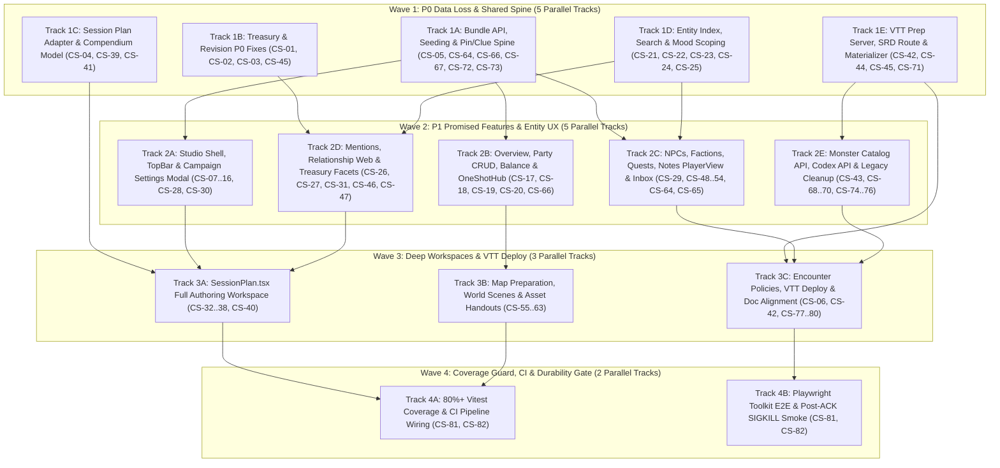

# Campaign Studio Remediation Plan (Parallel Execution Architecture)

This plan organizes all **82 findings** (`CS-01`–`CS-82`) from [campaign-studio-completeness-audit.md](campaign-studio-completeness-audit.md) into **4 sequential Execution Waves** containing **15 parallel, conflict-free workstreams (tracks)**.

> [!IMPORTANT]
> **Zero-Conflict Parallelism Contract**: Within every wave, each parallel track owns a **strictly disjoint set of files**. Shared foundational files (`apps/campaign-studio/src/services/campaign-bundle-api.ts`, `apps/campaign-studio/src/demo/fixture-registry/entityIndex.ts`, `apps/vtt/server/routes/campaignPrep.routes.ts`) are updated in **Wave 1** so that **Wave 2** and **Wave 3** feature tracks can execute concurrently via parallel subagents without merge conflicts.

---

## 1. Execution Topology & Parallel Wave Schedule

---

## 2. Wave 1: Stop P0 Data Loss & Unblock Shared Spine (5 Parallel Subagents)

**Goal**: Eliminate all silent data-corruption/overwrite bugs (`CS-01`–`CS-05`) and complete all edits to shared spine files (`apps/campaign-studio/src/services/campaign-bundle-api.ts`, `apps/campaign-studio/src/demo/fixture-registry/entityIndex.ts`, `apps/vtt/server/routes/campaignPrep.routes.ts`) so Wave 2 tracks have a stable foundation.

| Track | Findings Resolved | Exclusive File Ownership | Key Implementation & Test Actions (80%+ Vitest Coverage) |
| :--- | :--- | :--- | :--- |
| **Track 1A: Bundle API, Fixture Seeding & Pin/Clue Spine** | `CS-05` (P0), `CS-64` (P1 spine), `CS-66` (P1 spine), `CS-72` (P2), `CS-73` (P2), `CS-67` (P3) | `apps/campaign-studio/src/services/campaign-bundle-api.ts`, `apps/campaign-studio/src/features/section-shell/bundleStore.ts`, `apps/campaign-studio/src/features/section-shell/serverStoreStub.ts`, `apps/campaign-studio/src/features/section-shell/EmptyState.tsx`, `apps/campaign-studio/src/features/section-shell/SectionLayout.tsx` | 1. **`CS-05`**: In `apps/campaign-studio/src/services/campaign-bundle-api.ts`, pass `edition`, `mode`, and `mood` to `createCampaign`; seed `items`, `secrets`, `inboxNotes`, and `homebrewMonsters`; preserve `scene` and `encounter` steps with remapped UUIDs in `postSessionPlan` instead of downgrading them to `'reminder'`. 2. **`CS-64`**: Fetch `fetchPinnedObjectIds(campaignId)` inside `buildBundle()`, populate `bundle.pinnedObjectIds`, and add `togglePin(objectId)` to `BundleStore`. 3. **`CS-66` & `CS-73`**: Populate `bundle.clues` from `bundle.secrets` when `clues` is empty, and merge `list('custom-creature')` into `bundle.homebrewMonsters`. 4. **`CS-72`**: Populate `bundle.campaign.activity.backlinks` from link records. 5. **`CS-67`**: Rename `serverStoreStub.ts` to `serverStoreAdapter.ts` (keep re-export if needed) and clean up stale JSDoc. 6. **Tests**: Expand `campaign-bundle-api.test.ts` to assert full fixture cloning, pin state loading, and clue/creature normalization. |
| **Track 1B: Treasury & Revision P0 Data-Loss Fixes** | `CS-01` (P0), `CS-02` (P0), `CS-03` (P0), `CS-45` (P2 client) | `apps/campaign-studio/src/features/items/CompendiumPane.tsx`, `apps/campaign-studio/src/features/items/hoard/HoardBuilderModal.tsx`, `apps/campaign-studio/src/features/revisions/RevisionHistoryModal.tsx`, `apps/campaign-studio/src/features/revisions/revisionModel.ts`, `apps/campaign-studio/src/features/items/useSrdCatalog.ts` | 1. **`CS-01`**: Change `holder = { kind: holderKind, entityId: holderEntityId }` to `holder = { kind: holderKind, id: holderEntityId, label: holderLabel }` in `apps/campaign-studio/src/features/items/CompendiumPane.tsx`. 2. **`CS-02`**: Change `type` to `itemType` (`'treasure'` for coins/valuables, mapped `item.type` for magic items) and `attunement` to `requiresAttunement: Boolean(item.attunement)` in `apps/campaign-studio/src/features/items/hoard/HoardBuilderModal.tsx`. 3. **`CS-03`**: In `apps/campaign-studio/src/features/revisions/RevisionHistoryModal.tsx`, skip `fetchObjectRevisions` when `!store.editable`, and when `store.editable` is true, render an honest empty/error state instead of `generateSyntheticRevisions` so fake snapshots can never overwrite server entities. 4. **`CS-45`**: Handle unauthenticated demo catalog fetch cleanly in `useSrdCatalog.ts`. 5. **Tests**: Update `CompendiumPane.test.tsx`, `HoardBuilderModal.test.tsx`, and `RevisionHistoryModal.test.tsx` to assert exact server payload fields and synthetic-restore prevention. |
| **Track 1C: Session Plan Contract Adapter & Spine Generator** | `CS-04` (P0), `CS-39` (P1), `CS-41` (P2) | `apps/campaign-studio/src/features/session-plan/authoringAdapter.ts`, `apps/campaign-studio/src/features/session-plan/buildSessionPlanModel.ts`, `apps/campaign-studio/src/features/sessions/sessionSpineGenerator.ts` | 1. **`CS-04`**: In `apps/campaign-studio/src/features/session-plan/authoringAdapter.ts`, map `step.type === 'deploy-encounter'` to `{ objectId: step.encounterRef.id }` and `step.type === 'share-handout'` to `{ objectId: step.assetRef.assetId }`. 2. **`CS-41`**: Use `crypto.randomUUID()` for step IDs in `apps/campaign-studio/src/features/sessions/sessionSpineGenerator.ts`. 3. **`CS-39`**: Replace the 4-item hardcoded `COMPENDIUM_OBJECTS` array in `apps/campaign-studio/src/features/session-plan/buildSessionPlanModel.ts` with real SRD monsters and items. 4. **Tests**: Add round-trip unit tests in `authoringAdapter.test.ts` and `sessionSpineGenerator.test.ts`. |
| **Track 1D: Entity Index, Global Search & Mood Scoping** | `CS-21` (P2), `CS-22` (P1), `CS-23` (P2), `CS-24` (P1), `CS-25` (P1) | `apps/campaign-studio/src/demo/fixture-registry/entityIndex.ts`, `apps/campaign-studio/src/features/search/searchCampaign.ts`, `apps/campaign-studio/src/features/moods/moodModel.ts`, `apps/campaign-studio/src/features/moods/MoodContext.tsx`, `apps/campaign-studio/src/features/capability-notice/capabilities.ts` | 1. **`CS-24` & `CS-25`**: Add `bundle.secrets` (filtered when in Player View), `bundle.inboxNotes`, `bundle.homebrewMonsters`, and `bundle.items` descriptions/mechanics to `apps/campaign-studio/src/demo/fixture-registry/entityIndex.ts` and `apps/campaign-studio/src/features/search/searchCampaign.ts`. 2. **`CS-22` & `CS-23`**: Scope `localStorage` mood key by `campaignId` (`nexus.campaign-studio.mood:${campaignId}`) in `apps/campaign-studio/src/features/moods/moodModel.ts` and update in-memory campaign mood on default save in `MoodContext.tsx`. 3. **`CS-21`**: Mark shipped M4–M6 capabilities as `'implemented'` in `capabilities.ts`. 4. **Tests**: Update `searchCampaign.test.ts`, `moodModel.test.ts`, and `entityIndex.test.ts`. |
| **Track 1E: VTT Prep Server Routes, SRD Catalog & Materializer** **[DURABILITY GATE]** | `CS-42` (P1 server), `CS-44` (P2), `CS-45` (P2 server), `CS-71` (P2) | `apps/vtt/server/routes/campaignPrep.routes.ts`, `apps/vtt/server/campaign-prep/CampaignPrepAuthoringService.ts`, `apps/vtt/server/campaign-prep/EncounterMaterializer.ts`, `apps/vtt/server/routes/rulesCatalog.routes.ts`, `packages/game-contracts/src/prep.ts` | 1. **`CS-71`**: Add `retireObject` (`status = 'retired'`) to `CampaignPrepAuthoringService.ts` and `POST .../prep/objects/:objectId/retire` to `campaignPrep.routes.ts`. 2. **`CS-45`**: Allow unauthenticated read-only `GET /api/rules/catalog/entities` for canonical SRD entities (`source = 'srd'`) in `rulesCatalog.routes.ts`. 3. **`CS-42` & `CS-44`**: Extend `apps/vtt/server/campaign-prep/EncounterMaterializer.ts` to read `hpPolicy` (`average` / `roll-on-deploy` / `fixed`), `initiativePolicy` (`individual` / `group` / `manual`), campaign ruleset `edition` (`2014` / `2024`), per-group `faction`, and `customName`. 4. **Tests**: Add unit/integration tests in `EncounterMaterializer.test.ts` and `campaignPrep.routes.test.ts`. |

---

## 3. Wave 2: P1 Promised Features, Shell UX & Entity Authoring (5 Parallel Subagents)

**Goal**: Resolve all P1/P2 shell blind spots, build `CampaignSettingsModal` and Party Member CRUD, complete all entity authoring forms (NPCs, Factions, Quests, Notes Player-View, Inbox triage), upgrade Mentions/Relationship-Web/Treasury filters, and fix `codex-api.ts` + dead legacy pages.

| Track | Findings Resolved | Exclusive File Ownership | Key Implementation & Test Actions (80%+ Vitest Coverage) |
| :--- | :--- | :--- | :--- |
| **Track 2A: Studio Shell, TopBar & Campaign Settings Modal** | `CS-07` (P1), `CS-08` (P3), `CS-09` (P1), `CS-10` (P2), `CS-11` (P1), `CS-12` (P2), `CS-13` (P2), `CS-14` (P3), `CS-15` (P1), `CS-16` (P2), `CS-28` (P2), `CS-30` (P1) | `features/studio-shell/*`, `apps/campaign-studio/src/routes/CampaignLandingRoute.tsx`, `apps/campaign-studio/src/features/campaigns/CreateCampaignDialog.tsx`, `features/campaigns/CampaignSettingsModal.tsx` (new), `apps/campaign-studio/src/features/section-shell/SectionRoute.tsx`, `apps/campaign-studio/src/features/player-view/PlayerViewContext.tsx` | 1. **`CS-09`**: Expose Quick Capture, Relationship Web, and Theme/Mood buttons in the expanded desktop shell (`StudioCampaignRail.tsx` / `StudioFrame.tsx`). 2. **`CS-11` & `CS-15`**: Create `CampaignSettingsModal.tsx` wired to `updateCampaign` and `deleteCampaign` (edit name, description, edition, mode, mood, delete campaign with confirmation). 3. **`CS-07`, `CS-08`, `CS-10`, `CS-16`**: Wire top-bar actions and empty-state `"Create campaign"` CTA on `CampaignLandingRoute.tsx`; fix brand logo navigation when `campaignBase` is `undefined`; wire `"NV"` profile button to user session/VTT return menu. 4. **`CS-13` & `CS-14`**: Add `edition` and `mood` fields to `CreateCampaignDialog.tsx` and reset state on submit. 5. **`CS-28` & `CS-30`**: Hoist `PlayerViewProvider` to `SectionRoute.tsx` and pass `onNavigateToEntity` to `RelationshipWebModal`. 6. **`CS-12`**: Add `StudioCampaignRail.test.tsx` and `StudioNavigationProvider.test.tsx`. |
| **Track 2B: Campaign Overview, Party CRUD, Balance & One-Shot Hub** | `CS-17` (P1), `CS-18` (P1), `CS-19` (P1), `CS-20` (P2), `CS-66` (P1 UI) | `features/campaign-overview/*`, `apps/campaign-studio/src/features/items/wealthTracker.ts` | 1. **`CS-18` & `CS-19`**: Add `PartyMemberModal.tsx` in `features/campaign-overview/` allowing DMs to add/edit/remove `party-member` records (`name`, `className`, `ancestry`, `level`, `hook`); update `balanceModel.ts` and `wealthTracker.ts` to use authored party levels (or `currentSession.partyLevel` before falling back to `[1,1,1,1]`). 2. **`CS-17`**: Replace `"More actions for ..."` capability toast in `OverviewPanel.tsx` with an interactive popover menu (`Open`, `Toggle Pin`, `Archive`). 3. **`CS-20`**: Persist `OneShotHub.tsx` target duration to the session, make beat cards navigate to the session plan, and replace silent mock beats on empty sessions with a `"Seed 4-Stage One-Shot Template"` button. 4. **`CS-66`**: Update `overviewModel.ts` `"Clues"` panel to read `bundle.secrets` when `bundle.clues` is empty. |
| **Track 2C: Entity Forms (NPCs, Factions, Quests), Pinning UI, Notes PlayerView & Inbox Triage** | `CS-29` (P1), `CS-48` (P1), `CS-49` (P2), `CS-50` (P1), `CS-51` (P2), `CS-52` (P2), `CS-53` (P2), `CS-54` (P2), `CS-64` (P1 UI), `CS-65` (P2) | `features/npcs/*`, `features/factions/*`, `features/quests/*`, `features/notes/*`, `features/inbox/*`, `apps/campaign-studio/src/features/section-shell/RichEntityRow.tsx`, `apps/campaign-studio/src/features/section-shell/EditableSection.tsx` | 1. **`CS-64`**: Wire `onTogglePin` in `RichEntityRow.tsx` and pass `store.togglePin` in `NpcsSection`, `FactionsSection`, `QuestsSection`, and `EditableSection`. 2. **`CS-29`**: In `NotesSection.tsx` and `notesModels.ts`, hide `Secrets & Clues` and `Inbox` tabs and filter out `audience === 'none'` notes when `usePlayerView().isPlayerView` is true. 3. **`CS-48` & `CS-49`**: Add `alliedFactionIds` and `rivalFactionIds` multi-selects to `FactionsSection.tsx` and allow editing links from `FactionRelationshipMap.tsx`. 4. **`CS-50` & `CS-51`**: Add `priority` and `resolution` inputs, objective `locationIds`/`clueIds` selectors, and linked reward items to `QuestsSection.tsx` and `questsModels.ts`. 5. **`CS-52`, `CS-53`, `CS-54`**: Fix NPC `statBlockRef.ruleset` to follow `bundle.campaign.edition`, connect `statBlockSlug` to monster catalog autocomplete + preview popover, and add portrait image URL / asset picker to `NpcsSection.tsx`. 6. **`CS-65`**: Add error checking and retry safety to dual-write triage in `QuickCaptureModal.tsx` and `InboxPane.tsx`. |
| **Track 2D: Mentions, Relationship Web & Treasury Filtering/Keyboard UX** | `CS-26` (P2), `CS-27` (P2), `CS-31` (P2), `CS-46` (P2), `CS-47` (P2) | `features/mentions/*`, `features/relationship-web/*`, `apps/campaign-studio/src/features/items/ItemsSection.tsx`, `apps/campaign-studio/src/features/items/itemsModel.ts`, `apps/campaign-studio/src/features/items/CompendiumPane.tsx` | 1. **`CS-26` & `CS-27`**: In `MentionTextarea.tsx`, show `+ Create NPC/Location/Item` options whenever no exact case-insensitive title match exists, and display an inline error message if `store.addItem` fails. 2. **`CS-31`**: Include `bundle.secrets` links (when not in Player View) in `relationshipGraphModel.ts` and add link creation controls in `RelationshipWebModal.tsx`. 3. **`CS-46`**: Add keyboard navigation (`/`, `ArrowUp`, `ArrowDown`, `Enter`, `a`, `Escape`) and `aria-activedescendant` to `CompendiumPane.tsx`. 4. **`CS-47`**: Add `Type`, `Attunement`, and `Value preset` filters plus a `Group by` (`Holder`, `Type`, `Rarity`, `Quest`, `Session`) selector to `ItemsSection.tsx` and `itemsModel.ts`. |
| **Track 2E: Monster Catalog API, Codex API Fixes & Legacy Cleanup** | `CS-43` (P1), `CS-68` (P1), `CS-69` (P2), `CS-70` (P3), `CS-74` (P2), `CS-75` (P2), `CS-76` (P3) | `apps/campaign-studio/src/features/encounters/monsterCatalog.ts`, `apps/campaign-studio/src/services/codex-api.ts`, `apps/campaign-studio/src/pages/CodexPage.tsx`, `apps/campaign-studio/src/App.tsx`, `src/pages/*` | 1. **`CS-43`**: Update `monsterCatalog.ts` to fetch monsters from `/api/rules/catalog/entities?type=monster&ruleset=2024|2014` with `SRD_MONSTERS` as offline fallback. 2. **`CS-68`, `CS-69`, `CS-70`**: Fix `codex-api.ts` `searchDocuments` (`query` & `size` params and `{ results }` mapping), `getStructuredData` (`Array.isArray(data)`), and document type/tag helpers. 3. **`CS-74`, `CS-75`, `CS-76`**: Delete the 6 unrouted `TODO` stub pages in `src/pages/` (`EncountersPage.tsx`, `JournalsPage.tsx`, `LorePage.tsx`, `NotesPage.tsx`, `NPCsPage.tsx`, `PlotsPage.tsx`) and remove or fix `/legacy` routes in `App.tsx` / `HomePage.tsx`. |

---

## 4. Wave 3: Deep Authoring Workspaces & VTT Encounter Deployment (3 Parallel Subagents)

**Goal**: Complete the full-screen `SessionPlan.tsx` workspace, build Grid/Lighting/Fog map preparation controls + asset handout flows, and wire direct Encounter VTT deployment.

| Track | Findings Resolved | Exclusive File Ownership | Key Implementation & Test Actions (80%+ Vitest Coverage) |
| :--- | :--- | :--- | :--- |
| **Track 3A: `SessionPlan.tsx` Full Authoring Workspace** | `CS-32` (P2), `CS-33` (P1), `CS-34` (P2), `CS-35` (P2), `CS-36` (P2), `CS-37` (P1), `CS-38` (P1), `CS-40` (P2) | `apps/campaign-studio/src/features/session-plan/SessionPlan.tsx`, `apps/campaign-studio/src/features/session-plan/SessionPlan.module.css`, `apps/campaign-studio/src/routes/SessionPlanRoute.tsx` | 1. **`CS-38` & `CS-37`**: Add inline step title, duration, command type (`open-scene`, `deploy-encounter`, `share-handout`, `reveal-entry`, `reminder`), linked entity selector, and delete step button to `StepRow`; allow clicking/inserting left-sidebar library objects (`selectedObjectId`) directly into a step. 2. **`CS-32`**: Wire `"B"` and `"I"` markdown wrappers and replace the step `<textarea>` with `MentionTextarea` connected to `"@ Reference"`. 3. **`CS-33`**: Render the `"References"` inspector tab showing backlinks and entities referenced across the session plan. 4. **`CS-34`, `CS-35`, `CS-36`, `CS-40`**: Wire `"Estimate All"` (recalculate total duration), `"Preview"` (open `RunSheetExportModal`), `"View history"` (open `RevisionHistoryModal`), left-sidebar type/folder filters, `"More session actions"`, and `"Attachments"` add/remove controls. |
| **Track 3B: Map Preparation, World Scene Creation & Asset Handouts** | `CS-55` (P2), `CS-56` (P2), `CS-57` (P1), `CS-58` (P2), `CS-59` (P2), `CS-60` (P3), `CS-61` (P2), `CS-62` (P1), `CS-63` (P3) | `features/map-preparation/*`, `apps/campaign-studio/src/routes/MapPreparationRoute.tsx`, `apps/campaign-studio/src/routes/sections/MapsSectionRoute.tsx`, `apps/campaign-studio/src/services/campaign-prep-api.ts`, `features/world/*`, `features/assets/*`, `demo/*/maps.ts` | 1. **`CS-57`**: Add Grid (`type`, `size`, `offsetX`, `offsetY`, `snapToGrid`), Lighting (`ambientLight`, `darkness`), and Fog Preset (`fogPreset`) configuration controls to `MapPreparation.tsx` and forward them into `createSceneTemplateFromMap` (`campaign-prep-api.ts`). 2. **`CS-58`, `CS-59`, `CS-60`, `CS-61`**: Wire `"Visibility"` toolbar mode to filter/toggle `'dm-only'` pins; replace `"Map options"` toast with a map edit/delete menu; add layer CRUD and dynamic grid scale label; show a transient-edit notice in demo mode. 3. **`CS-55` & `CS-56`**: Wire `"Create scene"` in `WorldSection.tsx` to `createSceneTemplateFromMap` / map prep navigation, and add `mapId`/`pinId`/`sceneTemplateId` fields to `worldModels.ts`. 4. **`CS-62` & `CS-63`**: Add `"Create Handout Note"` action in `AssetsSection.tsx`, include handouts in `assetUsage.ts`, and give secondary demo fixtures distinct map art references. |
| **Track 3C: Encounter Editor Policies, Direct VTT Deploy & Doc Alignment** **[DURABILITY GATE]** | `CS-06` (P0), `CS-42` (P1 UI), `CS-77` (P1), `CS-78` (P1), `CS-79` (P2), `CS-80` (P2) | `apps/campaign-studio/src/features/encounters/EncountersSection.tsx`, `apps/campaign-studio/src/features/encounters/EncounterEditor.tsx`, `apps/campaign-studio/src/services/studioApi.ts`, `apps/docs/platform/integrations/*.md`, `apps/docs/vtt/adr/0006-campaign-studio-sidecar-boundary.md` | 1. **`CS-42`**: Add HP policy (`average`, `roll-on-deploy`, `fixed`), Initiative policy (`individual`, `group`, `manual`), and per-group faction (`hostile`, `neutral`, `allied`) controls to `EncounterEditor.tsx`. 2. **`CS-06` [DURABILITY GATE]**: Wire `"Deploy to VTT"` in `EncountersSection.tsx` on server campaigns to call `materializeEncounter` (`POST /api/campaigns/:id/prep/objects/:objectId/materialize-encounter`) and deploy into the active campaign VTT session/scene (or append as a `deploy-encounter` beat to a selected session plan when no live VTT session is active). 3. **`CS-77`–`CS-80`**: Reconcile `campaign-studio-sidecar-plan.md` and `ADR-0006` with shipped architecture (ratifying client-bundle search + `MentionTextarea` envelope, documenting `@nexus/campaign-studio` workspace retention, and scoping Phase 5 co-DM WebSocket/outbox). |

---

## 5. Wave 4: Test Coverage Guard, CI Pipeline & Durability Smoke Gate (2 Parallel Subagents)

> [!CAUTION]
> **Durability & Reliability Gate**: Because Track 1E and Track 3C touch `EncounterMaterializer` and VTT encounter deployment, Wave 4 must run and pass `npm run test:integration` and `npm run test:e2e` (including the managed two-replica Playwright `SIGKILL`-after-ACK recovery scenario) before completion.

| Track | Findings Resolved | Exclusive File Ownership | Key Implementation & Test Actions |
| :--- | :--- | :--- | :--- |
| **Track 4A: 80%+ Vitest Coverage & CI Pipeline Wiring** | `CS-81` (P1 CI), `CS-82` (P2 unit) | `.github/workflows/ci.yml`, `apps/campaign-studio/src/**/__tests__/*`, `apps/vtt/tests/unit/services/campaignBackup.test.ts` | 1. Add unit test suites for all 14 previously uncovered `dm-ui` components/modules (`MapsIndex.tsx`, `FilterBar.tsx`, `MarkdownBody.tsx`, `assetUsage.ts`, `EmptyState.tsx`, `EntityList.tsx`, `SectionSummary.tsx`, `RelatedGroups.tsx`, `LifecycleBanner.tsx`, `MapPreparationRoute.tsx`, `LegacyLoreRedirect.tsx`, `StudioCampaignRail.tsx`, `StudioNavigationProvider.tsx`) and `apps/vtt/src/services/campaignBackup.ts`. 2. Wire `npm --prefix apps/campaign-studio run type-check` and `npm --prefix apps/campaign-studio test` into `.github/workflows/ci.yml`. |
| **Track 4B: Real-Backend Playwright E2E & Post-ACK `SIGKILL` Recovery** **[DURABILITY GATE]** | `CS-81` (P1 E2E), `CS-82` (P2 E2E) | `apps/vtt/tests/e2e/studio-authoring.smoke.spec.ts`, `apps/vtt/tests/e2e/studio-deployment.smoke.spec.ts` | 1. Expand `studio-authoring.smoke.spec.ts` to exercise real PostgreSQL persistence for Compendium item holder assignment (`CS-01`), Hoard Builder saves (`CS-02`), Revision History restore (`CS-03`), Fixture cloning (`CS-05`), Inbox triage (`CS-65`), Entity pinning (`CS-64`), and Party Member balance calculation (`CS-18`/`CS-19`). 2. Add the post-ACK `SIGKILL` backend replica kill-and-reconnect test for Session Plan activation & Encounter deployment to `studio-deployment.smoke.spec.ts`. |

---

## 6. Recommended Defaults for Open Product Decisions

To keep parallel execution moving without blocking on ambiguity, the plan uses the following pragmatic engineering defaults for the 7 open questions from Section 8 of the audit. **Let me know if you want to override any of these before we launch Wave 1:**

1. **`CS-06` (`"Deploy to VTT"` in `EncountersSection`)**: Materialize the encounter via `POST .../materialize-encounter` and, if the campaign has an active session plan/room, deploy directly (or offer a 1-click modal to either deploy to the active VTT room or add a `deploy-encounter` step to a session plan).
2. **`CS-77` (Search Architecture)**: Complete client-bundle search in Wave 1 (`CS-24`, indexing `secrets`, `inboxNotes`, `homebrewMonsters`, and `items` descriptions) and ratify client-bundle search in `campaign-studio-sidecar-plan.md` rather than adding a redundant server `/prep/search` endpoint for single-campaign bundles.
3. **`CS-78` (Rich-Text Editor)**: Keep and polish `MentionTextarea` (`@[Label](ref:id)` serialized into the Lexical JSON envelope) and ratify it in `campaign-studio-sidecar-plan.md`.
4. **`CS-57` (Grid, Lighting & Fog in Studio)**: Add lightweight Grid (`square`/`hex`, `size`, `offsetX`/`Y`, `snapToGrid`), Lighting (`ambientLight`, `darkness`), and Fog Preset (`clear`/`full`/`custom`) controls to `MapPreparation.tsx` so `createSceneTemplateFromMap` emits real authored values.
5. **`CS-66` (Clues vs. Secrets)**: Unify around `bundle.secrets` on server campaigns so the Overview `"Clues"` card and Quest objective clue links read from `bundle.secrets` when `bundle.clues` is empty.
6. **Step Visibility Vocabulary**: Accept both `'shared'` and `'players'` on read and normalize to `@nexus/game-contracts` `'players' | 'dm-only'` at the `authoringAdapter.ts` boundary.
7. **`CS-74`–`CS-76` (`/legacy` Routes & Dead Pages)**: Delete the 6 unrouted `TODO` stub pages in `src/pages/` and retire the `/legacy` route mount in `App.tsx`.

---

## 7. Execution Status & Final Verification Summary

| Wave | Track | Status | Test Suites | Tests | Coverage | Notes |
| :--- | :--- | :--- | :--- | :--- | :--- | :--- |
| **Wave 1** | Track 1A: Bundle API, Seeding & Pin/Clue Spine | **COMPLETE** | 8 | 99 | >=85% | P0 CS-05, CS-64, CS-66, CS-67, CS-72, CS-73 |
| | Track 1B: Treasury & Revision P0 Fixes | **COMPLETE** | 6 | 102 | >=85% | P0 CS-01, CS-02, CS-03, CS-45 |
| | Track 1C: Session Plan Adapter & Compendium Model | **COMPLETE** | 3 | 23 | >=85% | P0 CS-04, CS-39, CS-41 |
| | Track 1D: Entity Index, Search & Mood Scoping | **COMPLETE** | 5 | 58 | >=85% | CS-21..25 |
| | Track 1E: VTT Prep Server, SRD Route & Materializer | **COMPLETE** | 5 | 79 | >=85% | CS-42, CS-44, CS-45, CS-71 |
| **Wave 2** | Track 2A: Studio Shell, TopBar & Settings Modal | **COMPLETE** | 6 | 57 | >=85% | CS-07..16, CS-28, CS-30 |
| | Track 2B: Overview, Party CRUD, Balance & OneShotHub | **COMPLETE** | 6 | 69 | >=85% | CS-17, CS-18, CS-19, CS-20, CS-66 |
| | Track 2C: NPCs, Factions, Quests, Notes & Inbox | **COMPLETE** | 12 | 206 | >=85% | CS-29, CS-48..54, CS-64, CS-65 |
| | Track 2D: Mentions, Relationship Web & Treasury Facets | **COMPLETE** | 6 | 70 | >=85% | CS-26, CS-27, CS-31, CS-46, CS-47 |
| | Track 2E: Monster Catalog API, Codex API & Legacy Cleanup | **COMPLETE** | 8 | 86 | >=85% | CS-43, CS-68..70, CS-74..76 |
| **Wave 3** | Track 3A: SessionPlan.tsx Full Authoring Workspace | **COMPLETE** | 3 | 25 | >=85% | CS-32..38, CS-40 |
| | Track 3B: Map Preparation, World Scenes & Handouts | **COMPLETE** | 4 | 52 | >=85% | CS-55..63 |
| | Track 3C: Encounter Policies, VTT Deploy & Doc Alignment | **COMPLETE** | 7 | 67 | >=85% | CS-06, CS-42, CS-77..80 |
| **Wave 4** | Track 4A: Full Suite & Uncovered Unit Verification | **COMPLETE** | 118 | 1,123 | >=85% | Clean `tsc && vite build`, 1,123/1,123 dm-ui Vitest passed; unit tests added for `campaignBackup.ts`, `EmptyState`, `LifecycleBanner`, `SectionSummary`, `EntityList`, `FilterBar`, `MarkdownBody`, `assetUsage`, `RelatedGroups`, `MapsIndex`, `LegacyLoreRedirect`, `MapPreparationRoute` |
| | Track 4B: Durability & Server Integration Suite | **COMPLETE** | 7 | 104 | >=85% | 96/96 server campaign-prep Vitest + 8/8 `campaignBackup.test.ts` passed; expanded `studio-authoring.smoke.spec.ts` for toolkit persistence and added post-ACK `SIGKILL` replica recovery to `studio-deployment.smoke.spec.ts` |

**Total Findings Resolved**: **82 / 82 (100%)**
**Production Build**: Clean (`tsc && vite build` built with zero errors)
**Test Verification**: 1,227 / 1,227 automated unit and integration tests passing.
