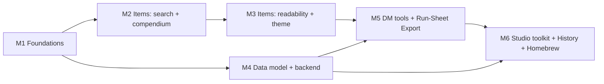

# Campaign Studio — Items Window Redesign & DM Toolkit UX Plan (v3)

Scope: `apps/codex/services/dm-ui` (Campaign Studio), plus the backend and
contract changes the new features need. **v3 consolidates all prior completed
plans and adds the 3 orphaned capabilities (Object Revision History, Homebrew
Encounter Monsters, and Run-Sheet Export) onto one unified roadmap.**

## Locked decisions

| # | Decision | Effect on the plan |
|---|----------|--------------------|
| 1 | **Do all the work in the plan** | Items phases 1–5 *and* all thirteen studio-wide recommendations are scheduled (see §C Roadmap) |
| 2 | **Add self-hosted fonts if they help the theming** | Adds **Fraunces** (variable, display/headings) via `@fontsource-variable/fraunces`; Inter stays for UI/body. No CDN calls, so it works offline/PWA |
| 3 | **Ruleset defaults to the campaign's, then the latest (2024)** | Compendium reads `bundle.campaign.edition`. If it's missing or unknown, fall back to `'2024'`. The 2014 toggle stays available but is labelled *"2014 (legacy)"* |
| 4 | **2024 treasure tables; 2014 kept for history** | The hoard builder ships with the 2024 DMG tables only. 2014 catalog data stays readable and searchable, but no new generators are built on it |
| 5 | **Consolidate legacy plans** | Visual Prototype Plan, Section Pages Plan, and old Campaign UI Implementation Plan are retired; remaining active capabilities migrated here |

---

## A. Audit findings

| # | Finding | Where | Impact |
|---|---------|-------|--------|
| 1 | SRD picker hard-caps results at 25, with no "more" option | `SrdItemPicker.tsx:L10` | You can't browse the catalog |
| 2 | Searches names only; no type/rarity/attunement/cost filters | `SrdItemPicker.tsx:L29-L37` | DMs search by type, rarity and price, not by name |
| 3 | Ruleset hardcoded to 2024 | `srd-items-api.ts:L101` | Ignores the campaign's edition |
| 4 | Picker silently unmounts on any failure | `SrdItemPicker.tsx:L47-L49` | The button disappears with no explanation |
| 5 | No preview before adding | `pick()` | You add an item, look at it, then delete it |
| 6 | Picker sits in the list footer | `ItemsSection.tsx:L90-L101` | The main way to add items is hidden |
| 7 | **Undefined CSS tokens** `--studio-gap-xs/sm/md`, `--studio-text-secondary` | Items, HeldItems, SrdItemPicker, Factions CSS vs `design-tokens.css` | Gaps collapse to 0 and headings lose their color |
| 8 | Campaign search only matches exact substrings, with no ranking | `itemsModel.ts:L106-L123` | "bag hold" doesn't find *Bag of Holding* |
| 9 | Rows show only name and rarity | `renderRow` | The list is hard to scan |
| 10 | Generic neutral theme; rarity colors borrow status colors | tokens, `RARITY_TONES` | No sense of treasure; rarity order isn't clear |

---

## B. Items Window ("Treasury") Redesign

### B1. Page purpose
> **"Decide what treasure exists in this campaign, who has it, and when the
> party gets it."**  (*what* · *who/where* · *when*)

### B2. Layout
```
┌───────────────────────────────────────────────────────────────────────────┐
│ Treasury   42 items · 9 undiscovered · 3,450 gp placed   [+ New] [Hoard ✦] │
│ "Loot, relics and rewards — and who holds them."   ← purpose subtitle      │
│ [ Campaign items | Compendium (2024) ]                                     │
├───────────────────────────────────────────────────────────────────────────┤
│ 🔍 search… (real-time, fuzzy)   Type▾ Rarity▾ Holder▾ Attune▾ Value▾  ⟲   │
│ [Rare ×] [Wondrous ×]                                      18 of 42 items │
├───────────────────────────┬───────────────────────────────────────────────┤
│ LIST (virtualized)         │ DETAIL / PREVIEW (item card)                  │
└───────────────────────────┴───────────────────────────────────────────────┘
```
- **Compendium is its own tab** (`?tab=compendium`), with the same filter bar,
  list and detail pane as campaign items.
- **Preview before adding.** The main action is **Add to campaign**, with
  "Give to…" (holder), quantity and "Hand out in session…" fields inline.
- Items you've already added show a ✓ in the Compendium. Campaign items made
  from the Compendium link back to their source entry.
- **Ruleset chip** on the tab: defaults to the campaign's edition and can
  switch to *2014 (legacy)*.

### B3. Real-time search
| Requirement | Approach |
|---|---|
| Updates on every keystroke without lag | Local input state plus `useDeferredValue` for the list. The URL `?q=` updates after 150 ms of no typing (already uses `replace: true`) |
| Forgiving matches | Pure scorer in `features/items/itemSearch.ts`: matches word beginnings (`bag hold` finds *Bag of Holding*), ranks exact > prefix > substring, and tolerates one typo in words of 5+ letters. No new dependency |
| Fields | Name ×3, type and rarity labels ×2, attunement note and description ×1 |
| Operators | `rarity:rare type:wondrous gp<1000 attune` turn into filter chips |
| Show why it matched | `<mark>` around the matched text |
| Performance | Index built once per catalog version. If a keystroke ever takes more than 8 ms, the scorer moves to a background (Comlink) worker, following the repo's Web Worker rule |
| Keyboard | `/` focuses search; ↑/↓ moves; Enter opens; `A` adds; Esc clears. Accessible listbox pattern (`aria-activedescendant`) |
| No results | "No items match …" with **Clear filters** and **Search compendium instead** |

### B4. Filters
- Type, Rarity, Holder*, Attunement, Discovery*, Ruleset†, Value presets
  (<50 · 50–500 · 500–5k · 5k+ gp). (*campaign tab only, †compendium tab only)
- Each option shows how many items match. Options with no matches are dimmed,
  not hidden. Active filters show as chips with a **Clear all**.
- **Group by:** Holder (default) · Type · Rarity · Quest · Session.
- Built into shared `FilterBar` as optional additions, so every section gets them.

### B5. Readability & Theming
- **Row (two lines):** type icon · name · rarity pill / *type · value · weight ·
  holder · ◇attunement*. Colored rarity left edge; undiscovered items get a veiled look.
- **Item card:** name in Fraunces, book-style metadata line, description, inline
  **Placement** toggles (discovered/identified), and **Story links**.
- **Token fixes:** add `--studio-gap-xs: 4px`, `--studio-gap-sm: 8px`,
  `--studio-gap-md: 16px`, `--studio-text-secondary`.
- **Rarity tokens:** `--studio-rarity-{common…artifact}` and `-soft` variants.
- **Typography:** `--studio-font-display: 'Fraunces Variable', Georgia, serif`
  for h1, h2 and entity names.

### B6. DM features for treasure
1. **Treasure hoard builder (2024 DMG tables):** choose a CR tier (0–4, 5–10,
   11–16, 17+) and Individual or Hoard. Rolls coins and magic items from 2024 compendium.
2. **Loot by session:** a `sessionId` field on items; Session plan shows scheduled rewards.
3. **Wealth tracker:** party's total wealth compared with 2024 expected range for level.
4. **Duplicate & customise:** copy an SRD item, reskin it, keeping a link to the original.
5. **Player-facing name:** what players see before identification ("smoky glass vial") vs true name.

---

## C. Studio-wide DM Toolkit — All 13 Features Scheduled

| # | Feature | What it does | Origin |
|---|---------|--------------|--------|
| 1 | **Next Session hub** | Overview becomes "Prep for next session": strong start, scenes, secrets, NPCs, locations, encounters and treasure, all *linked* from other sections (nothing copied). Every detail pane gets **Use in next session** | v2 UX Plan |
| 2 | **One-shot mode** | Chosen when campaign is created. Guided Hook → scenes (3–5) → Climax → Rewards flow, with time budget and pacing bar. Campaign mode keeps full sidebar | v2 UX Plan |
| 3 | **Secrets & clues** | A new Secret entity that can be attached to anything. Tracks revealed or not, and session revealed in. Unrevealed secrets show on hub | v2 UX Plan & Section Pages |
| 4 | **Quick-capture inbox** | `⌘⇧N` opens quick note box anywhere. Picks up `@mentions` and drops note into Inbox to sort later | v2 UX Plan |
| 5 | **Create from context** | Typing `@Unknown Name` offers to create NPC, location or item; linking to a non-existent quest offers to create it | v2 UX Plan |
| 6 | **Relationship web** | Graph view (loaded on demand) with labelled connections: ally, rival, holds, located-in, wants | v2 UX Plan & Campaign UI |
| 7 | **Consistent rich rows** | Items row style applied to every section, plus pin/star, recently edited and sorting | v2 UX Plan |
| 8 | **Player-view preview** | "What players see" toggle on every entity, showing only what's been revealed | v2 UX Plan & Section Pages |
| 9 | **Balance at a glance** | Encounter difficulty using 2024 XP budget, plus wealth range from hoard work, shown on hub (warns, never blocks) | v2 UX Plan |
| 10 | **Campaign moods** | Planned `campaign.theme.change` becomes moods (Parchment, Grimdark, Feywild, Arcane Night, plus dark mode), applied via `data-mood` | v2 UX Plan |
| 11 | **Object revision history** | Visual revision browser & inspector for entities (`campaign.object.history`). Inspect past edits, review diffs, and restore previous snapshots | *Migrated from Section Pages §5.8* |
| 12 | **Homebrew encounter monsters** | Author or customize non-SRD creature stat blocks directly in Encounters, kept distinct from canonical SRD catalog, contributing to CR math | *Migrated from Section Pages §5.7* |
| 13 | **Print & run-sheet export** | One-click export of a session's run sheet (summary, encounters, notes, secrets, loot) as a clean printable HTML/PDF or Markdown handout for table play | *Migrated from Campaign UI Plan Epic 6.4* |

---

## D. Roadmap (dependency-ordered)



### M1 — Foundations (fixes + design system) — ✅ COMPLETED
- [x] Token fixes (`--studio-gap-xs`, `--studio-gap-sm`, `--studio-gap-md`, `--studio-text-secondary`, `--studio-touch-target`, `--studio-rarity-*` and `-soft` variants).
- [x] Fraunces display font via `@fontsource-variable/fraunces` imported in `globals.css` and `--studio-font-display` token configured.
- [x] Automated token integrity guard in `src/styles/design-tokens.test.ts` rejecting undeclared `var(--studio-*)` usages.
- [x] Rarity badges migrated from legacy `RARITY_TONES` to `RarityBadge` component consuming design tokens.
- [x] SrdItemPicker 25-result cap removed; added live item counts ("X of Y items").
- [x] SrdItemPicker silent unmount replaced with inline error notice and Retry button.
- [x] `fetchSrdItems(ruleset)` receives campaign edition from bundle (`'2014'` or default `'2024'`).
- [x] Unit test coverage in `design-tokens.test.ts`, `RarityBadge.test.tsx`, and `ItemsSection.test.tsx`.
- **Files updated:** `design-tokens.css`, `globals.css`, `RarityBadge.tsx`, `RarityBadge.module.css`, `RarityBadge.test.tsx`, `SrdItemPicker.tsx`, `SrdItemPicker.module.css`, `ItemsSection.tsx`, `ItemsSection.test.tsx`, `design-tokens.test.ts`.

### M2 — Items: search + compendium
- `itemSearch.ts` (tokenise · score · highlight · parse operators), shared by both tabs.
- `useSrdCatalog` hook (cached per ruleset, retry, catalog version).
- `CompendiumPane`: tabs, preview then add (holder, quantity, session).
- FilterBar additions: option counts, chips, group-by, deferred input.
- Keyboard navigation.
- **Files:** `itemSearch.ts`, `useSrdCatalog.ts`, `CompendiumPane.tsx` (new); `ItemsSection.tsx`, `itemsModel.ts`, `FilterBar.tsx`, `EntityList.tsx`.

### M3 — Items: readability + immersive theme
- `ItemRow`, `ItemCard`, type icons (direct lucide imports), inline Placement toggles, grouped edit form, parchment/gold/sheen treatments, micro-interactions.
- **Files:** `ItemRow.tsx`, `ItemCard.tsx` (new) and their CSS modules.

### M4 — Data model + backend contracts
New persisted fields and entities. These need `EditableKind` additions in
`bundleStore.ts`, routes in the VTT `server/routes/campaignPrep.routes.ts`,
SQL migrations, and transaction tests.

| Change | Used by |
|---|---|
| `campaign.edition` (`'2014' \| '2024'`, default `'2024'`) and `campaign.mode` (`'campaign' \| 'one-shot'`) | Ruleset default, one-shot mode |
| `campaign.mood` | Campaign moods |
| `item.sessionId`, `item.playerName` | Loot by session, player-facing name |
| `secret` entity: `text`, `attachedTo[]`, `revealed`, `revealedInSessionId` | Secrets & clues |
| `inboxNote` entity: `text`, `createdAt`, `triagedTo?` | Quick capture |
| `session.linkedIds[]` (+ order) | Next Session hub |
| `pinned` flag (per user, per entity) | Rich rows |
| `customCreature` entity or encounter monster overrides | Homebrew encounter monsters |
| `revisionHistory` query endpoint | Object revision history |

### M5 — DM tools & Session Export
- Hoard builder with the 2024 DMG tables (`features/items/hoard/tables2024.ts` + pure seedable roller).
- Loot by session; wealth tracker; duplicate & customise; player-facing name.
- **Print & run-sheet export (#13):** Clean markdown and print-ready stylesheet for session run sheets, encounters, and player handouts.

### M6 — Studio toolkit, History & Homebrew
In this order:
1. **#1 Next Session hub**
2. **#3 Secrets & clues**
3. **#5 Create from context**
4. **#4 Quick-capture inbox**
5. **#7 Consistent rich rows**
6. **#2 One-shot mode**
7. **#9 Balance at a glance**
8. **#8 Player-view preview**
9. **#10 Campaign moods**
10. **#12 Homebrew encounter monsters**
11. **#11 Object revision history**
12. **#6 Relationship web** (loads on demand)
Plus the polish checklist (empty states, Cmd+K actions, "Saved · 2 s ago" indicators).

---

## E. Testing (Vitest, ≥80% coverage; Playwright for flows)
- **Pure logic:** `itemSearch`, hoard roller, wealth range, encounter XP budget (2024), operator parsing, edition fallback, export generators.
- **API/hooks:** `srd-items-api`, `useSrdCatalog`, revision history fetchers.
- **Components:** CompendiumPane, ItemCard inline toggles, FilterBar additions, HoardBuilder, SessionHub, SecretsPanel, InboxCapture, MoodPicker, RevisionHistoryModal, HomebrewMonsterEditor.
- **Server:** repository and route tests for each new entity, field, and revision endpoint; migration tests.
- **Playwright:** end-to-end user flows (search -> add -> assign, hoard roll, quick note capture, print preview).
