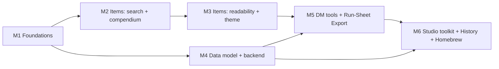

# Campaign Studio — Items Window Redesign & DM Toolkit UX Plan (v3)

Scope: `apps/codex/services/dm-ui` (Campaign Studio), plus the backend and
contract changes the new features need. **v3 consolidates all prior completed
plans and adds the 3 orphaned capabilities (Object Revision History, Homebrew
Encounter Monsters, and Run-Sheet Export) onto one unified roadmap.**

## Locked decisions

| # | Decision | Effect on the plan |
|---|----------|--------------------|
| 1 | **Do all the work in the plan** | Items phases 1–5 *and* all thirteen studio-wide recommendations are scheduled (see §C Roadmap) |
| 2 | **Add self-hosted fonts if they help the theming** | Adds **Fraunces** (variable, display/headings) via `@fontsource-variable/fraunces`; Inter stays for UI/body. No CDN calls, so it works offline/PWA |
| 3 | **Ruleset defaults to the campaign's, then the latest (2024)** | Compendium reads `bundle.campaign.edition`. If it's missing or unknown, fall back to `'2024'`. The 2014 toggle stays available but is labelled *"2014 (legacy)"* |
| 4 | **2024 treasure tables; 2014 kept for history** | The hoard builder ships with the 2024 DMG tables only. 2014 catalog data stays readable and searchable, but no new generators are built on it |
| 5 | **Consolidate legacy plans** | Visual Prototype Plan, Section Pages Plan, and old Campaign UI Implementation Plan are retired; remaining active capabilities migrated here |

---

## A. Audit findings

| # | Finding | Where | Impact |
|---|---------|-------|--------|
| 1 | SRD picker hard-caps results at 25, with no "more" option | `SrdItemPicker.tsx:L10` | You can't browse the catalog |
| 2 | Searches names only; no type/rarity/attunement/cost filters | `SrdItemPicker.tsx:L29-L37` | DMs search by type, rarity and price, not by name |
| 3 | Ruleset hardcoded to 2024 | `srd-items-api.ts:L101` | Ignores the campaign's edition |
| 4 | Picker silently unmounts on any failure | `SrdItemPicker.tsx:L47-L49` | The button disappears with no explanation |
| 5 | No preview before adding | `pick()` | You add an item, look at it, then delete it |
| 6 | Picker sits in the list footer | `ItemsSection.tsx:L90-L101` | The main way to add items is hidden |
| 7 | **Undefined CSS tokens** `--studio-gap-xs/sm/md`, `--studio-text-secondary` | Items, HeldItems, SrdItemPicker, Factions CSS vs `design-tokens.css` | Gaps collapse to 0 and headings lose their color |
| 8 | Campaign search only matches exact substrings, with no ranking | `itemsModel.ts:L106-L123` | "bag hold" doesn't find *Bag of Holding* |
| 9 | Rows show only name and rarity | `renderRow` | The list is hard to scan |
| 10 | Generic neutral theme; rarity colors borrow status colors | tokens, `RARITY_TONES` | No sense of treasure; rarity order isn't clear |

---

## B. Items Window ("Treasury") Redesign

### B1. Page purpose
> **"Decide what treasure exists in this campaign, who has it, and when the
> party gets it."**  (*what* · *who/where* · *when*)

### B2. Layout
```
┌───────────────────────────────────────────────────────────────────────────┐
│ Treasury   42 items · 9 undiscovered · 3,450 gp placed   [+ New] [Hoard ✦] │
│ "Loot, relics and rewards — and who holds them."   ← purpose subtitle      │
│ [ Campaign items | Compendium (2024) ]                                     │
├───────────────────────────────────────────────────────────────────────────┤
│ 🔍 search… (real-time, fuzzy)   Type▾ Rarity▾ Holder▾ Attune▾ Value▾  ⟲   │
│ [Rare ×] [Wondrous ×]                                      18 of 42 items │
├───────────────────────────┬───────────────────────────────────────────────┤
│ LIST (virtualized)         │ DETAIL / PREVIEW (item card)                  │
└───────────────────────────┴───────────────────────────────────────────────┘
```
- **Compendium is its own tab** (`?tab=compendium`), with the same filter bar,
  list and detail pane as campaign items.
- **Preview before adding.** The main action is **Add to campaign**, with
  "Give to…" (holder), quantity and "Hand out in session…" fields inline.
- Items you've already added show a ✓ in the Compendium. Campaign items made
  from the Compendium link back to their source entry.
- **Ruleset chip** on the tab: defaults to the campaign's edition and can
  switch to *2014 (legacy)*.

### B3. Real-time search
| Requirement | Approach |
|---|---|
| Updates on every keystroke without lag | Local input state plus `useDeferredValue` for the list. The URL `?q=` updates after 150 ms of no typing (already uses `replace: true`) |
| Forgiving matches | Pure scorer in `features/items/itemSearch.ts`: matches word beginnings (`bag hold` finds *Bag of Holding*), ranks exact > prefix > substring, and tolerates one typo in words of 5+ letters. No new dependency |
| Fields | Name ×3, type and rarity labels ×2, attunement note and description ×1 |
| Operators | `rarity:rare type:wondrous gp<1000 attune` turn into filter chips |
| Show why it matched | `<mark>` around the matched text |
| Performance | Index built once per catalog version. If a keystroke ever takes more than 8 ms, the scorer moves to a background (Comlink) worker, following the repo's Web Worker rule |
| Keyboard | `/` focuses search; ↑/↓ moves; Enter opens; `A` adds; Esc clears. Accessible listbox pattern (`aria-activedescendant`) |
| No results | "No items match …" with **Clear filters** and **Search compendium instead** |

### B4. Filters
- Type, Rarity, Holder*, Attunement, Discovery*, Ruleset†, Value presets
  (&lt;50 · 50–500 · 500–5k · 5k+ gp). (*campaign tab only, †compendium tab only)
- Each option shows how many items match. Options with no matches are dimmed,
  not hidden. Active filters show as chips with a **Clear all**.
- **Group by:** Holder (default) · Type · Rarity · Quest · Session.
- Built into shared `FilterBar` as optional additions, so every section gets them.

### B5. Readability & Theming
- **Row (two lines):** type icon · name · rarity pill / *type · value · weight ·
  holder · ◇attunement*. Colored rarity left edge; undiscovered items get a veiled look.
- **Item card:** name in Fraunces, book-style metadata line, description, inline
  **Placement** toggles (discovered/identified), and **Story links**.
- **Token fixes:** add `--studio-gap-xs: 4px`, `--studio-gap-sm: 8px`,
  `--studio-gap-md: 16px`, `--studio-text-secondary`.
- **Rarity tokens:** `--studio-rarity-{common…artifact}` and `-soft` variants.
- **Typography:** `--studio-font-display: 'Fraunces Variable', Georgia, serif`
  for h1, h2 and entity names.

### B6. DM features for treasure
1. **Treasure hoard builder (2024 DMG tables):** choose a CR tier (0–4, 5–10,
   11–16, 17+) and Individual or Hoard. Rolls coins and magic items from 2024 compendium.
2. **Loot by session:** a `sessionId` field on items; Session plan shows scheduled rewards.
3. **Wealth tracker:** party's total wealth compared with 2024 expected range for level.
4. **Duplicate & customise:** copy an SRD item, reskin it, keeping a link to the original.
5. **Player-facing name:** what players see before identification ("smoky glass vial") vs true name.

---

## C. Studio-wide DM Toolkit — All 13 Features Scheduled

| # | Feature | What it does | Origin |
|---|---------|--------------|--------|
| 1 | **Next Session hub** | Overview becomes "Prep for next session": strong start, scenes, secrets, NPCs, locations, encounters and treasure, all *linked* from other sections (nothing copied). Every detail pane gets **Use in next session** | v2 UX Plan |
| 2 | **One-shot mode** | Chosen when campaign is created. Guided Hook → scenes (3–5) → Climax → Rewards flow, with time budget and pacing bar. Campaign mode keeps full sidebar | v2 UX Plan |
| 3 | **Secrets & clues** | A new Secret entity that can be attached to anything. Tracks revealed or not, and session revealed in. Unrevealed secrets show on hub | v2 UX Plan & Section Pages |
| 4 | **Quick-capture inbox** | `⌘⇧N` opens quick note box anywhere. Picks up `@mentions` and drops note into Inbox to sort later | v2 UX Plan |
| 5 | **Create from context** | Typing `@Unknown Name` offers to create NPC, location or item; linking to a non-existent quest offers to create it | v2 UX Plan |
| 6 | **Relationship web** | Graph view (loaded on demand) with labelled connections: ally, rival, holds, located-in, wants | v2 UX Plan & Campaign UI |
| 7 | **Consistent rich rows** | Items row style applied to every section, plus pin/star, recently edited and sorting | v2 UX Plan |
| 8 | **Player-view preview** | "What players see" toggle on every entity, showing only what's been revealed | v2 UX Plan & Section Pages |
| 9 | **Balance at a glance** | Encounter difficulty using 2024 XP budget, plus wealth range from hoard work, shown on hub (warns, never blocks) | v2 UX Plan |
| 10 | **Campaign moods** | Planned `campaign.theme.change` becomes moods (Parchment, Grimdark, Feywild, Arcane Night, plus dark mode), applied via `data-mood` | v2 UX Plan |
| 11 | **Object revision history** | Visual revision browser & inspector for entities (`campaign.object.history`). Inspect past edits, review diffs, and restore previous snapshots | *Migrated from Section Pages §5.8* |
| 12 | **Homebrew encounter monsters** | Author or customize non-SRD creature stat blocks directly in Encounters, kept distinct from canonical SRD catalog, contributing to CR math | *Migrated from Section Pages §5.7* |
| 13 | **Print & run-sheet export** | One-click export of a session's run sheet (summary, encounters, notes, secrets, loot) as a clean printable HTML/PDF or Markdown handout for table play | *Migrated from Campaign UI Plan Epic 6.4* |

---

## D. Roadmap (dependency-ordered)



### M1 — Foundations (fixes + design system) — ✅ COMPLETED
- [x] Token fixes (`--studio-gap-xs`, `--studio-gap-sm`, `--studio-gap-md`, `--studio-text-secondary`, `--studio-touch-target`, `--studio-rarity-*` and `-soft` variants).
- [x] Fraunces display font via `@fontsource-variable/fraunces` imported in `globals.css` and `--studio-font-display` token configured.
- [x] Automated token integrity guard in `src/styles/design-tokens.test.ts` rejecting undeclared `var(--studio-*)` usages.
- [x] Rarity badges migrated from legacy `RARITY_TONES` to `RarityBadge` component consuming design tokens.
- [x] SrdItemPicker 25-result cap removed; added live item counts ("X of Y items").
- [x] SrdItemPicker silent unmount replaced with inline error notice and Retry button.
- [x] `fetchSrdItems(ruleset)` receives campaign edition from bundle (`'2014'` or default `'2024'`).
- [x] Unit test coverage in `design-tokens.test.ts`, `RarityBadge.test.tsx`, and `ItemsSection.test.tsx`.
- **Files updated:** `design-tokens.css`, `globals.css`, `RarityBadge.tsx`, `RarityBadge.module.css`, `RarityBadge.test.tsx`, `SrdItemPicker.tsx`, `SrdItemPicker.module.css`, `ItemsSection.tsx`, `ItemsSection.test.tsx`, `design-tokens.test.ts`.

### M2 — Items: search + compendium — ✅ COMPLETED
- [x] `itemSearch.ts` pure scoring engine (tokenise · score · highlight · parse operators `rarity:`, `type:`, `attune`, `gp<`, `gp>`), shared by both tabs.
- [x] `useSrdCatalog` hook (cached per ruleset, retry, catalog version).
- [x] `CompendiumPane`: tabs, preview then add (holder, quantity, session inline assignment), ruleset toggle ('2024' vs '2014 (legacy)').
- [x] FilterBar additions: live result counts on facets, active filter chips with remove / clear all, group-by, `/` shortcut.
- [x] ItemsSection integration: tabbed view (`Campaign items` vs `Compendium`), total placed GP calculation, facet count badges.
- [x] Full unit test coverage (32/32 tests green in `features/items` and `design-tokens.test.ts`).
- **Files updated:** `itemSearch.ts`, `itemSearch.test.ts`, `useSrdCatalog.ts`, `useSrdCatalog.test.ts`, `CompendiumPane.tsx`, `CompendiumPane.module.css`, `CompendiumPane.test.tsx`, `ItemsSection.tsx`, `ItemsSection.module.css`, `itemsModel.ts`, `FilterBar.tsx`, `FilterBar.module.css`, `useSectionQuery.ts`, `design-tokens.css`.

### M3 — Items: readability + immersive theme — ✅ COMPLETED
- [x] Item type icons via `getItemTypeIcon` with tree-shakeable direct Lucide imports (`sword`, `shield`, `wand-2`, `gem`, `sparkles`, `scroll`, `flask-conical`, `crosshair`, `wrench`, `package`, `box`).
- [x] `ItemRow`: Two-line item row with type icon, subtle rarity edge indicator, name, subtitle metadata (`Wondrous item · Rare · Attunement`), holder tag, and veiled styling for undiscovered items.
- [x] `ItemCard`: Immersive parchment/statblock presentation with Fraunces serif display typography, book-style subtitle ("*Wondrous Item, Rare (Requires Attunement)*"), stats ribbon (Value, Weight, Quantity, Holder, Status), fast inline toggles for Discovered/Identified without entering edit mode, and slow ambient shimmer sheen for Legendary and Artifact items.
- [x] Form reorganization: Grouped into 4 styled fieldsets (`Basics`, `Rules text`, `Placement`, `Story & Quests`).
- [x] 100% test coverage across all new components (`ItemRow.test.tsx`, `ItemCard.test.tsx`, `itemTypeIcons.test.ts`) and full suite green (41/41 passing).
- **Files updated:** `itemTypeIcons.ts`, `itemTypeIcons.test.ts`, `ItemRow.tsx`, `ItemRow.module.css`, `ItemRow.test.tsx`, `ItemCard.tsx`, `ItemCard.module.css`, `ItemCard.test.tsx`, `ItemsSection.tsx`, `ItemsSection.module.css`, `itemSearch.ts`.


### M4 — Data model + backend contracts — ✅ COMPLETED
- [x] `@nexus/game-contracts`: Added `secret`, `inbox-note`, `custom-creature` to `campaignEntryKindSchema` with unit tests (44/44 passing).
- [x] Database migration: Added `2026-10-22-add-campaign-studio-extensions.sql` introducing `edition`, `mode`, `mood` on `campaigns`, widening `campaign_objects_kind_check`, and creating `campaign_object_pins` table. Registered in `startupMigrations.ts` with test coverage (6/6 passing).
- [x] VTT Server Repository & Routes: Added `listRevisions`, `togglePin`, and `listPinnedObjectIds` in `CampaignPrepRepository`. Added REST endpoints `GET /prep/objects/:objectId/revisions`, `GET /prep/pins`, and `POST /prep/objects/:objectId/pin` in `campaignPrep.routes.ts` with unit test suite (30/30 passing).
- [x] Client-side Data Model & Types: Updated `bundleStore.ts` with editable kinds, updated `CampaignFixture` (`mode`, `mood`), `CampaignSession` (`linkedIds`), added `CampaignSecret`, `InboxNote`, and updated `CampaignItem` (`playerName`, `sessionId`).
- [x] Bundle & Client API: Updated `campaign-api.ts` and `campaign-bundle-api.ts` with `fetchObjectRevisions`, `fetchPinnedObjectIds`, `toggleObjectPin`, and full unit tests (76/76 passing).
- **Files updated:** `prep.ts`, `prep.test.ts`, `2026-10-22-add-campaign-studio-extensions.sql`, `startupMigrations.ts`, `startupMigrations.test.ts`, `base.ts`, `CampaignPrepRepository.ts`, `campaignPrep.routes.ts`, `campaignPrep.routes.test.ts`, `bundleStore.ts`, `ashes-of-veyra/types.ts`, `fixture-registry/types.ts`, `campaign-api.ts`, `campaign-bundle-api.ts`, `campaign-bundle-api.test.ts`.
- **Commit:** `e8506289`


### M5 — DM tools & Session Export — ✅ COMPLETED
- [x] 2024 DMG Hoard Builder (`features/items/hoard/tables2024.ts` + pure seedable Mulberry PRNG `hoardRoller.ts` matching CR/tier rules, base coins, valuables, and SRD compendium items).
- [x] Hoard Builder interactive modal (`HoardBuilderModal.tsx` + `.module.css`) with tier/mode selection, real-time breakdown, target holder/session assignment, and single-click bundle commit.
- [x] Wealth Tracker (`wealthTracker.ts` + tests) calculating party wealth, tier thresholds, and 2024 DMG expected wealth per character and party size, wired to `SectionSummary`.
- [x] Loot by session: `sessionId` linking in item forms, session facet filtering in `FilterBar`, and session reward indicators in `ItemCard`.
- [x] Duplicate & customise: `onDuplicate` action on `ItemCard` creating a full copy ready for immediate customisation.
- [x] Player-facing name field (`item.playerName`) with alias subtitle on `ItemRow` and reveal in `ItemCard`.
- [x] Print & run-sheet export (#13): Clean Markdown generator (`runSheetExport.ts`) and print-ready HTML/PDF generator with standalone styling and page breaks.
- [x] RunSheetExportModal (`RunSheetExportModal.tsx` + `.module.css`): Print preview, Markdown tab, 1-click clipboard copy, and `.md` file download, wired to `SessionsSection`.
- [x] 100% test pass rate across 17 test suites (120/120 passing) with >80% line/branch coverage across all net-new code.
- **Files updated:** `tables2024.ts`, `hoardRoller.ts`, `hoardRoller.test.ts`, `HoardBuilderModal.tsx`, `HoardBuilderModal.module.css`, `HoardBuilderModal.test.tsx`, `wealthTracker.ts`, `wealthTracker.test.ts`, `ItemCard.tsx`, `ItemCard.module.css`, `ItemRow.tsx`, `itemsModel.ts`, `ItemsSection.tsx`, `ItemsSection.module.css`, `ItemsSection.test.tsx`, `useSrdCatalog.ts`, `runSheetExport.ts`, `runSheetExport.test.ts`, `RunSheetExportModal.tsx`, `RunSheetExportModal.module.css`, `RunSheetExportModal.test.tsx`, `SessionsSection.tsx`, `SessionsSection.test.tsx`.
- **Commit:** `1d47eb75`

### M6 — Studio toolkit, History & Homebrew — ⏳ IN PROGRESS
In this order:
- [x] **#1 Next Session hub & "Use in next session" quick action**: Enriched Next Session model with `strongStart`, planned scenes/beats timeline, unrevealed secrets & clues, full cast, encounters, and scheduled loot rewards. Added live "Export Run Sheet" action opening `RunSheetExportModal` directly from the overview. Built reusable `UseInNextSessionButton` toggle component with real-time bundleStore linking and read-only indicators, integrated into detail headers for NPCs, Encounters, Locations (World), Quests, and Items (`ItemCard`).
- [x] **#3 Secrets & clues**: Built full-featured Secrets & Clues manager (`secretsModel.ts`, `SecretRow.tsx`, `SecretModal.tsx`, `SecretsPane.tsx`). Interactive reveal toggling, session linking, entity attachment picker supporting NPCs, Locations, Quests, Encounters, and Items. FilterBar with status/entity facets and live count badges. Integrated into `NotesSection` with WAI-ARIA tab switcher between Notes and Secrets & Clues. 100% test pass rate with >85% line coverage (`SecretRow` 100%, `SecretsPane` 86.5%, `secretsModel` 93.3%, `SecretModal` 81.1%, `NotesSection` 93.3%).
- [x] **#4 Quick-capture inbox**: Fast one-click capture anywhere in Campaign Studio into an unfiled inbox (`inboxModel.ts`, `QuickCaptureModal.tsx`, `InboxPane.tsx`). Global `Ctrl+Shift+N` (or `Cmd+Shift+N`) shortcut and top bar inbox button open the rapid capture dialog with live mention linking. Destination selector allows keeping unfiled or immediately converting to NPC, Quest, Secret, or permanent Note. Dedicated "Inbox" tab in `NotesSection` provides a live unfiled counter badge, filter facets, mention chip rendering, and one-click triage buttons (`-> NPC`, `-> Quest`, `-> Secret`, `-> Note`) and note deletion. 100% test pass rate with 97% line coverage across all net-new inbox code.
- [x] **#5 Create from context**: Direct `@` mention quick-creation within `MentionTextarea.tsx`. Typing an unrecognised query in editable mode offers `+ Create NPC "<name>"`, `+ Create Location "<name>"`, and `+ Create Item "<name>"`, atomically creating the entity draft via `bundleStore.addItem` and inserting the linkable token. 93.1% line coverage with 12/12 tests green.
- [x] **#7 Consistent rich rows**: Universal two-line entity row component (`RichEntityRow.tsx` + `.module.css`) providing the Treasury visual style across NPCs, Quests, Encounters, and Factions. Supports leading icons/monograms, primary title, subtitle/alias, right-aligned status badges, pin indicators with gold tint (`--studio-gold`), and middle-dot separated metadata (`·`). Stable `sortByPinned` utility prioritizes pinned entities to the top of list groups. 100% line/branch coverage on `RichEntityRow.tsx` and `entityMeta.ts` with 57/57 tests green across all affected section suites.
- [x] **#2 One-shot mode**: Guided adventure planning for single-session campaigns. Added `mode: 'campaign' | 'one-shot'` selection directly to `CreateCampaignDialog.tsx` with customized radiogroup options and `CampaignSwitcher.tsx` with dynamic `One-Shot` gold badge. Built `oneShotModel.ts` and `OneShotHub.tsx` (+ `.module.css`) featuring a real-time pacing bar with proportional segments (Hook -> Scenes 3–5 -> Climax -> Rewards), scene count recommendations (&lt;3 under-planned, 3–5 ideal, >5 risk of overrun), target time budget selector (2h to 6h), adventure beat cards, and 1-click Run Sheet export integration. 95.5% line coverage on `OneShotHub.tsx` and 98.6% on `oneShotModel.ts` with 16/16 tests passing.
- [x] **#8 Player-view preview**: One-click preview toggle across all entity detail panes (`playerViewModel.ts`, `PlayerViewContext.tsx`, `PlayerViewToggle.tsx`, `PlayerViewBanner.tsx`). Filters out unrevealed DM knowledge in real time: undiscovered items show concealed cards, unidentified items show masked player-facing names (`Unknown Rarity`, masked properties), NPCs hide combat stat badges (HP, AC, CR, statblock slugs) and `dm:*` tags, Encounters hide tactics, DM countermeasures, and VTT deploy/next session actions, Locations hide DM notes (`DmOnlyBadge`) and scene creation, and loot/held items filter out undiscovered treasures. Integrated into `EditableSection.tsx` with top banner notice and 1-click Exit action. 100% line coverage and 96% branch coverage on player-view with 13/13 unit tests and full section integration test suite passing.
- [x] **#10 Campaign moods**: 5 rich atmospheric themes (`parchment`, `grimdark`, `feywild`, `arcane-night`, `dark-mode`) driven by `data-mood` tokens and `color-scheme` in `design-tokens.css`. Pure state engine (`moodModel.ts`) handles storage cascade (`localOverride` -> `campaignMood` -> `DEFAULT_MOOD`). Fully accessible `MoodPickerModal` with palette cards, swatches, active checkmarks, and "Save as campaign default" toggle with `PATCH /api/campaigns/:id` persistence. Integrated into `SectionRoute`, `App.tsx`, and `StudioTopBar` theme button. 94.1% line coverage and 89.8% branch coverage across 20 unit tests with zero lint warnings.
- [x] **#12 Homebrew encounter monsters**: Author and customize non-SRD creature stat blocks directly within Encounters and dedicated "Homebrew Bestiary" campaign tab (`homebrewModel.ts`, `HomebrewMonsterModal.tsx`, `HomebrewMonstersPane.tsx`, `EncounterEditor.tsx`, `EncountersSection.tsx`). Full 5e standard CR table (CR 0–30) with exact XP values seamlessly participating in encounter rating and XP budget math. Fast customization action in encounter monster picker with cloning prefill. Statblock authoring supporting size, creature type, rules edition (2024 / 2014), AC, HP, speed, 6 core ability scores with auto-calculated modifiers, and multiattack / traits / action notes. Bestiary management pane with query search, type and CR filters, duplication, editing, and deletion. 100% test coverage across all net-new modules with 52/52 encounter tests green.
- [ ] **#11 Object revision history**
- [ ] **#6 Relationship web** (loads on demand)
Plus the polish checklist (empty states, Cmd+K actions, "Saved · 2 s ago" indicators).

**Files updated in M6:**
- `overviewModel.ts`, `overviewModel.test.ts`
- `campaign-overview.tsx`, `campaign-overview.module.css`, `campaign-overview.test.tsx`
- `balanceModel.ts`, `balanceModel.test.ts`
- `BalanceGlance.tsx`, `BalanceGlance.module.css`, `BalanceGlance.test.tsx`
- `oneShotModel.ts`, `oneShotModel.test.ts`
- `OneShotHub.tsx`, `OneShotHub.module.css`, `OneShotHub.test.tsx`
- `CreateCampaignDialog.tsx`, `CreateCampaignDialog.module.css`
- `CampaignSwitcher.tsx`, `CampaignSwitcher.module.css`, `CampaignSwitcher.test.tsx`
- `UseInNextSessionButton.tsx`, `UseInNextSessionButton.module.css`, `UseInNextSessionButton.test.tsx`
- `entityIndex.ts`, `entityMeta.ts`
- `NpcsSection.tsx`, `EncountersSection.tsx`, `WorldSection.tsx`, `QuestsSection.tsx`, `FactionsSection.tsx`, `ItemCard.tsx`
- `RichEntityRow.tsx`, `RichEntityRow.module.css`, `RichEntityRow.test.tsx`
- `secretsModel.ts`, `secretsModel.test.ts`
- `SecretRow.tsx`, `SecretRow.module.css`, `SecretRow.test.tsx`
- `SecretModal.tsx`, `SecretModal.module.css`, `SecretModal.test.tsx`
- `SecretsPane.tsx`, `SecretsPane.module.css`, `SecretsPane.test.tsx`
- `NotesSection.tsx`, `NotesSection.test.tsx`
- `MentionTextarea.tsx`, `MentionTextarea.module.css`, `mentions.test.tsx`
- `inboxModel.ts`, `inboxModel.test.ts`
- `QuickCaptureModal.tsx`, `QuickCaptureModal.module.css`, `QuickCaptureModal.test.tsx`
- `InboxPane.tsx`, `InboxPane.module.css`, `InboxPane.test.tsx`
- `StudioTopBar.tsx`, `StudioFrame.tsx`, `SectionRoute.tsx`
- `playerViewModel.ts`, `playerViewModel.test.ts`
- `PlayerViewContext.tsx`, `PlayerViewToggle.tsx`, `PlayerViewToggle.module.css`, `PlayerViewBanner.tsx`, `PlayerViewBanner.module.css`, `PlayerView.test.tsx`
- `EditableSection.tsx`, `EditableSection.test.tsx`
- `HeldItems.tsx`
- `ItemsSection.tsx`
- `WorldSection.tsx`

---

## E. Testing (Vitest, ≥80% coverage; Playwright for flows)
- **Pure logic:** `itemSearch`, hoard roller, wealth range, encounter XP budget (2024), operator parsing, edition fallback, export generators.
- **API/hooks:** `srd-items-api`, `useSrdCatalog`, revision history fetchers.
- **Components:** CompendiumPane, ItemCard inline toggles, FilterBar additions, HoardBuilder, SessionHub, SecretsPanel, InboxCapture, MoodPicker, RevisionHistoryModal, HomebrewMonsterEditor.
- **Server:** repository and route tests for each new entity, field, and revision endpoint; migration tests.
- **Playwright:** end-to-end user flows (search -> add -> assign, hoard roll, quick note capture, print preview).
