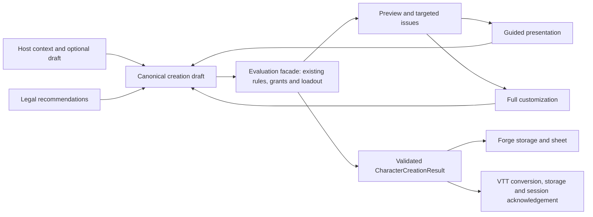

# Shared character creation implementation plan

Date: 2026-10-23  
Status: Proposed; implementation has not started under this plan.  
Planning baseline: `edd07ca931b6ae590b28a061756e1d56041072db` (`edd07ca9`).  
Primary scope: `packages/character-creator`, its Forge/VTT hosts, and existing shared rules/contracts.  
Effort: approximately **50–75 engineering person-days**, or **60–90 with contingency**; rules review, research and QA add approximately **15–25 specialist days**. A three-engineer team with fractional UX/rules and dedicated QA should provision **8–12 calendar weeks**, subject to Phase 0 re-estimation.

All paths are relative to the repository root. Ticket/module/API names introduced below are proposals. Source observations are pinned to the planning commit. Original review behavior was observed in Forge version 1.5.3 against the earlier `fc4008cb` checkout; this plan does not claim the deployed app includes the newer commit.

## 1. Outcome and boundaries

A first-time player should create a legal, playable character, recognize their most useful actions, and understand the next step into their game without reading a handbook.

Deliver:

1. One reliable rules/result pipeline behind the existing guided and full experiences.
2. A four-screen newcomer presentation with deterministic, legal recommendations.
3. Full customization against the same draft, with predictable navigation and recovery.
4. Correct 2014/2024 content and calculations for every combination advertised as supported.
5. Host-owned persistence/resume, trustworthy completion and an explicit path into play.
6. Independent rules fixtures, browser journeys, mobile/accessibility verification and a staged release.

The package remains the single creator and remains free of account identity, storage and multiplayer authority. Preserve `CharacterCreationResult`, asynchronous completion and `toNexusCharacter()` as the host seams described in [ADR-0002](https://github.com/joelmale/nexusVTT/blob/edd07ca931b6ae590b28a061756e1d56041072db/apps/docs/vtt/adr/0002-shared-character-creator.md#L47). Coordinate with the existing [Forge/VTT object integration plan](forge-vtt-object-integration-plan.md); reuse its implemented capabilities only after verifying them.

This work does not introduce a second creator, a new general rules engine, a new persistence service, automatic character repair, new classes, a Tailwind migration, or new multiplayer transaction semantics. Existing higher-level creation stays supported through the compatibility path until independently certified; a level-one release is not evidence of complete multiclass/high-level correctness.

## 2. Reconcile the review with current work

The newer [Priority 2 plan](https://github.com/joelmale/nexusVTT/blob/edd07ca931b6ae590b28a061756e1d56041072db/CHARACTER_CREATOR_PRIORITY_2_PLAN.md) and `edd07ca9` already add:

| Existing change                                                     | Plan treatment                                                                                                                                            |
| ------------------------------------------------------------------- | --------------------------------------------------------------------------------------------------------------------------------------------------------- |
| Desktop VTT Create/Claim entry and onboarding banner                | Verify room creation, assignment acknowledgement, spectator behavior and duplicate-launch protection. Extend only where a real handoff gap remains.       |
| Coin parsing and class/background accumulation                      | Reuse the implementation; test whole loadouts, gold alternatives, quantities, duplicates and denominations through real UI. Do not create another parser. |
| Guided default alignment becomes True Neutral                       | Retain its regression test; verify full/guided output compatibility. Alignment can become optional without undoing normalization.                         |
| Earlier ASI/background/style fixes mentioned by the Priority 2 plan | Reproduce the actual current paths. The review still observed deployed bonus loss, which the current calculator does not explain in isolation.            |

Remaining source evidence:

| Concern                                                                      | Current source seam                                                                                                                                                                                                                                                                                                                                                                                                           |
| ---------------------------------------------------------------------------- | ----------------------------------------------------------------------------------------------------------------------------------------------------------------------------------------------------------------------------------------------------------------------------------------------------------------------------------------------------------------------------------------------------------------------------- |
| Accepted loadout saves background items instead of the displayed class kit   | [packages/character-creator/src/components/CharacterCreationWizard/steps/Step6Equipment.tsx:412](https://github.com/joelmale/nexusVTT/blob/edd07ca931b6ae590b28a061756e1d56041072db/packages/character-creator/src/components/CharacterCreationWizard/steps/Step6Equipment.tsx#L412)                                                                                                                                          |
| Unarmored-only creation AC and edition-ambiguous class lookup                | [characterCreationUtils.ts:277](https://github.com/joelmale/nexusVTT/blob/edd07ca931b6ae590b28a061756e1d56041072db/packages/character-creator/src/utils/characterCreationUtils.ts#L277); [class lookup:14](https://github.com/joelmale/nexusVTT/blob/edd07ca931b6ae590b28a061756e1d56041072db/packages/character-creator/src/utils/characterCreationUtils.ts#L14)                                                             |
| Local guided defaults/edits disagree with submitted selections               | [packages/character-creator/src/components/guided/PersonalitySummary.tsx:55](https://github.com/joelmale/nexusVTT/blob/edd07ca931b6ae590b28a061756e1d56041072db/packages/character-creator/src/components/guided/PersonalitySummary.tsx#L55); [Continue:185](https://github.com/joelmale/nexusVTT/blob/edd07ca931b6ae590b28a061756e1d56041072db/packages/character-creator/src/components/guided/PersonalitySummary.tsx#L185) |
| Background allocation resets on mount                                        | [packages/character-creator/src/components/CharacterCreationWizard/components/BackgroundASIWidget.tsx:18](https://github.com/joelmale/nexusVTT/blob/edd07ca931b6ae590b28a061756e1d56041072db/packages/character-creator/src/components/CharacterCreationWizard/components/BackgroundASIWidget.tsx#L18)                                                                                                                        |
| Incomplete class choices pass validation                                     | [packages/character-creator/src/components/CharacterCreationWizard/hooks/useStepValidation.ts:69](https://github.com/joelmale/nexusVTT/blob/edd07ca931b6ae590b28a061756e1d56041072db/packages/character-creator/src/components/CharacterCreationWizard/hooks/useStepValidation.ts#L69)                                                                                                                                        |
| Empty Spell Randomize handler                                                | [packages/character-creator/src/components/CharacterCreationWizard/steps/Step4Spells.tsx:276](https://github.com/joelmale/nexusVTT/blob/edd07ca931b6ae590b28a061756e1d56041072db/packages/character-creator/src/components/CharacterCreationWizard/steps/Step4Spells.tsx#L276)                                                                                                                                                |
| Existing rules engine can evaluate sourced effects but content is incomplete | [packages/character-creator/src/rulesEngine/executors/characterExecutor.ts:26](https://github.com/joelmale/nexusVTT/blob/edd07ca931b6ae590b28a061756e1d56041072db/packages/character-creator/src/rulesEngine/executors/characterExecutor.ts#L26)                                                                                                                                                                              |
| Existing preparation helper also needs independent edition review            | [packages/rules-5e/src/preparation.ts:14](https://github.com/joelmale/nexusVTT/blob/edd07ca931b6ae590b28a061756e1d56041072db/packages/rules-5e/src/preparation.ts#L14)                                                                                                                                                                                                                                                        |

Phase 0 must maintain a defect ledger with **reproduced / fixed in source, awaiting runtime verification / verified fixed / unresolved deployment difference**. No original finding is automatically a new fix ticket or a completed task.

## 3. Roles and accountability

These are responsibilities, not requests to hire seven people. One contributor may wear several hats; a rules fixture and its implementation still need independent review.

| Role                                               | Accountable for                                                                             | Required review partner          |
| -------------------------------------------------- | ------------------------------------------------------------------------------------------- | -------------------------------- |
| **LEAD — technical/delivery lead**                 | Contracts, dependency order, task assignment, scope, integration and release decision       | QA and affected host owner       |
| **RULES — D&D rules/content specialist**           | Edition/source policy, grant coverage, independent expected values, recommendation legality | QA; CORE reviews representation  |
| **CORE — shared-package/rules engineer**           | Draft/evaluation/loadout pipeline, effect integration, compatibility adapters               | RULES and HOST                   |
| **UX — onboarding/content/accessibility designer** | Four-screen flow, terminology, defaults, interaction design, research protocol              | UI, RULES and QA                 |
| **UI — shared frontend engineer**                  | Both presentations, dialog/focus behavior, responsive controls, accessible help             | UX and QA                        |
| **HOST — Forge/VTT maintainers**                   | Storage, draft resume, exact saved identity, session/token handoff, host sheet actions      | CORE and QA                      |
| **QA — test/accessibility engineer**               | Regression matrix, independent journey verification, phone/assistive technology, evidence   | RULES for math; UX for usability |
| **RELEASE — CI/deployment owner**                  | Affected-target graph, both product builds, staged activation, rollback evidence            | LEAD and HOST                    |

Every ticket has one DRI, one reviewing role and a binary acceptance gate. No role may sign off its own rules oracle solely by comparing it to its own calculator.

## 4. Architecture to establish before parallel UI work

### 4.1 One canonical draft, separate presentation state

Introduce a versioned internal `CreationDraft` with stable draft/character identity, edition/source references, raw base scores, normalized answers, loadout selections and provenance: player-selected, recommended or imported. Keep step position, expanded panels and mode outside the rules answers.

Retain the public `CharacterCreationData` type and legacy exports through adapters while migrating. It currently mixes raw inputs, derived values and aliases; expanding it indefinitely would preserve the ambiguity. Both current public props interfaces must remain compatible until callers migrate ([result contract](https://github.com/joelmale/nexusVTT/blob/edd07ca931b6ae590b28a061756e1d56041072db/packages/character-creator/src/api/types.ts#L23); [component props](https://github.com/joelmale/nexusVTT/blob/edd07ca931b6ae590b28a061756e1d56041072db/packages/character-creator/src/components/CharacterCreator.tsx#L24)).

Domain actions reconcile dependent answers:

- Preserve compatible user selections and optional text.
- Regenerate incompatible recommended choices deterministically.
- Identify incompatible explicit choices with a targeted explanation and repair action.
- Never silently change the class/species/combat fantasy the player requested.
- Generate random names/trinkets or advanced random builds once per explicit request, not on render or preview.

### 4.2 One evaluation facade, existing rule implementations

Propose a single internal `evaluateDraft()` facade returning calculated preview, pending entitlements, structured validation issues and source/version metadata. Preview and final submission use the same evaluated revision.

Build draft-to-`BaseFacts` and edition-aware sourced-effect adapters around the existing `rulesEngine`. Fill its content gaps; do not enable its global feature flag for unverified combinations. Reuse independently corrected generic math/catalog/progression helpers from `@nexus/rules-5e` where appropriate. Its existing preparation implementation is not an oracle merely because tests pass.

Do not derive base facts from finished character scores: [extractBaseFacts](https://github.com/joelmale/nexusVTT/blob/edd07ca931b6ae590b28a061756e1d56041072db/packages/character-creator/src/rulesEngine/utils/extractBaseFacts.ts#L17) reads already calculated scores, which risks double-applying bonuses. Effect provenance must show each grant exactly once.

Adopt evaluation by certified class/edition slice. Uncertified higher-level/custom paths stay on an explicit compatibility adapter. There must be one authoritative calculation for each supported slice, never competing UI formulas.

Preserve the dependency direction `character-creator → rules-5e → game-contracts → character-contracts`. Generic rules and contracts must not import creator or host code.

### 4.3 One resolved loadout and one grant ledger

A resolved loadout owns items, integer quantities, currency, equipped slots and the class/background option selections that produced them. Resolve it once; preview and commit exactly that value. Equipment legality and preview/save equality are separate gates.

A grant ledger records species/background/class/feat choices and the source of each ability bonus, skill/tool/language, expertise, spell, mastery, feature and resource. Recommendations fill legal choices; they do not omit entitlements or calculate another set of stats. Origins and class spellcasting remain distinct casting sources.

Use edition/source-qualified identifiers; reuse [createCatalogKey()](https://github.com/joelmale/nexusVTT/blob/edd07ca931b6ae590b28a061756e1d56041072db/packages/rules-5e/src/catalog.ts#L22). Keep labels as labels. An older compatible option requires an explicit compatibility policy and provenance.

### 4.4 Additive host boundaries

Preserve `onComplete(result)` and rejected-save behavior. Add optional versioned draft input/change callbacks and host context for edition, starting level, allowed sources and capabilities.

Forge stores drafts through its own IndexedDB abstraction. VTT stores through its existing permitted host persistence/worker path; the package does not gain storage, account access or room state. Stable IDs survive retry. “Saved” and “accepted into session” are distinct states.

Proposed data flow:



## 5. Delivery phases and actionable backlog

Effort below is engineering person-days, not sequential elapsed time. RULES/UX/QA specialist work overlaps. All implementation tickets begin with the defect ledger: an already-fixed issue becomes a verification/coverage task.

### Phase 0 — Baseline, independent oracles and contract decisions

**Lead:** LEAD. **Review:** RULES + QA + HOST. **Budget:** 2–3 engineering days. **Gate G0:** baseline and contract note accepted.

| Ticket                                                 | DRI; dependency                | Deliverable and acceptance                                                                                                                                                                                                                                                                                                          |
| ------------------------------------------------------ | ------------------------------ | ----------------------------------------------------------------------------------------------------------------------------------------------------------------------------------------------------------------------------------------------------------------------------------------------------------------------------------- |
| **CC-001 — Re-establish deployed/source baseline**     | QA + RELEASE; none             | Record both host build commits/assets, edition and entry mode. Re-run three audit paths and all landed Priority 2 changes. Capture field values before evaluation, after evaluation and after host save in controlled test data. Explain or isolate bonus-loss and post-equip action differences; do not assign speculative causes. |
| **CC-002 — Approve support matrix and rules fixtures** | RULES; none                    | Enumerate advertised classes/species/backgrounds/source packs by edition and supported levels. Freeze six independent reference builds plus exact original audit reproductions. Record source locators, choices and expected outputs. Unsupported content is identified before selection.                                           |
| **CC-003 — Approve draft/evaluation/release contract** | LEAD + CORE + HOST; CC-001/002 | Document draft schema/versioning, stable IDs, issue IDs, provenance, loadout ownership and additive callbacks. Decide shared-helper ownership. Approve first release scope and baseline measures. Assign one owner per shared file.                                                                                                 |

Parallel work after G0: rules/content audit, focused containment and UX prototypes can proceed. Final math and catalog policy are inputs to UI, not inferred from it.

### Phase 1 — Contain failures in the existing experiences

**Lead:** CORE. **Review:** QA + RULES/UI as relevant. **Budget:** 5–8 days. **Depends:** G0. **Gate G1:** known completion/data-loss failures have production-path regressions and fixes; arithmetic/catalog defects still open remain explicitly tracked.

| Ticket                                                          | DRI; dependency      | Deliverable and acceptance                                                                                                                                                                                                                                                                        |
| --------------------------------------------------------------- | -------------------- | ------------------------------------------------------------------------------------------------------------------------------------------------------------------------------------------------------------------------------------------------------------------------------------------------- |
| **CC-101 — Commit the displayed equipment**                     | CORE; CC-003         | Repair the acceptance/skip paths in the existing step; use one materialized selection. Fighter and Wizard keep class and background kit, quantities, money and equipped state. Reuse the new parser. No second background grant or dummy coin item appears.                                       |
| **CC-102 — Make guided recommendations real**                   | UI; CC-003           | Initialize actual selected choices; summary changes update submitted answers. Untouched recommendations complete. Rename premature Create to Review. Missing/ineligible choices are caught at their group with a repair target, not a late alert.                                                 |
| **CC-103 — Preserve valid choices and remove no-op assistance** | UI; CC-003           | Stop ASI clearing on mount/back; reconcile background changes. Spell assistance either selects a legal fixed package or is absent until ready. Working array swaps replace no-op controls. Align duplicate style fields through a compatibility adapter.                                          |
| **CC-104 — Block invalid catalog/default combinations early**   | CORE + RULES; CC-002 | Validate membership/edition and required entitlements, including Human origin choices and prerequisite filtering. Restore missing 2014 options with reviewed data, or present an honest unavailable state until CC-301 finishes. No truthy display-name default can bypass membership validation. |
| **CC-105 — Protect work from dismissal**                        | UI; CC-003           | Nested Escape closes only the top editor; focus is contained/restored. Separate Back from Exit. Keep the draft in memory across mode changes/dismissal, pending durable host resume in CC-501. Save errors retain answers and Retry.                                                              |

These fixes can merge incrementally. G1 alone does not certify every resulting number or justify promoting a new default flow. Release the stabilized existing presentation only after G2/G3 certify its advertised combinations.

### Phase 2 — Canonical creation domain and correct evaluation

**Lead:** CORE. **Review:** RULES + HOST + QA. **Budget:** 12–18 days. **Depends:** G0; integrate CC-101–105 before replacing their seams. **Gate G2:** independently correct and identical preview/save/conversion for the six reference builds.

| Ticket                                                    | DRI; dependency              | Deliverable and acceptance                                                                                                                                                                                                                                                                                                                  |
| --------------------------------------------------------- | ---------------------------- | ------------------------------------------------------------------------------------------------------------------------------------------------------------------------------------------------------------------------------------------------------------------------------------------------------------------------------------------- |
| **CC-201 — Draft/actions/legacy adapters**                | CORE; CC-003                 | Implement versioned draft, raw-score invariants, answer provenance, presentation separation and stable choice IDs. Legacy answer imports preserve intent. Both current modes edit the same state; switching/back/edition changes preserve compatible values.                                                                                |
| **CC-202 — Catalog and entitlement resolver**             | CORE + RULES; CC-201, CC-002 | Resolve edition/source-qualified choices and all grant subchoices; detect missing, duplicate and incompatible grants. Return structured issue IDs/repair destinations. Cover replacement skills, expertise, species/origin spells, tools/languages, style/mastery and resource initialization.                                              |
| **CC-203 — Canonical loadout resolver**                   | CORE; CC-201, CC-101         | Replace independent merges with one typed loadout. Class/background gear-vs-gold alternatives are separate; purchases conserve value. Preserve pack contents, ammunition and supported currencies. Decide lossless electrum representation/conversion; parser support must not end in a dropped wallet field.                               |
| **CC-204 — Rules evaluation adapter and effect coverage** | CORE + RULES; CC-202/203     | Integrate existing effect engine and corrected shared helpers. Apply ability bonuses once, armor/shields/style, HP/feat benefits, proficiency, saves, attacks/damage, skills, passive scores, speed and resources. Use per-slice adoption with independent oracles; differential legacy comparison is diagnostic only.                      |
| **CC-205 — Edition-correct casting**                      | CORE + RULES; CC-202/204     | Correct shared preparation limits and tests; canonicalize spellbook/known/prepared fields and casting-source provenance. UI counts, available actions, DC/attack and slot/resource state agree. Low/high INT distinguish 2014 from 2024 preparation behavior.                                                                               |
| **CC-206 — Result, retry and host preservation**          | CORE + HOST; CC-204/205      | Finalize the exact evaluated draft revision; preserve completion shape and all adapter exports. Retry reuses identity and does not create duplicates. Forge reload and VTT conversion preserve equipment, effects, sources, resources and manual text. A failed session submission retains the saved character and recoverable next action. |

### Phase 3 — Edition-complete content and deterministic recommended builds

**Lead:** RULES. **Review:** CORE + QA + UX. **Budget:** 8–12 days. **Depends:** schemas from CC-201/202; research/data work starts after G0. **Gate G3:** every advertised recommendation is legal and complete; every unsupported option is explicit.

| Ticket                                            | DRI; dependency               | Deliverable and acceptance                                                                                                                                                                                                                                                                                                                                   |
| ------------------------------------------------- | ----------------------------- | ------------------------------------------------------------------------------------------------------------------------------------------------------------------------------------------------------------------------------------------------------------------------------------------------------------------------------------------------------------ |
| **CC-301 — Catalog integrity and edition repair** | RULES + CORE; CC-002/202      | Restore 2014 backgrounds; correct feat categories/prerequisites, species/lineage policy, language/tool grants, class features and source references. Validate uniqueness and all grant references. A 2024 flow cannot silently choose a 2014 class by first-match slug.                                                                                      |
| **CC-302 — Recommendation policies**              | RULES + UX + CORE; CC-202/203 | Deterministically resolve known class or combat intent plus desired species. Start with Fighter, stealth archer Rogue and Wizard, then certify every advertised level-one class/edition. Recommend legal nonduplicating skills, scores, bonus allocation, origins/subchoices, masteries/style and equipped kit. Store reasons and preserve explicit choices. |
| **CC-303 — Starter spell and action packages**    | RULES + UX; CC-205/302        | For each advertised caster, provide legal offense/protection/utility choices with prepared lists and separately resolved origin spells. Generate three first-turn explanations from actual granted features/edition; no unearned subclass or unavailable resource is advertised.                                                                             |
| **CC-304 — Broader support certification**        | QA + RULES; CC-301–303        | Add at least one independent build per advertised class/edition and boundary checks for existing high-level features. Publish a tested support manifest. Do not claim full combinatorial coverage from six goldens; keep uncertified slices on a clearly identified compatibility path, or unavailable if known-invalid.                                     |

A minimal internal pilot may use the six reference builds. Broad newcomer promotion requires the class/edition support promised by its chooser, not merely those six passing.

For CC-204/CC-304 and G3, the support manifest must map every advertised grant/effect and required subchoice to its edition-aware implementation and independent positive/negative acceptance cases. Reusable test families may cover equivalent options, but one build per class does not certify every feat, lineage, style or spell source. Unknown or unimplemented benefits block certification or make that option unavailable; catalog membership alone never establishes working mechanics.

### Phase 4 — Four-screen newcomer flow and complete customization

**Lead:** UI + UX. **Review:** QA + CORE + RULES. **Budget:** 10–15 days. **Depends:** CC-201 contract; integrated candidate requires G2/G3. **Gate G4:** all three personas finish through accessible ordinary UI without mandatory rules reading or lost customizations.

| Ticket                                           | DRI; dependency         | Deliverable and acceptance                                                                                                                                                                                                                                                                                                                                           |
| ------------------------------------------------ | ----------------------- | -------------------------------------------------------------------------------------------------------------------------------------------------------------------------------------------------------------------------------------------------------------------------------------------------------------------------------------------------------------------- |
| **CC-401 — Intent and recommended-hero screens** | UI + UX; CC-201/302     | Screen 1 offers close combat/shoot/sneak/cast/support, known-class bypass and optional species. Screen 2 shows real recommended selections and three practical strengths. “Just make a Fighter” bypasses the quiz; “sneaky elf archer” retains Elf, ranged weapon and Stealth capability.                                                                            |
| **CC-402 — Adventure and finalization screens**  | UI + UX; CC-203/205/303 | Screen 3 accepts gear/starter spells with optional swaps; Screen 4 accepts generated or typed name and saves. Edition/level come from host or a visible default. Alignment/prose/trinket are optional; max legal level-one HP is automatic. No hidden unresolved mechanical choices remain.                                                                          |
| **CC-403 — Advanced mode continuity and copy**   | UI + UX; CC-201/202/401 | Existing detailed controls edit the same draft. Mode/back navigation retains compatible answers. Replace Varies placeholders, explain proficiency/ASI/origin feat/mastery in one sentence, and expose full rules on demand. Keep optional shopping, rolls and broad catalogues out of the default path.                                                              |
| **CC-404 — Accessibility and phone layout**      | UI + QA; CC-105/401–403 | Shared accessible dialog/editor primitive, labelled controls, checked/pressed state, step-heading focus, targeted validation and tap/keyboard help. Product target 44×44 CSS-pixel touch areas. Complete at 320/390/768 widths, portrait/landscape, 200% zoom, keyboard and representative screen readers. Contrast is measured; required actions are never clipped. |

Use CSS Modules and existing scoped variables for new UI; preserve `.nexus-character-creator` and its explicit theme boundary. Use the creator palette inside the package and VTT tokens for host-owned surfaces. Keep host blanket CSS exclusions intact. Do not introduce hardcoded colors or undertake a styling-framework migration.

### Phase 5 — Host recovery and handoff to play

**Lead:** HOST. **Review:** CORE + QA + UX. **Budget:** 6–10 days. **Depends:** CC-201/206; can run alongside Phase 4. **Gate G5:** save, resume and game readiness are truthful in both hosts.

| Ticket                                          | DRI; dependency                   | Deliverable and acceptance                                                                                                                                                                                                                                                                                                                                                     |
| ----------------------------------------------- | --------------------------------- | ------------------------------------------------------------------------------------------------------------------------------------------------------------------------------------------------------------------------------------------------------------------------------------------------------------------------------------------------------------------------------ |
| **CC-501 — Host-owned durable drafts**          | HOST + CORE; CC-201/206           | Add optional draft callbacks; persist per host/player/context through existing storage. Close/reopen/reload offers Resume/Start over. Version migration preserves compatible answers or recovers visibly. Two tabs cannot silently overwrite a newer draft; preserve a recoverable copy or request an explicit selection. Do not add cloud sync as a side effect.              |
| **CC-502 — Forge completion**                   | Forge HOST; CC-206/402            | Open/link the exact newly saved sheet. Standalone Forge explains its actual export/import route; show Add to game only when an existing authenticated host capability can complete it. Failed transfer preserves the saved sheet and a retry path. No placeholder success or unsupported deep link.                                                                            |
| **CC-503 — VTT completion and placement state** | VTT HOST; CC-206/402              | Verify existing desktop and Simple Player creation/claim entries. Account save, applied session acknowledgement, active-character selection and token linkage have observable outcomes. Host-only placement requests show awaiting-GM state when appropriate. Spectators get no create/claim prompt. Rejection/reconnect cannot falsely report joined or duplicate submission. |
| **CC-504 — First-turn cards and sheet actions** | HOST + UX + RULES; CC-303/502/503 | Show build-specific attack, defining feature and recovery/basic turn guidance. Where supported, link to actual sheet actions. Verify attack/save/heal/cast controls use the approved numbers; equipping a weapon updates actions. Separate “saved,” “in this game” and “ready on the scene.”                                                                                   |

Reuse the existing authorized session-intent APIs. If implementation changes canonical realtime writes, keep PostgreSQL commit-before-ACK and entity/event contracts, and run the required durability/soak gates. Do not solve a UI handoff by bypassing those APIs.

### Phase 6 — Independent QA, research and controlled release

**Lead:** QA + RELEASE. **Review:** LEAD + RULES + UX + HOST. **Budget:** 5–8 engineering days plus research/QA execution. **Depends:** G2–G5. **Gate G6:** release evidence and rollback rehearsed.

| Ticket                                           | DRI; dependency            | Deliverable and acceptance                                                                                                                                                                                                                                                                                                                                                                       |
| ------------------------------------------------ | -------------------------- | ------------------------------------------------------------------------------------------------------------------------------------------------------------------------------------------------------------------------------------------------------------------------------------------------------------------------------------------------------------------------------------------------ |
| **CC-601 — Real-path regression matrix**         | QA; CC-206, G3/G4/G5       | Six builds × two modes × two hosts = 24 completion cases, followed by actual reload and action checks. Include bad-choice mutation, back/mode changes, save rejection/retry, stale drafts, double-click submission, currency alternatives and original audit reproductions. Use production components/calculation rather than mirrored payloads.                                                 |
| **CC-602 — Moderated study and instrumentation** | UX + QA; stable candidate  | Capture entry/step/choice-source/back/validation/resume/save/handoff durations through existing host telemetry or a local study recorder. Do not add a new analytics service. Recruit 12–18 participants across personas, phone and assistive technology; independently validate outputs and first-turn comprehension. Report counts/medians/assistance, not unsupported population percentages. |
| **CC-603 — Build and release integration**       | RELEASE + HOST; candidate  | Validate every affected workspace, both scoped themes and both host bundles. Update dependency/lock/Docker/CI graphs only as required. Record exact candidate commit, host build, content/evaluation revision and test artifacts. Exercise deployment in staging before promotion.                                                                                                               |
| **CC-604 — Pilot, promote and rollback**         | LEAD + RELEASE; CC-601–603 | Pilot behind a host-controlled capability/flag, with the existing full presentation available. Promote only after correctness/accessibility gates and study review. Roll back UI independently while retaining compatible calculation fixes; preserve new/legacy drafts and saved characters. No rollback silently reinstates known invalid outputs.                                             |

## 6. Required acceptance matrix

### 6.1 Independent reference builds

These are proposed fixed-input oracles for RULES/QA to approve in CC-002, not claims of current output. Tuples use STR/DEX/CON/INT/WIS/CHA; proficiency is +2 at level one. Specify all skills, source grants, equipment alternatives and spell choices in fixture metadata; calculate expectations independently of production helpers.

| ID      | Reference build                                                                      | Final abilities  | Required numeric checks                                                                                                 |
| ------- | ------------------------------------------------------------------------------------ | ---------------- | ----------------------------------------------------------------------------------------------------------------------- |
| **F14** | Standard Human Fighter/Soldier; Defense; chain mail, shield, longsword               | 16/14/15/9/13/11 | HP 12; AC 19; longsword +5, 1d8+3; STR/CON saves +5/+4; Second Wind 1 use                                               |
| **F24** | Human Fighter/Soldier; +2 STR/+1 CON; Human Tough; Defense; official class package A | 17/13/15/8/12/10 | HP 14; AC 17; greatsword +5, 2d6+3; Second Wind 2 uses; 18 gp with class/background package A                           |
| **R14** | Wood Elf Rogue/Criminal; Stealth/Sleight of Hand expertise; leather/shortbow         | 8/17/13/12/15/10 | HP 9; AC 14; shortbow +5, 1d6+3; both expertise skills +7; Perception +4                                                |
| **R24** | Wood Elf Rogue/Criminal; +2 DEX/+1 CON; same expertise; leather/shortbow             | 8/17/14/12/14/10 | HP 10; AC 14; shortbow +5, 1d6+3; expertise +7; Alert initiative +5; resolve lineage and species skill                  |
| **W14** | High Elf Wizard/Sage; no armor                                                       | 8/16/13/16/12/10 | HP 7; AC 13; spell attack +5/DC 13; six book spells/four preparations; three class cantrips plus racial grant           |
| **W24** | High Elf Wizard/Sage; +2 INT/+1 CON; no armor                                        | 8/14/14/17/12/10 | HP 8; AC 12; spell attack +5/DC 13; six book spells/four class preparations; separate lineage and Magic Initiate grants |

F24 intentionally uses the official kit’s Greatsword/Flail/Javelins, without a shield. The reviewed UI’s chain mail/shield promise has a separate **preview-preservation** fixture; AC 19 for that promise is not the expected official 2024 package A result.

Rules sources to record with locators in fixtures: [2024 classes](https://www.dndbeyond.com/sources/dnd/br-2024/character-classes), [2014 classes](https://www.dndbeyond.com/sources/dnd/basic-rules-2014/classes), [2024 origins](https://www.dndbeyond.com/sources/dnd/br-2024/character-origins), [feats](https://www.dndbeyond.com/sources/dnd/br-2024/feats) and the [official origin-feat overview](https://www.dndbeyond.com/posts/1785-the-backgrounds-and-origin-feats-in-the-2024). The expected numbers above are independent calculations from fixed choices, not copied app output.

### 6.2 Gates beyond the six builds

| Gate                | Required evidence                                                                                                                                                                       |
| ------------------- | --------------------------------------------------------------------------------------------------------------------------------------------------------------------------------------- |
| Catalog integrity   | Edition/source IDs unique; every grant reference resolves; supported 2014 backgrounds selectable; prerequisites/repeatability/compatibility reviewed                                    |
| Entitlements        | No missing or double ability/skill/tool/language/expertise/feat/spell/mastery grants; duplicate/replacement choices legal; no unresolved “choose one” inventory/tools                   |
| Loadout legality    | Chosen packages legal for edition; class/background alternatives independent; shop money conserved; quantities/currency/slots exact                                                     |
| Preview equality    | Displayed scores, kit, money, preparations and features equal saved result; legality passes separately                                                                                  |
| Rules mutations     | Class/species/background/edition/level changes preserve valid explicit choices and reconcile invalid dependencies predictably                                                           |
| Advanced boundaries | Levels 1/2/3/4/5/8/11/17/19/20 where applicable: subclass timing, ASI levels, CON retroactivity, proficiency, HP minimums, resource/slot scaling                                        |
| Spell scaling       | INT 18 Wizard 5 attack +7/DC 15; 2024 preparation independent of INT where class table specifies it; 2014 final-score formulas; origin sources separate                                 |
| Host round trip     | Save/reload/export/import twice preserves identity/provenance, choices, money, quantities, equipment and notes; gameplay HP/resource usage is not reset                                 |
| Failure recovery    | Rejected/slow save, duplicate click, interrupted handoff, stale/corrupt/unsupported-version draft, mode switch and nested Escape preserve recoverable work                              |
| Accessibility       | Keyboard completion and nested focus; NVDA plus VoiceOver/TalkBack representative runs; real-phone soft keyboard; 320/390/768 widths; 200% zoom and 400% text reflow; measured contrast |
| Actual play         | Correct weapon/save/spell/heal roll paths, resource decrement/recovery and character/token association; verify host permissions/acknowledgement                                         |

Keep existing unit/adapter coverage, but strengthen tests that mirror expressions or construct guessed guided payloads. A mocked calculator host test proves callback plumbing, not rules correctness. Prefer role/name queries and user-event interactions; isolate IndexedDB/store state. Target at least 80% relevant line/branch coverage for changed domain/UI code while preserving existing workspace thresholds. Do not lower gates or write assertion copies of the implementation.

### 6.3 Commands and evidence

Run narrow tests while changing code, then the affected package/host gates. Commands below exist at the planning baseline; focused filenames and new browser projects are implementation decisions, not already-installed test runners.

From repository root:

```text
npm run test:character-creator
npm run type-check --workspace=@nexus/character-creator
npm run test --workspace=nexus-forge -- --run
npm run lint --workspace=nexus-forge
npm exec --workspace=nexus-forge tsc -- --noEmit
npm run test:ci --workspace=nexus-vtt
npm run build:forge
npm run build:vtt
npm run test:docs
```

If `@nexus/rules-5e` or shared contracts change, add their package tests/builds. If workspace dependencies, Docker inputs or CI targets change, run:

```text
npm run check:workspace-lock
npm run check:docker-build-contracts
npm run test:affected-targets
```

Use existing affected-target metadata, not another handwritten workspace list. Shared creator changes must validate both hosts; new `rules-5e` consumption must be declared and carried through lock/install/build graphs. Keep lazy-loading and the explicit CSS/theme boundary.

Exercise real Forge browser journeys against the candidate’s running app, and VTT journeys through the existing managed browser harness or a dedicated documented suite added to that harness. New draft persistence needs host IndexedDB/worker integration tests.

For session handoff/realtime changes, run `npm run test:e2e --workspace=nexus-vtt`; if canonical write/reconnect behavior changes, also run the required conflict-enabled managed soak and SIGKILL-after-ACK recovery scenario. Do not require multiplayer chaos for a pure text or modal-only change.

Evidence per gate: exact commit/build, inputs, independent expected values, test command/results, browser screenshots and an unresolved-defect list. A gate is not passed merely because the new UI renders.

## 7. Targets, study protocol and measurement

The audit supplied interaction counts, not observed participant timings:

| Persona                |                                     Audit control actions |        Audit estimated time | Proposed release target                                                                          |
| ---------------------- | --------------------------------------------------------: | --------------------------: | ------------------------------------------------------------------------------------------------ |
| Newcomer Fighter       |                                                        33 |               14–24 minutes | Median at most 5 minutes; at most 4 creation screens; at most 10 control actions on default path |
| Fantasy-led elf archer |                             13 on successful guided route |                 5–9 minutes | Median at most 5 minutes; at most 12 control actions; Elf/ranged/Stealth intent preserved        |
| Experienced player     | 13 accepting guided defaults; 42 controlling Wizard build |         2–4 or 5–10 minutes | Median at most 3 minutes using known-class/preset path; detailed spell edits measured separately |
| Newcomer caster        |                  Wizard audit used an experienced persona | No measured novice baseline | Proposed median at most 8 minutes with legal starter package                                     |

These are product targets, not established benchmarks. Count button/card activations, dropdown selections, text fields and scrolling separately; show chooser and completion overhead separately from the four creator screens. Do not compare physical mouse clicks to normalized control actions.

Moderated study:

1. Recruit 12–18 participants across the three personas, including phone users and keyboard/assistive-technology users.
2. Use matched edition/level tasks; counterbalance baseline/candidate where practical. Supply only the class/fantasy prompt and campaign context.
3. Record independent completion, assistance, backtracking, abandonment, resume and elapsed active time. Do not coach through a blocker.
4. Independently validate the saved character, then ask the participant to locate the next game action and explain two key actions/one recovery option.
5. Report observed counts, medians/ranges and qualitative failures. A small moderated sample cannot substantiate a 95% population completion claim.

Usability gate: no critical task blocker; every reference build valid; most participants finish unassisted and correctly identify two key actions and the next join/play step. Proposed follow-up pilot targets: at least 95% successful supported-path creation, at least 90% interruption recovery and at least 80% confidence of 4/5 or better, interpreted only with adequate pilot sample sizes and denominators. Save success, valid build and applied session handoff are separate outcomes.

Telemetry uses existing host hooks or study logging; include build, mode, edition, step/issue IDs, recommendation acceptance and durations. Names, freeform prose and raw character payloads are unnecessary.

## 8. Compatibility, migration and rollout

- Preserve legacy public/subpath imports, result shape, async errors and adapters until callers migrate.
- Resolve legacy display names/aliases at adapters, not by ambiguous first-match lookups.
- Store new draft/evaluation schema versions separately from rules content revision and object revision.
- Preserve existing `rulesCatalogVersion` on saved characters; do not relabel an old character with the current catalog merely because it was opened.
- Do not silently recalculate legacy HP, gear, feats, current HP or resource usage. Existing saves often lack base scores and choice provenance. Offer a future explicit repair comparison/export backup only if separately scoped.
- Version drafts; migrate known versions, recover unsupported ones visibly. Preserve a recoverable copy before any transform. Draft conflict handling is local/host-owned, not a new shared cloud service.
- Stable character IDs and host deduplication protect save/submit retries. Record “saved, awaiting session acceptance” when necessary.
- Gate rules adoption per certified slice. Retain a compatible calculator/adapter for other existing paths; never promise unsupported options.
- Keep newcomer rollout and rules-engine adoption separately controllable. Reverting the presentation must not discard valid new data or deliberately restore known bad arithmetic.
- Preserve the shared CSS boundary and verify both host palettes at every candidate build.

Release sequence:

| Release                             | Entry condition                                    | Scope and rollback                                                                                                                                                                       |
| ----------------------------------- | -------------------------------------------------- | ---------------------------------------------------------------------------------------------------------------------------------------------------------------------------------------- |
| **R1 — Reliable existing creation** | G1 + G2 + relevant G3 certification                | Existing presentation, fixed output and focused recovery. Full-UI recommendation labels stay conservative. Revert individual changes only with passing output/compatibility fixtures.    |
| **R2 — Internal newcomer pilot**    | G2–G5, six reference builds and 24 real-path cases | Host-controlled fast-flow flag; exact advertised pilot support. Collect moderated evidence. Existing full view remains available.                                                        |
| **R3 — Broad default promotion**    | G3 for all advertised options + G6                 | Promote “Help me build” only after rules, phone, keyboard and handoff evidence. Monitor validity, failure/recovery and session outcomes; roll back presentation independently if needed. |

Stop promotion for missing grants, invalid builds, data loss, duplicate characters, wrong ownership, false session success or a critical accessibility blocker. A cosmetic defect may be tracked without blocking a release; a misleading ready-to-play state may not.

## 9. Scheduling, parallelism and execution discipline

| Approximate window    | Main work                                       | Parallel work and constraint                                                                        |
| --------------------- | ----------------------------------------------- | --------------------------------------------------------------------------------------------------- |
| Week 1                | Phase 0, initial Phase 1 repairs                | RULES prepares oracles; UX prototypes/copy; no competing contract edits                             |
| Weeks 2–4             | Phase 2 draft/loadout/evaluation                | Phase 3 catalog authoring; QA production-path tests; host callback prototypes after contract freeze |
| Weeks 4–6             | Phase 3 certification and Phase 4 screens       | Phase 5 host storage/handoff; existing-flow R1 after its gates                                      |
| Weeks 6–8             | Integrated phone/accessibility and R2 study     | Broad advertised-class/boundary coverage, documentation and integration fixes                       |
| Weeks 8–12, if needed | R3 certification, field pilot and stabilization | Re-estimate from catalog/legacy complexity; reserve is not permission to skip gates                 |

Effort bands: Phase 0 2–3, Phase 1 5–8, Phase 2 12–18, Phase 3 8–12, Phase 4 10–15, Phase 5 6–10, Phase 6 5–8 engineering days. Total 48–74, rounded to 50–75 before contingency. Re-estimate after G0. Broad high-level/multiclass certification or opt-in legacy repair can add substantial work and require an explicit scope update; preserve existing operation without claiming those features newly certified.

Critical path: **CC-003 → CC-201 → CC-202/203 → CC-204/205 → CC-206 → integrated CC-401/402 and CC-502/503 → CC-601/602 → CC-604**. Catalog decisions feed evaluation; CC-304 can become the longest path for broad promotion.

Execution rules:

- One contributor owns public contracts and canonical evaluator files at a time. Parallel workers own bounded UI, content, host or tests surfaces behind the agreed seam.
- Each PR includes the relevant regression, acceptance fixture, evidence and one independent approving review. Do not submit a large rewrite without intermediate behavior-preserving seams.
- Start with small prerequisite PRs: baseline/oracles; containment; draft adapters; loadout; effect/casting slices; recommendation data; UI; host recovery/handoff; release evidence.
- Use the local `ornith:9b` worker only for bounded advisory tasks per AGENTS.md. Only the primary agent calls it; serialize requests. Codex retains edits, rules decisions, security review, commands, tests and final conclusions.
- The primary integrator reviews cross-role changes and runs final gates. A worker’s report of tests is not a substitute for recorded commands/results.

## 10. Review-to-ticket traceability and first work packet

| Review finding                            | Primary tickets                | Closure evidence                                                                  |
| ----------------------------------------- | ------------------------------ | --------------------------------------------------------------------------------- |
| 1. Loadout discarded                      | CC-101, CC-203, CC-601         | Legal kit and exact displayed/saved inventory, currency and slots                 |
| 2. Wrong/incomplete numbers and resources | CC-202, CC-204–206, CC-504     | Independent math plus working sheet actions and host preservation                 |
| 3. Guided late missing-selection error    | CC-102, CC-201, CC-401         | Untouched recommendations complete and edits persist                              |
| 4. Empty 2014 backgrounds                 | CC-104, CC-301, CC-304         | Legal 2014 full/guided builds in both hosts                                       |
| 5. Missing choices/illegal feats          | CC-202, CC-301/302, CC-601     | Complete entitlement ledger and invalid-choice fixtures                           |
| 6. Long rules-first newcomer route        | CC-302, CC-401–403, CC-602     | Four-screen tasks and independent completion measures                             |
| 7. Escape/dismissal loses work            | CC-105, CC-404, CC-501         | Nested focus/Escape and reload/resume journeys                                    |
| 8. No-op/random/default/edit controls     | CC-103, CC-201, CC-302, CC-403 | Deterministic accepted answers and mutation/retry tests                           |
| 9. Spell selection/preparation            | CC-205, CC-303, CC-402         | Edition-correct counts, provenance and actual casting                             |
| 10. Handoff stops at library              | CC-502–504, CC-601/602         | Exact saved sheet, truthful session/placement status and first-turn understanding |

**Start with CC-001, CC-002 and CC-003.** LEAD assigns owners; QA captures current builds and reproductions; RULES approves independent fixtures; CORE/HOST agree the draft/evaluation seam. Then issue the first bounded containment PRs CC-101/102/103/105. Later tickets build on the accepted contracts and support matrix from G0.
